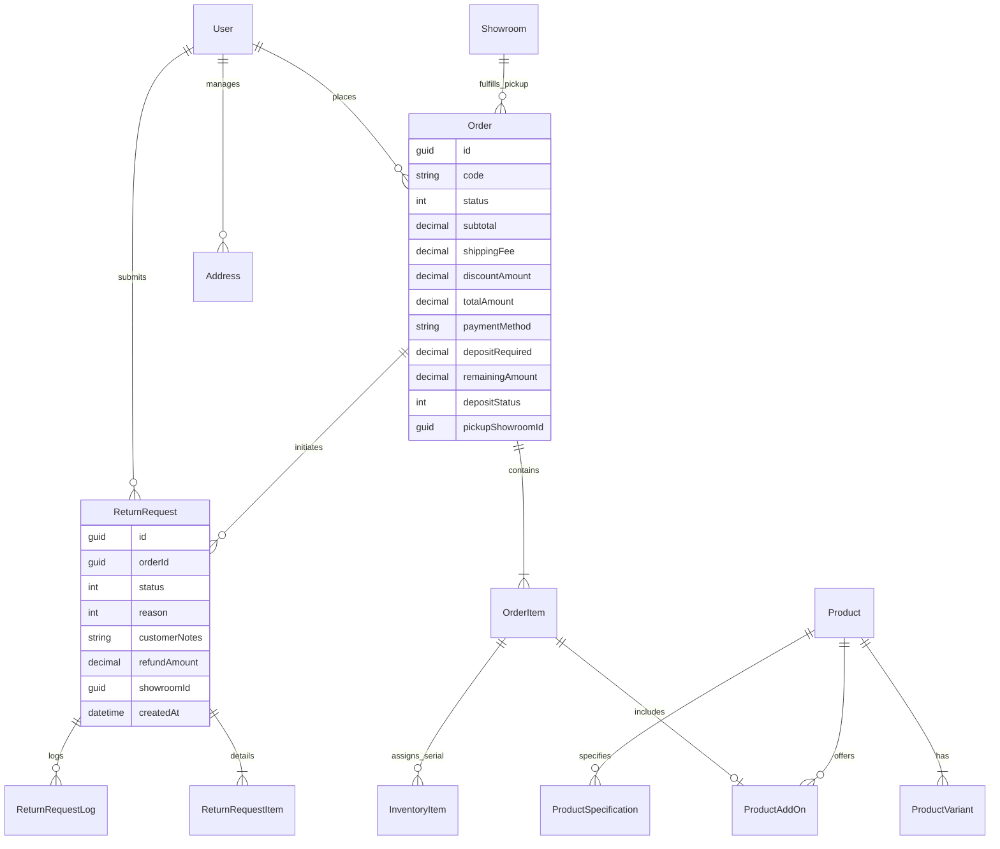

Cập nhật lần cuối: 02/11/2026 — đối chiếu commit 3837493

# Tài liệu Phân tích Nghiệp vụ (Business Analysis) — Phân hệ Khách hàng (Storefront)

Tài liệu này cung cấp đặc tả phân tích nghiệp vụ toàn diện cho ứng dụng **ShopViet E-Commerce Client (Storefront)**, phản ánh chính xác hiện trạng kiến trúc phân tầng, các quy tắc kinh doanh (Business Rules), mô hình dữ liệu và các luồng tương tác thực tế của người dùng cuối theo chuẩn Một Nguồn Sự Thật (SSoT 2026).

---

## 1. Tổng quan Sản phẩm & Phạm vi Hệ thống

Dự án là ứng dụng **E-commerce Client (Storefront)** xây dựng trên Next.js 15 (React 19), phục vụ khách hàng cuối mua sắm các sản phẩm công nghệ cao cấp (Laptop, Smartphone, Linh kiện, Phụ kiện chính hãng).

- **Mục tiêu**: Cung cấp giao diện mua sắm mượt mà, tối ưu hóa tỷ lệ chuyển đổi, hỗ trợ đầy đủ các dịch vụ công nghệ O2O (Online-to-Offline) kết nối trực tiếp với 45 showroom toàn quốc.
- **Giá trị cốt lõi**: Trải nghiệm giao diện công nghệ Dark Bento Grid, bảo mật xác thực cấp ngân hàng (httpOnly Cookie), quy trình đổi trả hàng minh bạch (RMA 7 ngày), và hỗ trợ đặt cọc COD an toàn cho đơn hàng giá trị cao.
- **Phạm vi hệ thống trong monorepo**:
  - **Phân hệ Khách hàng (In-scope tại `apps/frontend/ecommerce-client`)**: Duyệt danh mục đa cấp, ma trận so sánh thông số kỹ thuật (`/compare`), giỏ hàng guest/user, thanh toán đặt cọc COD 10%, thanh toán VNPay Sandbox, quản lý hồ sơ, sổ địa chỉ, lịch sử đơn hàng, và tạo yêu cầu đổi trả bảo hành (RMA).
  - **Phân hệ Quản trị (Hiện diện tại `apps/frontend/ecommerce-dashboard`)**: Cùng nằm trong monorepo (71 routes), phục vụ nhân viên và quản trị viên quản lý đơn hàng, xuất kho IMEI/Serial, duyệt yêu cầu RMA, quản lý 45 showroom, và phân quyền tài khoản.
  - **Tích hợp Thanh toán (Payment Gateways)**: Backend đã tích hợp hoàn chỉnh cổng thanh toán **VNPay Sandbox** (`PaymentsController.cs`, `VnPayPaymentGateway.cs`) và xử lý thanh toán khi nhận hàng (**COD**). Phía client đã có màn hình tiếp nhận kết quả thanh toán trực tuyến tại `/payment/vnpay-return`.

---

## 2. Bối cảnh Nghiệp vụ & Thuật ngữ (Glossary)

| Thuật ngữ | Định nghĩa nghiệp vụ | Ghi chú kỹ thuật |
|---|---|---|
| **Customer (User)** | Khách hàng cuối mua sắm trên hệ thống. | Có phân cấp thành viên VIP (`Bronze`, `Silver`, `Gold`, `Diamond`). |
| **Guest (Khách vãng lai)** | Người dùng chưa đăng nhập hệ thống. | Định danh qua server-side httpOnly cookie `guest_id` (hạn 7 ngày). |
| **Auth Token** | Bộ đôi JWT xác thực API an toàn. | **Chỉ lưu trong httpOnly Cookie**, tuyệt đối không lưu trong LocalStorage. |
| **COD (Cash On Delivery)** | Phương thức thanh toán tiền mặt khi nhận hàng. | Đơn $> 20.000.000₫$ bắt buộc đặt cọc trước **10%** (`DepositRequired`). |
| **VNPay Sandbox** | Cổng thanh toán trực tuyến qua thẻ nội địa/quốc tế/VNPAY-QR. | Tích hợp thực tế qua `VnPayPaymentGateway.cs` và callback `/payment/vnpay-return`. |
| **RMA (Return Merchandise Authorization)** | Quy trình đổi/trả sản phẩm bảo hành chính hãng. | Thời hạn gửi yêu cầu nghiêm ngặt trong vòng **7 ngày** kể từ ngày giao hàng (`Delivered`). |
| **O2O Showroom Pickup** | Mua hàng trực tuyến và nhận hàng tại showroom. | Kết nối dữ liệu tồn kho thời gian thực của mạng lưới **45 Showroom** toàn quốc. |
| **Product Add-Ons** | Gói bảo hành mở rộng hoặc phụ kiện mua kèm trên PDP. | Lưu vết trực tiếp vào `CartItem.addOnId` và cộng dồn vào tổng tiền đơn hàng. |
| **IMEI / Serial** | Mã định danh thiết bị phần cứng duy nhất. | Gán cho từng sản phẩm khi xuất kho và hiển thị trên chi tiết đơn hàng của khách. |
| **Freeship (Miễn phí ship)** | Miễn phí giao hàng cho đơn có tiền hàng $\ge 500.000₫$. | Đơn dưới 500k tính phí 30.000₫. Mã voucher `FREESHIP` giảm 100% phí vận chuyển. |

---

## 3. Actor & Phân quyền Hệ thống

### 3.1. Guest (Khách vãng lai)
- **Mục đích**: Tìm kiếm sản phẩm, so sánh thông số kỹ thuật, thêm sản phẩm vào giỏ hàng, thực hiện đặt hàng nhanh.
- **Cơ chế nhận diện & Giỏ hàng**:
  - Khi truy cập, `GuestCartMiddleware` phát hành httpOnly cookie `guest_id` thời hạn 7 ngày.
  - Dữ liệu giỏ hàng được ghi trực tiếp vào bảng `Carts` trong CSDL qua trường `AnonymousId` (**không dùng Redis**).
- **Quyền hạn**:
  - Truy cập tất cả các trang công khai: Trang chủ `/`, `/about`, `/contact`, `/compare`, `/products`, `/product/[slug]`.
  - Sử dụng giỏ hàng `/cart` và tiến hành `/checkout` (Guest Checkout).
  - Không thể truy cập khu vực `/account/*` (khi vào sẽ được chuyển hướng sang `/login?returnUrl=...`).

### 3.2. Authenticated User (Khách hàng thành viên)
- **Mục đích**: Mua sắm tích lũy điểm VIP, quản lý sổ địa chỉ giao hàng, theo dõi vòng đời đơn hàng, yêu cầu đổi trả bảo hành RMA.
- **Quyền hạn**:
  - Toàn quyền sử dụng giỏ hàng và thanh toán; khi đăng nhập, hệ thống tự động hợp nhất giỏ hàng vãng lai vào tài khoản.
  - Quản lý thông tin tài khoản tại `/account`, sổ địa chỉ nhận hàng tại `/account/addresses`.
  - Xem danh sách và chi tiết đơn hàng kèm timeline vận chuyển và số IMEI/Serial thiết bị tại `/account/orders`.
  - Khởi tạo yêu cầu đổi trả RMA tại `/account/returns` đối với các đơn hàng `Delivered` trong vòng 7 ngày; theo dõi tiến trình 5 bước thẩm định.
  - Bị chặn truy cập lại các trang xác thực `/login`, `/register` (chuyển hướng về `/` hoặc `returnUrl`).

> **Ghi chú về Quản trị viên (Admin/Staff)**: Hệ thống phân quyền có các vai trò `Admin`, `ProductManager`, `OrderManager`, `WarehouseStaff`. Giao diện phục vụ các vai trò này nằm độc lập tại ứng dụng **`ecommerce-dashboard`** (71 routes) trên cổng 3001, tách biệt hoàn toàn với mã nguồn Storefront.

---

## 4. Danh mục Module & Tính năng Nghiệp vụ

| Module | Mô tả nghiệp vụ | Điểm vào giao diện (Route) |
|---|---|---|
| **Xác thực & Phiên làm việc** | Đăng ký, đăng nhập, quên/đặt lại mật khẩu, Google OAuth, quản lý phiên qua httpOnly cookie | `/login`, `/register`, `/forgot-password`, `/reset-password`, `/auth/google-callback` |
| **Khám phá & Danh mục** | Trang chủ Bento Grid, tìm kiếm sản phẩm, lọc đa diện facets (CPU, GPU, RAM, SSD, Giá, Hãng) | `/`, `/products`, `/products/[category]`, `/products/[category]/[brand]` |
| **Chi tiết Sản phẩm (PDP)** | Hiển thị 14 thông số chuẩn, thư viện ảnh, chọn cấu hình SKU, chọn gói bảo hành Add-Ons, kiểm tra kho 45 showroom | `/product/[slug]`, `/products/[category]/[brand]/[slug]` |
| **So sánh Thông số Kỹ thuật** | Bảng ma trận so sánh 2-4 thiết bị, lọc điểm khác biệt, highlight thông số tối ưu, thêm vào giỏ từ bảng | `/compare` |
| **Giỏ hàng Thông minh** | Giỏ hàng guest/user, thanh đo tiến trình Freeship 500k, áp dụng mã voucher, tính tổng tiền tự động | `/cart` |
| **Thanh toán & Đặt hàng** | Chọn địa chỉ, chọn nhận tại Showroom O2O, cọc COD 10% đơn > 20 triệu, xuất hóa đơn VAT điện tử | `/checkout` |
| **Cổng thanh toán VNPay** | Tiếp nhận phản hồi giao dịch VNPay Sandbox, hiển thị mã đối soát, đếm ngược 30 phút giữ đơn khi lỗi | `/payment/vnpay-return` |
| **Hồ sơ & Sổ địa chỉ** | Quản lý thông tin cá nhân, phân hạng thành viên VIP, quản lý sổ địa chỉ 3 cấp hành chính | `/account`, `/account/addresses`, `/account/addresses/new` |
| **Quản lý Đơn hàng** | Danh sách đơn hàng, xem chi tiết tiến trình vận chuyển, hiển thị mã IMEI/Serial thiết bị đã xuất kho | `/account/orders`, `/account/orders/[orderId]` |
| **Đổi trả Hàng Bảo hành (RMA)** | Tạo yêu cầu đổi trả trong 7 ngày, tải ảnh/video chứng minh lỗi, chọn đổi tại Showroom/Bưu điện, theo dõi 5 bước | `/account/returns`, `/account/returns/[returnId]` |
| **Mạng lưới 45 Showroom & Hotline** | Tra cứu danh sách 45 showroom toàn quốc, bản đồ tương tác, tổng đài miễn cước 1800 6868/6869 | `/about`, `/contact` |

---

## 5. Đặc tả Ca sử dụng Điển hình (Core Use Cases)

### UC1: Đặt hàng Thanh toán (Checkout) & Đặt cọc COD 10%
- **Actor**: Khách hàng (Guest hoặc Authenticated User).
- **Tiền điều kiện**: Giỏ hàng có ít nhất một sản phẩm hợp lệ còn tồn kho.
- **Luồng chính**:
  1. Người dùng vào trang `/checkout` từ giỏ hàng.
  2. Hệ thống tải thông tin người dùng (nếu đã đăng nhập) hoặc hiển thị form nhập thông tin khách mua.
  3. Người dùng chọn hình thức nhận hàng:
     - *Giao hàng tận nơi*: Nhập/chọn địa chỉ giao hàng (Tỉnh/Thành phố, Quận/Huyện, Phường/Xã, Số nhà).
     - *Nhận tại Showroom (O2O Pickup)*: Chọn 1 trong 45 cơ sở Showroom thuận tiện nhất.
  4. Người dùng chọn phương thức thanh toán:
     - **Thanh toán khi nhận hàng (COD)**:
       - Nếu tổng giá trị đơn hàng $\le 20.000.000₫$: Thu toàn bộ 100% khi nhận hàng (`DepositRequired = 0`).
       - Nếu tổng giá trị đơn hàng $> 20.000.000₫$: Hệ thống tự động tính số tiền cọc trước **10%** (`DepositRequired = Math.Round(TotalAmount * 0.10m)`), số tiền còn lại 90% (`RemainingAmount`) sẽ thanh toán khi nhân viên giao hàng; hiển thị thông điệp cảnh báo đặt cọc giữ máy. Trạng thái cọc ban đầu là `Pending`.
     - **Cổng thanh toán trực tuyến VNPay**: Chuyển hướng sang giao diện VNPay Sandbox để thanh toán.
     - **Tùy chọn VietQR Pro / MoMo / ZaloPay**: Ghi nhận phương thức thanh toán vào đơn hàng.
  5. Người dùng có thể tích chọn "Yêu cầu xuất hóa đơn VAT doanh nghiệp" và điền thông tin công ty.
  6. Người dùng nhấn nút "Đặt hàng ngay" (`bg-brand`).
  7. Hệ thống tạo đơn hàng thành công và chuyển hướng:
     - Nếu chọn VNPay: Chuyển hướng sang cổng thanh toán VNPay Sandbox.
     - Nếu chọn COD: Chuyển hướng về trang chi tiết đơn hàng `/account/orders/[orderId]`.

### UC2: Tạo Yêu cầu Đổi trả Hàng Bảo hành (Customer RMA)
- **Actor**: Khách hàng thành viên (Authenticated User).
- **Tiền điều kiện**: Đơn hàng có trạng thái **`Delivered` (Đã giao hàng thành công)** và thời điểm hiện tại chưa quá **7 ngày** tính từ ngày nhận hàng (`(DateTime.UtcNow - deliveredDate).TotalDays <= 7`).
- **Luồng chính**:
  1. Khách hàng truy cập `/account/orders/[orderId]` hoặc `/account/returns`.
  2. Bấm nút "Yêu cầu đổi/trả hàng".
  3. Chọn sản phẩm trong đơn hàng cần đổi trả và số lượng tương ứng.
  4. Chọn lý do đổi trả (`EReturnReason`): Lỗi kỹ thuật nhà sản xuất, Giao sai thông số/màu sắc, Hư hỏng do vận chuyển, Thiếu phụ kiện kèm theo...
  5. Nhập mô tả chi tiết lỗi gặp phải và tải lên hình ảnh/video bằng chứng thực tế.
  6. Chọn hình thức gửi trả:
     - *Gửi hàng tại 45 Showroom ShopViet*: Mang máy đến showroom gần nhất để kỹ thuật viên kiểm định lấy ngay trong 15 phút.
     - *Gửi qua bưu điện / chuyển phát*: Nhân viên giao vận sẽ đến tận nơi lấy hàng thu hồi.
  7. Nhấn "Gửi yêu cầu đổi trả". Hệ thống tạo bản ghi `ReturnRequest` với trạng thái ban đầu `PendingApproval (0)`.
- **Ràng buộc nghiệp vụ (Business Rule)**:
  - Nếu đơn hàng chưa đạt trạng thái `Delivered` hoặc đã giao quá 7 ngày, hệ thống chặn gửi yêu cầu và thông báo lỗi: *"Đã quá hạn đổi/trả 7 ngày kể từ ngày nhận hàng."*

### UC3: So sánh Chi tiết Thông số Kỹ thuật (`/compare`)
- **Actor**: Mọi người dùng (Guest hoặc Authenticated).
- **Luồng chính**:
  1. Người dùng bấm icon "So sánh" trên thẻ sản phẩm (ProductCard) hoặc trang chi tiết (PDP).
  2. Danh sách so sánh lưu trữ 2 đến 4 sản phẩm cần đối chiếu.
  3. Người dùng truy cập trang `/compare` để xem bảng ma trận thông số kỹ thuật đa chiều (CPU, GPU, RAM, SSD, Màn hình, Pin, Cổng kết nối, Trọng lượng).
  4. Người dùng bật tùy chọn **"Chỉ hiển thị điểm khác biệt"** để ẩn các dòng có thông số giống nhau giữa các sản phẩm.
  5. Hệ thống tự động đánh dấu nhãn nổi bật (`Highlight Badge`): "Cao nhất", "Hiệu năng cao", "Tối ưu HDR", "Thời lượng pin dài", "Siêu nhẹ".
  6. Người dùng có thể nhấn nút "Thêm vào giỏ hàng" trực tiếp từ cột sản phẩm trong bảng so sánh.

### UC4: Mua kèm Gói Bảo hành Mở rộng & Phụ kiện (Product Add-Ons)
- **Actor**: Khách hàng mua sắm trên Storefront.
- **Luồng chính**:
  1. Trên trang chi tiết sản phẩm (`/product/[slug]`), hệ thống truy vấn danh sách gói bảo hành/phụ kiện có sẵn (`availableAddOns`).
  2. Khách hàng xem các gói bổ sung (ví dụ: AppleCare+ 2 năm, Gói bảo hành rơi vỡ ngập nước, Bút cảm ứng, Túi chống sốc).
  3. Khách hàng tích chọn gói bảo hành $\rightarrow$ Đơn giá hiển thị tự động cộng thêm giá của gói Add-On (`effectiveUnitPrice = baseUnitPrice + addOnPrice`).
  4. Bấm "Thêm vào giỏ hàng" hoặc "Mua ngay" $\rightarrow$ `CartItem` được tạo với `addOnId`, `addOnName`, và `addOnPrice`.
  5. Giỏ hàng và chi tiết đơn hàng hiển thị minh bạch thông tin phụ kiện mua kèm bên dưới tên sản phẩm chính.

---

## 6. Thực thể & Dữ liệu Nghiệp vụ Chuẩn

### 6.1. Sơ đồ Quan hệ Thực thể Nghiệp vụ (ERD)

### 6.2. Vòng đời & 9 Trạng thái Đơn hàng (`EOrderStatus`)
Chuỗi chuyển trạng thái đơn hàng tuân thủ nghiêm ngặt 9 giá trị của enum `Ecommerce.Domain.Enums.EOrderStatus`:

| Giá trị (Enum Value) | Tên trạng thái | Diễn giải nghiệp vụ | Chuyển tiếp hợp lệ từ |
|:---:|---|---|---|
| **0** | `Pending` | Chờ xử lý — Đơn hàng mới được tạo thành công | Khởi tạo ban đầu |
| **1** | `Processing` | Đang xử lý — Đã xác nhận đơn, đang kiểm tra tồn kho & đóng gói | `Pending` |
| **2** | `Shipped` | Đã gửi hàng — Đơn hàng đã bàn giao cho đơn vị vận chuyển | `Processing` |
| **3** | `Completed` | Hoàn tất — Giao dịch mua hàng thành công trọn vẹn | `Delivered` |
| **4** | `Cancelled` | Đã hủy — Đơn hàng bị hủy bởi khách hoặc hệ thống | `Pending`, `Processing` |
| **5** | `Refunded` | Đã hoàn tiền — Đã thực hiện hoàn trả tiền cho khách | `Cancelled`, `Returned` |
| **6** | `Delivered` | Đã giao hàng — Xác nhận khách đã nhận hàng thành công | `Shipped` |
| **7** | `ReturnRequested`| Yêu cầu trả hàng — Khách hàng gửi yêu cầu RMA đổi/trả | `Shipped`, `Delivered` |
| **8** | `Returned` | Đã trả hàng — Hàng đổi/trả đã nhập lại kho thành công | `ReturnRequested` |

> **Quy tắc Chuyển trạng thái Bất di bất dịch:**
> - Luồng thành công chuẩn mực: `Pending (0) -> Processing (1) -> Shipped (2) -> Delivered (6) -> Completed (3)`.
> - **Tuyệt đối không nhảy cóc từ `Shipped` thẳng sang `Completed`** (bắt buộc phải ghi nhận qua trạng thái `Delivered`). Mọi bước chuyển trái phép sẽ bị Domain ném ngoại lệ `InvalidStatusTransitionException`.

---

## 7. Tổng hợp Quy tắc Kinh doanh (Business Rules)

### 7.1. Quy tắc Vận chuyển & Miễn phí Giao hàng (Freeship)
- **Chuẩn SSoT 2026**:
  - Đơn hàng có tổng tiền hàng (Subtotal) $\ge 500.000₫$ được **miễn phí vận chuyển (0₫)**.
  - Đơn hàng có Subtotal $< 500.000₫$ chịu phí vận chuyển cố định là **30.000₫**.
  - Đơn hàng rỗng (0₫) có phí vận chuyển là 0₫.
  - Nhập mã voucher `FREESHIP` hợp lệ được giảm 100% phí vận chuyển.

### 7.2. Quy tắc Đặt cọc COD cho Đơn hàng Giá trị cao
- Áp dụng khi phương thức thanh toán là `COD` và tổng tiền thanh toán `TotalAmount > 20.000.000₫`.
- Tiền cọc bắt buộc: `DepositRequired = Math.Round(TotalAmount * 0.10m)` (10% tổng tiền).
- Số tiền còn lại thu khi nhận máy: `RemainingAmount = TotalAmount - DepositRequired` (90% tổng tiền).
- Trạng thái cọc ban đầu: `DepositStatus = EDepositStatus.Pending`.

### 7.3. Quy tắc Đổi trả Hàng Bảo hành (RMA)
- Khách hàng chỉ được phép tạo yêu cầu đổi trả khi đơn hàng đã đạt trạng thái `Delivered`.
- Thời hạn gửi yêu cầu: **Trong vòng 7 ngày** kể từ thời điểm `Delivered`.
- Quá thời hạn 7 ngày, hệ thống chặn gửi yêu cầu từ cả giao diện và backend API.

### 7.4. Quy tắc Bảo mật Phiên & Token
- Toàn bộ thông tin phiên xác thực được lưu trữ qua **httpOnly Cookie** do máy chủ gửi về, trình duyệt tự động đính kèm trong các request (chống XSS).
- Thời hạn sống Token:
  - Token JWT Claim danh định: 60 phút.
  - Cookie trình duyệt `access_token`: 15 phút (tự động thu hồi phiên nếu không có tương tác).
  - Cookie `refresh_token`: 7 ngày.
- Mọi request thay đổi trạng thái (POST/PUT/DELETE) bắt buộc có mã CSRF hợp lệ trong header `X-CSRF-Token`.

---

## 8. Luồng Nghiệp vụ Đầu-Cuối Điển hình (End-to-End Flows)

### 8.1. Luồng Mua hàng Thành công (Happy Path)
1. Khách hàng truy cập trang chủ `/`, duyệt danh mục `/products` hoặc so sánh tại `/compare`.
2. Khách hàng xem chi tiết tại `/product/[slug]`, chọn biến thể RAM/SSD, chọn gói bảo hành AppleCare+ Add-On, bấm "Thêm vào giỏ".
3. Vào `/cart`, hệ thống kiểm tra tiền hàng $\ge 500.000₫$, kích hoạt thanh tiến độ Freeship 100%.
4. Khách hàng bấm "Tiến hành thanh toán" $\rightarrow$ chuyển đến `/checkout`.
5. Khách hàng chọn "Giao tận nơi", điền địa chỉ; hoặc chọn "Nhận tại Showroom", chọn 1 trong 45 showroom gần nhất.
6. Chọn phương thức thanh toán (COD hoặc VNPay).
7. Nếu chọn COD và đơn $> 20$ triệu: Hệ thống hiển thị khoản cọc 10%, khách hàng xác nhận đặt cọc.
8. Bấm "Đặt hàng ngay" $\rightarrow$ Đơn hàng tạo thành công với mã đơn `#ORD-...`.
9. Khách hàng theo dõi trạng thái đơn hàng qua từng mốc: `Pending` $\rightarrow$ `Processing` $\rightarrow$ `Shipped` (hiển thị số IMEI/Serial máy) $\rightarrow$ `Delivered` $\rightarrow$ `Completed`.

### 8.2. Luồng Xử lý Đổi trả Hàng Bảo hành (RMA Path)
1. Đơn hàng sau khi được giao thành công chuyển sang trạng thái `Delivered`.
2. Trong vòng 7 ngày, nếu thiết bị phát sinh lỗi, khách hàng vào `/account/orders/[orderId]` bấm "Yêu cầu đổi/trả".
3. Khách hàng điền form RMA, chọn lý do lỗi, đính kèm hình ảnh/video bằng chứng, chọn mang máy đến Showroom.
4. Đơn hàng chuyển trạng thái `ReturnRequested (7)`.
5. Yêu cầu hiển thị trên danh sách quản trị `/returns` tại Dashboard. Kỹ thuật viên kiểm tra bằng chứng và chấp thuận.
6. Khách hàng mang máy đến Showroom, kỹ thuật viên thẩm định phần cứng trong 15 phút.
7. Khi thẩm định đạt yêu cầu: Đơn hàng chuyển sang `Returned (8)` và thực hiện đổi máy mới nguyên seal hoặc chuyển sang `Refunded (5)` để hoàn tiền cho khách.

---

## 9. Mục "Sai lệch Đã biết" (Known Discrepancies)

Ghi nhận các điểm chênh lệch giữa tài liệu, thiết kế và mã nguồn thực tế để đội ngũ kỹ thuật đối soát:

1. **Ngưỡng Freeship 500.000₫:**
   - *Chuẩn SSoT & Frontend (`CartHeader.tsx`, `OrderSummary.tsx`):* Áp dụng Freeship khi `subtotal >= 500.000₫`.
   - *Backend (`ShippingCalculator.cs:34`):* Đang dùng toán tử lớn hơn hẳn `subtotal > FREE_SHIPPING_THRESHOLD`. Do đó, đơn hàng có đúng 500.000₫ tại backend vẫn bị tính phí 30.000₫.
2. **Thời hạn Token giữa Cookie và JWT:**
   - *JWT Payload Claim (`TokenService.cs:54`):* Sinh ra thời hạn 60 phút (`AccessTokenExpirationMinutes = 60`).
   - *Cookie Trình duyệt (`CookieAuthExtensions.cs:36`):* Thiết lập thời hạn 15 phút theo `CookieSettings:AccessTokenMinutes ?? 15`. Trình duyệt sẽ thu hồi cookie sau 15 phút dù JWT bên trong còn hạn.
3. **Cổng thanh toán MoMo, ZaloPay, VietQR:**
   - *Giao diện Client (`payment-method.tsx`):* Cho phép chọn các ví điện tử MoMo, ZaloPay, VietQR Pro.
   - *Backend (`PaymentsController.cs`):* Chưa có webhook/IPN thực tế cho các phương thức này, hiện chỉ lưu tên phương thức vào database. Chỉ có **COD** và **VNPay** là được xử lý giao dịch hoàn chỉnh.
4. **Sai lệch Enum `OrderStatus` trong tệp TypeScript:**
   - *Backend `EOrderStatus`:* 9 trạng thái (`Pending=0, Processing=1, Shipped=2, Completed=3, Cancelled=4, Refunded=5, Delivered=6, ReturnRequested=7, Returned=8`).
   - *Client (`types/order.ts:150-157`):* Đang khai báo chỉ có 6 trạng thái và gán `Delivered=3`, thiếu `Completed` và `Refunded`.
5. **Banner Tiếp thị RMA trên Giao diện:**
   - *Giao diện Client (`account/returns/page.tsx`):* Hiển thị banner tiếp thị "Chính sách 30 ngày 1 đổi 1".
   - *Backend API (`CreateReturnRequestCommandHandler.cs:61`):* Kiểm tra nghiêm ngặt thời hạn không quá **7 ngày** (`(DateTime.UtcNow - deliveredDate).TotalDays > 7`). Đơn hàng sau 7 ngày sẽ bị từ chối tạo yêu cầu.

---

## 10. Kế hoạch Nâng cấp & Hoàn thiện (Backlog)

- [ ] **Đồng bộ TypeScript Enum**: Cập nhật `types/order.ts` của client đầy đủ 9 trạng thái của `EOrderStatus` để tránh hiển thị sai nhãn trạng thái đơn hàng.
- [ ] **Đồng bộ Toán tử Freeship**: Sửa đổi `ShippingCalculator.cs` từ `>` sang `>=` để bảo đảm đơn hàng đúng 500.000₫ được miễn phí ship đúng như giao diện cam kết.
- [ ] **Thống nhất Thông điệp RMA**: Cập nhật banner trên giao diện Storefront thành "Chính sách đổi trả 7 ngày theo tiêu chuẩn SSoT 2026" để tránh gây hiểu lầm cho khách hàng.
- [ ] **Mở rộng Tích hợp Cổng thanh toán**: Tích hợp webhook thực tế cho MoMo IPN và cổng thanh toán tự động VietQR Pro.
