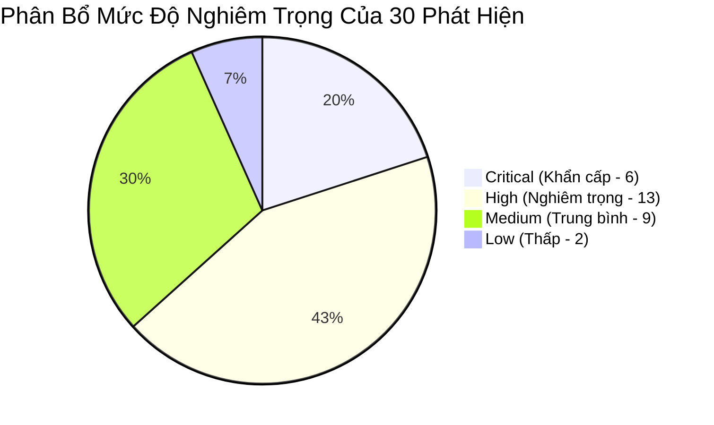

> **TÀI LIỆU LƯU TRỮ** — Nội dung phản ánh trạng thái dự án tại thời điểm 14/10/2026, không còn là hiện trạng. Xem tài liệu hiện hành: [`docs/reports/KIEM_KE_HIEN_TRANG.md`](../reports/KIEM_KE_HIEN_TRANG.md).

# 00. Tóm Tắt Dành Cho Ban Lãnh Đạo (Executive Summary)

**Dự án:** ShopViet E-Commerce Platform  
**Kho mã nguồn:** `https://github.com/lenam2809/ecommerce`  
**Loại hình đánh giá:** Technical Due Diligence & Toàn diện Kiến trúc, An toàn thông tin, Dữ liệu, Hiệu năng  
**Thời điểm kiểm toán:** Tháng 10/2026  
**Đơn vị thực hiện:** Nhóm Chuyên gia Kỹ thuật Cấp cao (Software Architect, Principal Security Engineer, Lead Database & QA Engineer)

---

## 1. Kết Luận Chung & Đánh Giá Mức Độ Sẵn Sàng (Production Readiness Verdict)

> ### **ĐÁNH GIÁ TỔNG THỂ: LATE BETA (CHƯA ĐỦ ĐIỀU KIỆN GO-LIVE NGAY LẬP TỨC)**
> 
> Hệ thống **ShopViet E-Commerce** sở hữu nền tảng kiến trúc được xây dựng rất bài bản theo tiêu chuẩn **Clean Architecture, Domain-Driven Design (DDD) và CQRS với .NET 8**. Các luồng mua sắm cơ bản, tích hợp thanh toán VNPay Sandbox, và hạ tầng giám sát phân tán (OpenTelemetry + Jaeger) đã hoạt động.
>
> Tuy nhiên, hệ thống **tồn tại 6 lỗ hổng mức CRITICAL và 13 lỗi mức HIGH** liên quan trực tiếp đến **rò rỉ bí mật bảo mật đám mây, lỗ hổng xóa file hệ thống, khóa chết giỏ hàng khi chọn nhiều biến thể, thất thoát tồn kho khi hủy đơn, và cho phép khách thường truy cập giao diện quản trị**.
>
> **Khuyến nghị chiến lược:** Bắt buộc phải hoàn tất **6 hạng mục Hotfix P0** (ước tính 14.25 giờ kỹ thuật) trước khi cho phép người dùng thật truy cập hoặc kết nối cổng thanh toán thật.

---

## 2. Các Điểm Mạnh Cốt Lõi Của Hệ Thống (Key Strengths)

1. **Kiến trúc phân tầng chuẩn mực (Clean Architecture & CQRS):**
   - Phân tách mạch lạc giữa Domain, Application, Infrastructure và WebAPI.
   - 100% logic nghiệp vụ được đóng gói thành các CQRS Commands/Queries độc lập qua MediatR, dễ dàng mở rộng và bảo trì.
2. **Cơ chế Xác thực Kép & Phòng vệ CSRF An Toàn:**
   - Sử dụng mô hình Dual-token (Access Token 15 phút + Refresh Token 7 ngày) lưu trong HttpOnly Cookie thay vì LocalStorage, ngăn chặn triệt để nguy cơ trộm token qua tấn công XSS.
   - Middleware `CsrfValidationMiddleware` triển khai mô hình Double Submit Cookie chuẩn OWASP cho toàn bộ các phương thức thay đổi trạng thái (POST/PUT/DELETE).
3. **Hạ tầng Quan sát & Giám sát Chuyên Nghiệp (Observability):**
   - Tích hợp sẵn OpenTelemetry tracing phân tán kết nối trực tiếp với Jaeger và Prometheus metrics, sẵn sàng cho việc vận hành ở quy mô lớn.
4. **Nền tảng Kiểm thử Backend Khá Tốt:**
   - Khác với nhận định trong tài liệu cũ, mã nguồn đã có 3 dự án kiểm thử với **261 test cases**; trong đó toàn bộ 57 test của tầng Domain và 199/203 test của tầng Application đều vượt qua thành công.

---

## 3. Các Rủi Ro Nghiêm Trọng Nhất (Top Critical Risks)

| Mã | Hạng mục | Vấn đề | Tác động |
|---|---|---|---|
| **SEC-01** | Lộ Bí mật Đám mây | Khóa `ServiceRoleKey` admin và mật khẩu database Supabase bị commit plaintext trong `appsettings.*.json`. | Kẻ tấn công có thể xóa toàn bộ dữ liệu đám mây hoặc trích xuất thông tin khách hàng. |
| **SEC-02** | Xóa File Tùy ý | Lỗ hổng Path Traversal (`..`) trong hàm `FileStorageService.DeleteFileAsync` và `TestStorageController`. | Bất kỳ ai cũng có thể gửi request xóa file DLL hoặc cấu hình máy chủ web (`appsettings.json`). |
| **SEC-03** | Lỗi Phân quyền MediatR | Pipeline `AuthorizationBehavior` chỉ kiểm tra class Command, trong khi lập trình viên gắn `[Authorize]` trên Handler class. | MediatR pipeline hoàn toàn KHÔNG kiểm tra quyền đối với bất kỳ handler nào. |
| **DATA-01** | Khóa Giỏ Hàng (Cart Lock) | Bảng `CartItem` đặt Composite PK `{ CartId, ProductId }`. | Khách hàng không thể thêm 2 kích cỡ/màu sắc (SKU) khác nhau của cùng 1 sản phẩm mà không bị lỗi crash 500. |
| **FLOW-01..03** | Thất Thoát Tồn Kho | Trừ kho ngoài Transaction; khi hủy đơn lại cập nhật sai entity và quên gọi `CompleteAsync()`; sự kiện hoàn tất RMA không có handler. | Hàng hóa bị mất số liệu tồn kho, hủy đơn hoặc đổi trả xong kho không bao giờ được phục hồi. |
| **FE-03** | Lỗ hổng Admin Dashboard | Middleware Next.js của Dashboard chỉ kiểm tra `userId`, không kiểm tra vai trò `Admin/Manager`. | Tài khoản khách hàng thông thường có thể truy cập toàn bộ giao diện quản trị (`/dashboard`, `/roles`). |
| **OPS-01** | Lỗi Kết Nối Docker | Docker Compose nạp `NEXT_PUBLIC_API_URL=http://backend:5000/api`. | Trình duyệt người dùng trên máy tính thật không thể phân giải tên miền container nội bộ `backend` -> Web client sập. |

---

## 4. Bảng Số Liệu Kiểm Toán Chính (Audit Metrics & Scorecard)

| Chỉ số | Giá trị thực tế | Nhận xét |
|---|---|---|
| **Tổng số Ứng dụng** | 3 (1 Backend WebAPI, 1 Client Web, 1 Admin Dashboard) | Monorepo hoàn chỉnh |
| **Số lượng Controllers WebAPI** | 32 Controllers (135+ HTTP Endpoints) | Bao phủ toàn bộ nghiệp vụ E-Commerce |
| **Số lượng Modules Nghiệp vụ** | 29 Feature Folders trong `Ecommerce.Application` | Phân rã CQRS chi tiết |
| **Kết quả Kiểm thử Backend** | 256 / 261 Tests PASS (98.1%) | 4 test fail do cấu hình localization `CultureInfo` |
| **Kết quả Kiểm thử Frontend** | 0 Tests (Client: 0, Dashboard: 0) | Khoảng trống kiểm thử nghiêm trọng phía UI |
| **Cảnh báo Linter (ESLint)** | 76 Cảnh báo (Client & Dashboard) | Cần dọn dẹp trước khi thiết lập CI/CD |
| **Tổng số Phát hiện (Findings)** | 30 Phát hiện (6 Critical, 13 High, 9 Medium, 2 Low) | Cần 14.25 giờ kỹ thuật cho nhóm P0 |

---

## 5. Kế Hoạch Hành Động Khẩn Cấp (Immediate Action Checklist - P0)

Ban Lãnh đạo Kỹ thuật cần giao việc ngay cho đội ngũ phát triển xử lý 6 đầu việc sau trong vòng **48 giờ**:

- [ ] **Bước 1: Thu hồi ngay lập tức Supabase Keys & Database Password:** Đổi mật khẩu database trên Supabase dashboard, vô hiệu hóa ServiceRoleKey cũ, và gỡ bỏ chuỗi kết nối khỏi `appsettings.Development.json` và `appsettings.Production.json`.
- [ ] **Bước 2: Vá lỗ hổng Path Traversal:** Chuẩn hóa đường dẫn trong `FileStorageService.DeleteFileAsync` và vô hiệu hóa `TestStorageController`.
- [ ] **Bước 3: Sửa Composite Key của Giỏ hàng:** Chuyển khóa chính `CartItem` sang ID độc lập và tạo Unique Index trên `{ CartId, ProductVariantSkuId }` để khách hàng chọn nhiều size/màu không bị văng lỗi.
- [ ] **Bước 4: Khắc phục lỗi khôi phục tồn kho khi Hủy đơn và Hoàn trả (RMA):** Cập nhật đúng entity `ProductVariantSku`, gọi `_unitOfWork.CompleteAsync()` trong `OrderStatusChangedEventHandler`, và bổ sung `ReturnRequestCompletedEventHandler`.
- [ ] **Bước 5: Thắt chặt phân quyền tại Next.js Dashboard Middleware:** Bổ sung điều kiện kiểm tra vai trò `Admin/Manager` trước khi cho phép vào router `/dashboard`.
- [ ] **Bước 6: Sửa biến `NEXT_PUBLIC_API_URL` trong Docker Compose:** Đổi về `http://localhost:5000/api` để trình duyệt bên ngoài container có thể tương tác bình thường.

---

## 6. Mục Lục Bộ Hồ Sơ Kiểm Toán Kiến Trúc (Audit Documentation Suite)

Bộ tài liệu kiểm toán chi tiết gồm 13 văn bản chuyên đề được lưu trữ tại thư mục `docs/architecture-audit/`:

1. [00-executive-summary.md](file:///d:/2026/projects/ecommerce/docs/architecture-audit/00-executive-summary.md): Báo cáo tóm tắt dành cho Ban Lãnh đạo và Giám đốc Kỹ thuật.
2. [01-repository-inventory.md](file:///d:/2026/projects/ecommerce/docs/architecture-audit/01-repository-inventory.md): Kiểm kê chi tiết cấu trúc mã nguồn, 32 Controllers, công nghệ và thư viện.
3. [02-architecture-analysis.md](file:///d:/2026/projects/ecommerce/docs/architecture-audit/02-architecture-analysis.md): Đánh giá kiến trúc Clean Architecture, DDD, CQRS, sơ đồ Mermaid và nguyên tắc SOLID.
4. [03-business-flow-analysis.md](file:///d:/2026/projects/ecommerce/docs/architecture-audit/03-business-flow-analysis.md): Truy vết sâu các luồng nghiệp vụ: Giỏ hàng, Đặt hàng, VNPay, Hoàn trả RMA, Đánh giá sản phẩm.
5. [04-api-and-data-flow.md](file:///d:/2026/projects/ecommerce/docs/architecture-audit/04-api-and-data-flow.md): Kiểm toán toàn bộ 32 API Controllers, hợp đồng dữ liệu, ma trận xác thực và phân quyền.
6. [05-database-analysis.md](file:///d:/2026/projects/ecommerce/docs/architecture-audit/05-database-analysis.md): Đánh giá Schema EF Core, chỉ mục (Index), khóa ngoại, sai lệch nhà cung cấp DB và concurrency.
7. [06-security-audit.md](file:///d:/2026/projects/ecommerce/docs/architecture-audit/06-security-audit.md): Báo cáo an toàn thông tin theo chuẩn OWASP Top 10, phân tích BOLA/IDOR, CSRF, Path Traversal.
8. [07-performance-analysis.md](file:///d:/2026/projects/ecommerce/docs/architecture-audit/07-performance-analysis.md): Nút thắt hiệu năng bộ nhớ (OOM trong báo cáo), truy vấn N+1, đa tầng cache và giải pháp tối ưu.
9. [08-code-quality-and-testing.md](file:///d:/2026/projects/ecommerce/docs/architecture-audit/08-code-quality-and-testing.md): Báo cáo chất lượng mã nguồn, kết quả thực thi 261 bài test và đánh giá khoảng trống kiểm thử.
10. [09-devops-and-operations.md](file:///d:/2026/projects/ecommerce/docs/architecture-audit/09-devops-and-operations.md): Đánh giá cấu hình Docker Compose, Render Blueprint, CI/CD và hệ thống Observability.
11. [10-feature-completeness.md](file:///d:/2026/projects/ecommerce/docs/architecture-audit/10-feature-completeness.md): Ma trận đánh giá độ hoàn thiện 32 tính năng giữa Backend, Client Web và Admin Dashboard.
12. [11-prioritized-roadmap.md](file:///d:/2026/projects/ecommerce/docs/architecture-audit/11-prioritized-roadmap.md): Lộ trình kỹ thuật khắc phục phân cấp từ P0 (Khẩn cấp) đến P3 (Dài hạn).
13. [12-findings-register.md](file:///d:/2026/projects/ecommerce/docs/architecture-audit/12-findings-register.md): Sổ cái trung tâm quản lý 30 phát hiện kỹ thuật với mã định danh ổn định.
