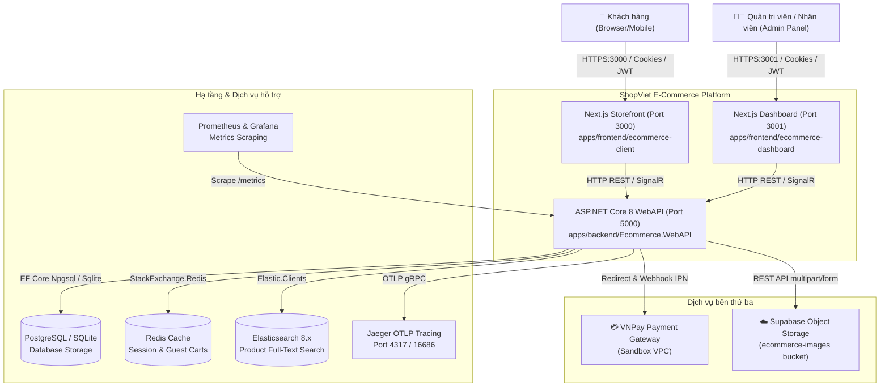
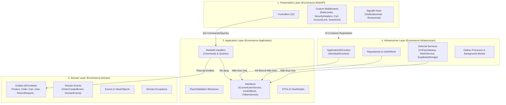
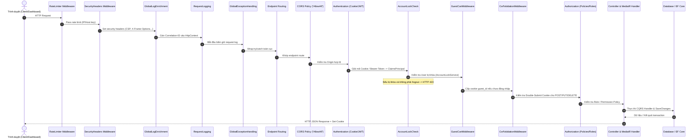

> **TÀI LIỆU LƯU TRỮ** — Nội dung phản ánh trạng thái dự án tại thời điểm 14/10/2026, không còn là hiện trạng. Xem tài liệu hiện hành: [`docs/architecture-backend.md`](../architecture-backend.md).

# 02 — Phân tích Kiến trúc Hệ thống

> **Dự án:** ShopViet E-Commerce Platform  
> **Repository:** https://github.com/lenam2809/ecommerce  
> **Thời điểm kiểm toán:** 14/10/2026  
> **Phạm vi:** Toàn bộ kiến trúc Backend (.NET 8 Clean Architecture) và Frontend (Next.js 15 App Router song song).

---

## 1. Tổng quan Kiến trúc Hệ thống

ShopViet được tổ chức theo mô hình **Monorepo kết hợp Modular Monolith**:
- **Backend API**: ASP.NET Core 8 được thiết kế theo các nguyên lý **Clean Architecture** (Onion Architecture), phân tách thành 4 tầng chính: `Ecommerce.Domain`, `Ecommerce.Application`, `Ecommerce.Infrastructure`, `Ecommerce.WebAPI`.
- **Frontend Layer**: 2 ứng dụng Next.js 15 độc lập:
  - `ecommerce-client`: Giao diện khách hàng (B2C storefront) chạy React 19.
  - `ecommerce-dashboard`: Giao diện quản trị (Admin backoffice) chạy React 18.
- **External Integrations**: VNPay Sandbox (thanh toán), Supabase Storage (lưu trữ ảnh cloud), Elasticsearch (tìm kiếm nâng cao), Redis (bộ nhớ đệm và giỏ hàng khách).

---

## 2. Sơ đồ Kiến trúc Thực tế (Mermaid Diagrams)

### 2.1. System Context Diagram



---

### 2.2. Phân tầng Backend (Clean Architecture Dependency Graph)



---

### 2.3. Request Pipeline Sequence (Chuỗi xử lý thực tế qua Middleware)



---

## 3. Đánh giá Chất lượng Thiết kế & Nguyên lý SOLID

### 3.1. Điểm mạnh kiến trúc (Strengths)

1. **Tuân thủ Dependency Inversion Principle (DIP)**:
   - Các business handler trong `Ecommerce.Application` chỉ phụ thuộc vào abstraction interface (`IUnitOfWork`, `IRepository<T>`, `ICurrentUserService`, `IFileStorageService`, `IPublisher`).
   - Mọi implementation cụ thể (EF Core, Redis, Supabase, VNPay) đều nằm ở `Ecommerce.Infrastructure` và được tiêm phụ thuộc thông qua IoC container.
2. **CQRS rõ ràng với MediatR**:
   - Mỗi tác vụ nghiệp vụ được tách biệt thành `Command` (thay đổi trạng thái) hoặc `Query` (chỉ đọc dữ liệu), kèm theo DTO riêng. Không có tình trạng Controller trực tiếp gọi DbContext.
3. **Outbox Pattern đảm bảo tính toàn vẹn (Transactional Outbox)**:
   - Sự kiện `OrderCreatedEvent` được ghi vào bảng `OutboxMessages` trong cùng một transaction với đơn hàng (`ApplicationDbContext.SaveChangesAsync`), sau đó `OutboxBackgroundService` quét định kỳ và publish độc lập, ngăn ngừa mất mát sự kiện khi service crash.
4. **Cơ chế Dual-Authentication & Server-Side Security**:
   - Hỗ trợ đồng thời JWT Bearer (cho API/mobile) và HttpOnly Cookie (cho web client), kết hợp middleware Double-Submit Cookie CSRF bảo vệ mutation requests.

---

### 3.2. Vi phạm Kiến trúc & Lỗ hổng Thiết kế (Architectural Violations)

#### ⚠️ Vi phạm 1: Thực thi Mutation trực tiếp ra ngoài Transaction trong Handler (Leak Invariants)
- **Bằng chứng:** Trong `CreateOrderCommandHandler.cs` dòng 112:
  ```csharp
  var stockDecremented = await TryDecrementStockAsync(stockItem, cancellationToken);
  ```
- **Cơ chế:** `TryDecrementStockAsync` gọi trực tiếp `ExecuteUpdateAsync` trên database ngay lập tức trước khi đơn hàng được lưu.
- **Hậu quả:** `ExecuteUpdateAsync` là một lệnh SQL thực thi ngay độc lập, nằm ngoài change tracker của EF Core. Nếu các bước tiếp theo (như lưu đơn hàng `_unitOfWork.CompleteAsync()` hoặc thanh toán) gặp lỗi không mong muốn, lượng tồn kho đã bị trừ trong database sẽ **không thể rollback tự động**, dẫn đến rò rỉ tồn kho (Inventory Leak).

#### ⚠️ Vi phạm 2: Logic phân nhánh đa cơ sở dữ liệu sơ sài (Fragile Database Provider Switching)
- **Bằng chứng:** [AddDatabaseExtensions.cs](file:///d:/2026/projects/ecommerce/apps/backend/Ecommerce/Ecommerce.Infrastructure/Extensions/AddDatabaseExtensions.cs#L22-L46):
  ```csharp
  if (connectionString.Contains("Data Source"))
  {
      options.UseSqlite(connectionString...);
  }
  else
  {
      options.UseNpgsql(connectionString...);
  }
  ```
- **Hậu quả:**
  - Logic xác định provider dựa vào việc chuỗi kết nối có chứa chữ `"Data Source"` hay không là cực kỳ lỏng lẻo.
  - Mã SQL raw trong `ProcessPaymentCallbackCommandHandler.cs` dòng 203–205:
    ```sql
    INSERT INTO "PaymentTransactions" (...) VALUES (...) ON CONFLICT ("TxnRef") DO NOTHING
    ```
    Đây là cú pháp đặc thù của PostgreSQL/SQLite. Nếu cấu hình kết nối trỏ tới hệ quản trị khác hoặc SQL Server, truy vấn này sẽ lập tức gây crash ứng dụng.

#### ⚠️ Vi phạm 3: Hardcode logic môi trường trong Pipeline khởi động
- **Bằng chứng:** [Program.cs](file:///d:/2026/projects/ecommerce/apps/backend/Ecommerce/Ecommerce.WebAPI/Program.cs#L245-L247):
  ```csharp
  // Always apply migrations
  await context.Database.MigrateAsync();
  //await ApplicationDbContextSeed.SeedAsync(services, app.Environment.IsDevelopment());
  await ApplicationDbContextSeed.SeedAsync(services, true);
  ```
- **Hậu quả:** Dòng 246 bị comment và dòng 247 truyền cứng giá trị `true`. Khi ứng dụng chạy trong môi trường Staging hoặc Production, seeder sẽ tự động insert hàng trăm sản phẩm test, danh mục test và user test vào database thật tại mỗi lần restart container!

#### ⚠️ Vi phạm 4: Lệch phiên bản React giữa hai ứng dụng Frontend
- **Bằng chứng:**
  - `apps/frontend/ecommerce-client/package.json`: `"react": "^19.0.0"`
  - `apps/frontend/ecommerce-dashboard/package.json`: `"react": "^18.3.1"`
- **Hậu quả:** Không thể chia sẻ component dùng chung hoặc tạo package UI component nội bộ dùng chung giữa 2 app vì sự khác biệt breaking changes giữa React 18 và React 19 (hooks, typing, form actions).
