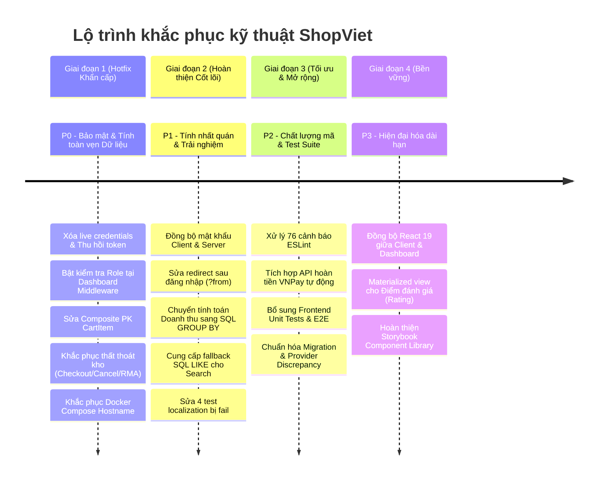

> **TÀI LIỆU LƯU TRỮ** — Nội dung phản ánh trạng thái dự án tại thời điểm 14/10/2026, không còn là hiện trạng. Xem tài liệu hiện hành: [`docs/reports/KE_HOACH_CAP_NHAT_TAI_LIEU.md`](../reports/KE_HOACH_CAP_NHAT_TAI_LIEU.md).

# 11. Kế Hoạch Khắc Phục Ưu Tiên (Prioritized Remediation Roadmap)

Tài liệu này cung cấp lộ trình kỹ thuật chi tiết để khắc phục toàn bộ các lỗ hổng, lỗi cấu trúc, điểm nghẽn hiệu năng và sai lệch kỹ thuật được phát hiện trong quá trình kiểm toán hệ thống **ShopViet E-Commerce**.

---

## 1. Tổng Quan Lộ Trình Phân Cấp (Priority Hierarchy)



---

## 2. Giai Đoạn 1: Mức Ưu Tiên P0 — Khẩn Cấp & Chặn Triển Khai (Immediate Blockers)

*Phải hoàn thành trước khi triển khai môi trường Staging/Production hoặc bàn giao cho người dùng.*

### P0-1: Thu hồi và cô lập thông tin xác thực Live Supabase trong mã nguồn
- **Mã lỗi:** `SEC-01`
- **Tập tin:** `apps/backend/Ecommerce/Ecommerce.WebAPI/appsettings.Development.json` (dòng 14, 27)
- **Nguyên nhân gốc rễ:** Chuỗi kết nối PostgreSQL Supabase thật (kèm mật khẩu plaintext) và chuỗi `ServiceRoleKey` (toàn quyền bypass RLS) bị commit trực tiếp vào git repository.
- **Tác động:** Kẻ tấn công có thể xóa toàn bộ database hoặc chiếm đoạt hạ tầng cloud Supabase.
- **Giải pháp tạm thời (Minimal Fix):**
  1. Lập tức đổi mật khẩu Database Supabase và tạo mới Service Role Key trên Supabase Console.
  2. Xóa các chuỗi nhạy cảm khỏi `appsettings.Development.json`, thay bằng giá trị mẫu hoặc placeholder `${SUPABASE_KEY}`.
- **Giải pháp dài hạn (Long-term Fix):**
  - Chạy `git-filter-repo` hoặc BFG Repo-Cleaner để loại bỏ hoàn toàn các commit chứa secrets trong lịch sử git.
  - Thiết lập pre-commit hook với `gitleaks` hoặc `trufflehog` trên máy lập trình viên.
- **Ước tính công sức:** 2 giờ (0.5 story point)
- **Tiêu chí nghiệm thu (Acceptance Criteria):**
  - [ ] Khóa Supabase cũ bị vô hiệu hóa; khóa mới chỉ tồn tại trên biến môi trường cục bộ (`appsettings.Local.json` có trong `.gitignore`) hoặc Secret Manager.
  - [ ] Kiểm tra `git log -S "supabase"` không còn dấu vết mật khẩu.

---

### P0-2: Ngăn chặn tự động Seed Data trên môi trường Staging / Production
- **Mã lỗi:** `SEC-02`
- **Tập tin:** `apps/backend/Ecommerce/Ecommerce.WebAPI/Program.cs` (dòng 247)
- **Nguyên nhân gốc rễ:** Lệnh `await ApplicationDbContextSeed.SeedAsync(services, true);` được gọi trực tiếp mà không bọc trong điều kiện `if (app.Environment.IsDevelopment())`.
- **Tác động:** Mỗi lần backend khởi động lại trên Production, hệ thống tự động chèn hàng trăm bản ghi mẫu (tài khoản demo, sản phẩm test) làm ô nhiễm dữ liệu thật.
- **Giải pháp tạm thời:**
  ```csharp
  if (app.Environment.IsDevelopment())
  {
      await ApplicationDbContextSeed.SeedAsync(services, true);
  }
  ```
- **Giải pháp dài hạn:** Chuyển tác vụ seeding sang lệnh CLI riêng biệt (`dotnet run --seed`) hoặc một container init job độc lập trong Kubernetes/Docker.
- **Ước tính công sức:** 15 phút (0.25 story point)
- **Tiêu chí nghiệm thu:**
  - [ ] Khởi chạy backend với `ASPNETCORE_ENVIRONMENT=Production`, log không xuất hiện bất kỳ câu lệnh seed nào.

---

### P0-3: Sửa lỗi khóa chính tổng hợp `CartItem` gây crash khi thêm nhiều biến thể
- **Mã lỗi:** `DATA-01`
- **Tập tin:** `apps/backend/Ecommerce/Ecommerce.Infrastructure/Data/Configurations/CartItemConfiguration.cs` (dòng 15)
- **Nguyên nhân gốc rễ:** Cấu hình EF Core thiết lập `builder.HasKey(ci => new { ci.CartId, ci.ProductId });` trong khi một sản phẩm có thể có nhiều biến thể (Size M, Size L) với các `ProductVariantSkuId` khác nhau.
- **Tác động:** Khách hàng chọn mua 2 biến thể khác nhau của cùng 1 mẫu áo/giày sẽ bị hệ thống báo lỗi 500 (`DbUpdateException: UniqueConstraintViolation`).
- **Giải pháp:**
  1. Đổi khóa chính của `CartItem` sang `Id` (GUID/Identity độc lập) hoặc tổng hợp theo `{ CartId, ProductVariantSkuId }`:
     ```csharp
     builder.HasKey(ci => ci.Id);
     builder.HasIndex(ci => new { ci.CartId, ci.ProductVariantSkuId }).IsUnique();
     ```
  2. Tạo migration mới: `dotnet ef migrations add FixCartItemPrimaryKey`.
- **Ước tính công sức:** 3 giờ (1 story point)
- **Tiêu chí nghiệm thu:**
  - [ ] Thêm liên tiếp 2 SKU khác nhau của cùng một Product vào giỏ hàng thành công.
  - [ ] Cập nhật số lượng và tính tổng tiền giỏ hàng chuẩn xác.

---

### P0-4: Khắc phục thất thoát tồn kho trong vòng đời Đơn hàng (Checkout, Hủy đơn, RMA)
- **Mã lỗi:** `FLOW-01`, `FLOW-02`, `FLOW-03`
- **Tập tin liên quan:**
  - `apps/backend/Ecommerce/Ecommerce.Application/Orders/Commands/CreateOrder/CreateOrderCommandHandler.cs` (dòng 105–125)
  - `apps/backend/Ecommerce/Ecommerce.Application/Orders/EventHandlers/OrderStatusChangedEventHandler.cs` (dòng 77–101)
  - `apps/backend/Ecommerce/Ecommerce.Application/Returns/EventHandlers/ReturnRequestCompletedEventHandler.cs` (chưa tồn tại)
- **Nguyên nhân gốc rễ:**
  1. *Checkout:* Sử dụng `ExecuteUpdateAsync` trừ kho trực tiếp ngoài Transaction của EF Core. Nếu `_unitOfWork.CompleteAsync()` thất bại, kho đã bị trừ nhưng đơn hàng không được tạo.
  2. *Hủy đơn:* Cập nhật tồn kho trên đối tượng `Product` thay vì `ProductVariantSku` và quên gọi `_unitOfWork.CompleteAsync()`.
  3. *Đổi trả:* `ReturnRequestCompletedEvent` không có bất kỳ Handler nào tiếp nhận.
- **Giải pháp:**
  1. Bọc khối tạo đơn hàng và trừ kho trong một `IDbContextTransaction` rõ ràng. Nếu lưu đơn hàng thất bại, rollback transaction.
  2. Trong `OrderStatusChangedEventHandler`, truy xuất đúng `ProductVariantSku` theo `orderItem.ProductVariantSkuId`, cộng lại `StockQuantity`, và gọi `await _unitOfWork.CompleteAsync(cancellationToken)`.
  3. Tạo class `ReturnRequestCompletedEventHandler` lắng nghe `ReturnRequestCompletedEvent` và hoàn trả số lượng các `ReturnItem` đã được kiểm duyệt vào kho hàng.
- **Ước tính công sức:** 6 giờ (2 story points)
- **Tiêu chí nghiệm thu:**
  - [ ] Khi submit đơn hàng bị văng ngoại lệ bất ngờ, số lượng tồn kho của SKU không bị suy giảm.
  - [ ] Khi hủy một đơn hàng ở trạng thái `Pending` hoặc `Processing`, tồn kho của từng SKU tăng lại chính xác.
  - [ ] Khi trạng thái RMA chuyển sang `Completed`, tồn kho được khôi phục.

---

### P0-5: Bổ sung xác thực quyền Quản trị viên tại Dashboard Middleware
- **Mã lỗi:** `SEC-03`
- **Tập tin:** `apps/frontend/ecommerce-dashboard/middleware.ts` (dòng 107–120)
- **Nguyên nhân gốc rễ:** Middleware chỉ kiểm tra sự tồn tại của `userId` trong cookie/profile, không kiểm tra trường `role` hoặc `permissions`.
- **Tác động:** Bất kỳ khách hàng bình thường nào đăng nhập vào hệ thống đều có thể truy cập URL Dashboard (`/dashboard`, `/roles`, `/orders`) và xem cấu trúc giao diện quản trị.
- **Giải pháp:**
  Kiểm tra token payload hoặc profile để đảm bảo có role `Admin` hoặc `Manager`:
  ```typescript
  const userRole = profile?.role || profile?.roles;
  const isAuthorized = Array.isArray(userRole) 
    ? userRole.some(r => ['Admin', 'Manager'].includes(r))
    : ['Admin', 'Manager'].includes(userRole);

  if (!isAuthorized) {
    return NextResponse.redirect(new URL('/unauthorized', req.url));
  }
  ```
- **Ước tính công sức:** 2 giờ (0.5 story point)
- **Tiêu chí nghiệm thu:**
  - [ ] Đăng nhập bằng tài khoản Customer (`customer@example.com`) rồi mở Dashboard -> Bị redirect về trang báo lỗi quyền truy cập.
  - [ ] Đăng nhập bằng tài khoản Admin -> Truy cập bình thường.

---

### P0-6: Sửa cấu hình Docker Compose `NEXT_PUBLIC_API_URL`
- **Mã lỗi:** `OPS-01`
- **Tập tin:** `docker-compose/.env` (dòng 57), `docker-compose/docker-compose.yml`
- **Nguyên nhân gốc rễ:** Giá trị `NEXT_PUBLIC_API_URL=http://backend:5000/api` dùng hostname nội bộ container `backend`. Khi người dùng mở website từ máy host, trình duyệt web cố gắng kết nối tới domain `backend:5000` không tồn tại trong file hosts.
- **Giải pháp:**
  - Thiết lập `NEXT_PUBLIC_API_URL=http://localhost:5000/api` cho các request phía client browser.
  - Nếu Next.js Server Components cần gọi nội bộ, sử dụng biến riêng `INTERNAL_API_URL=http://backend:5000/api`.
- **Ước tính công sức:** 1 giờ (0.25 story point)
- **Tiêu chí nghiệm thu:**
  - [ ] Chạy `docker compose up`, truy cập `http://localhost:3000` trên trình duyệt máy chủ, các API gọi lấy danh mục và sản phẩm tải thành công.

---

## 3. Giai Đoạn 2: Mức Ưu Tiên P1 — Hoàn Thiện Nghiệp Vụ Cốt Lõi (High Priority)

*Thực hiện trong Sprint kế tiếp (1-2 tuần) để hoàn thiện luồng người dùng.*

### P1-1: Đồng bộ quy tắc kiểm thực Mật khẩu giữa Frontend và Backend
- **Mã lỗi:** `FE-01`
- **Tập tin:** `apps/frontend/ecommerce-client/app/(auth)/register/page.tsx` (dòng 77), `RegisterCommandValidator.cs` (dòng 15–19)
- **Hiện tượng:** Client Zod schema cho phép mật khẩu `>= 6` ký tự bất kỳ. Backend FluentValidation bắt buộc `>= 12` ký tự kèm chữ hoa, chữ thường, số và ký tự đặc biệt. Khách đăng ký mật khẩu 6-11 ký tự bị từ chối ngầm mà form không chỉ rõ lỗi.
- **Giải pháp:** Cập nhật Zod schema tại Client đồng bộ 100% với regex của Backend.
- **Ước tính công sức:** 2 giờ (0.5 story point)

### P1-2: Sửa luồng chuyển hướng sau đăng nhập tại Client (`?from` vs `returnUrl`)
- **Mã lỗi:** `FE-02`
- **Tập tin:** `apps/frontend/ecommerce-client/middleware.ts` (dòng 13), `apps/frontend/ecommerce-client/app/(auth)/login/page.tsx` (dòng 50)
- **Hiện tượng:** Middleware chuyển hướng khách chưa đăng nhập đến `/login?from=/checkout`, nhưng trang Login chỉ đọc query `returnUrl` hoặc `redirect`, khiến khách luôn bị trả về trang chủ `/`.
- **Giải pháp:** Chuẩn hóa toàn bộ tham số redirect sang `redirect` hoặc `from`.
- **Ước tính công sức:** 1 giờ (0.25 story point)

### P1-3: Chuyển các phép tính Thống kê Báo cáo sang SQL `GROUP BY`
- **Mã lỗi:** `PERF-01`
- **Tập tin:** `GetRevenueByCategoryQueryHandler.cs`, `GetRevenueByMonthQueryHandler.cs`
- **Hiện tượng:** Truy vấn tải toàn bộ các bản ghi `Order` và `OrderItem` trong 12 tháng về RAM máy chủ (.NET heap) để tính `Sum()` và `GroupBy()`.
- **Giải pháp:** Viết biểu thức LINQ trực tiếp hoặc Raw SQL Dapper/EF Core để cơ sở dữ liệu thực thi `SUM(TotalAmount)` và `GROUP BY CategoryId, Month`.
- **Ước tính công sức:** 4 giờ (1 story point)

### P1-4: Bổ sung SQL LIKE Fallback cho `NoOpProductSearchService`
- **Mã lỗi:** `ARCH-01`
- **Tập tin:** `apps/backend/Ecommerce/Ecommerce.Infrastructure/Services/NoOpProductSearchService.cs` (dòng 25)
- **Hiện tượng:** Khi tắt Elasticsearch, service ném `SearchServiceUnavailableException` (HTTP 503) thay vì fallback sang SQL LIKE như tài liệu cam kết.
- **Giải pháp:** Thay thế thân hàm của `NoOpProductSearchService` bằng một truy vấn EF Core cơ bản tìm kiếm theo `p.Name.Contains(keyword) || p.Description.Contains(keyword)`.
- **Ước tính công sức:** 3 giờ (1 story point)

### P1-5: Sửa 4 unit test localization bị thất bại trong `Application.Tests`
- **Mã lỗi:** `TEST-01`
- **Tập tin:** `Ecommerce.Application.Tests/Validators/...`
- **Hiện tượng:** Test mong đợi thông báo lỗi tiếng Anh mặc định, nhưng pipeline FluentValidation trả về tiếng Việt hoặc phụ thuộc `CultureInfo`.
- **Giải pháp:** Cố định `CultureInfo.CurrentUICulture = CultureInfo.InvariantCulture` trong hàm khởi tạo Test Fixture.
- **Ước tính công sức:** 2 giờ (0.5 story point)

---

## 4. Giai Đoạn 3: Mức Ưu Tiên P2 — Nâng Cao Chất Lượng Mã & Độ Tin Cậy (Medium Priority)

*Thực hiện trong vòng 1 tháng.*

| Hạng mục | Mã lỗi | Chi tiết & Giải pháp | Công sức |
|---|---|---|---|
| **Khắc phục 76 ESLint Warnings** | `CODE-01` | Sửa các lỗi `react-hooks/exhaustive-deps`, biến không sử dụng (`@typescript-eslint/no-unused-vars`) trên cả Client và Dashboard. | 6 giờ |
| **Bổ sung Frontend Unit Tests** | `TEST-02` | Thiết lập Vitest + React Testing Library cho 2 ứng dụng frontend; viết test cho giỏ hàng và form đăng nhập/đăng ký. | 16 giờ |
| **Tích hợp API Hoàn tiền VNPay tự động** | `FLOW-04` | Xây dựng client gọi `vnp_Command=refund` của VNPay khi Admin phê duyệt hoàn tiền đơn hàng. | 8 giờ |
| **Chuẩn hóa Database Provider** | `DATA-02` | Cập nhật tài liệu: Loại bỏ đề cập SQL Server; chuẩn hóa hướng dẫn dev trên PostgreSQL / Docker. | 2 giờ |
| **Composite Unique Index cho Soft-Delete** | `DATA-03` | Thêm Filtered Index cho các cột Unique kết hợp `IsDeleted = false` (Category Slug, Brand Slug, User Email). | 4 giờ |

---

## 5. Giai Đoạn 4: Mức Ưu Tiên P3 — Bền Vững & Tối Ưu Hóa Dài Hạn (Low Priority / Tech Debt)

*Thực hiện trong lộ trình nâng cấp hạ tầng (Quarterly).*

| Hạng mục | Chi tiết & Lợi ích | Công sức |
|---|---|---|
| **Đồng bộ phiên bản React** | Hiện Client dùng React 19 và Dashboard dùng React 18. Nâng cấp Dashboard lên React 19 để dùng chung các thư viện components. | 12 giờ |
| **Materialized Cache cho Đánh giá Sản phẩm** | Thêm bảng thống kê hoặc cột cache `AverageRating`, `TotalReviews` trên bảng `Product` thay vì quét `AVG()` động trên toàn bộ review mỗi lần mở trang. | 6 giờ |
| **Ảo hóa danh sách bảng Dashboard (Virtualization)** | Tích hợp `@tanstack/react-virtual` cho các bảng đơn hàng và sản phẩm lớn trên Dashboard để mượt mà khi cuộn. | 8 giờ |
| **Hoàn thiện Storybook Component Library** | Viết Storybook stories đầy đủ cho các UI primitive components trong `ecommerce-dashboard`. | 16 giờ |

---

## 6. Bảng Ma Trận Phân Bổ Nguồn Lực (Effort Allocation)

| Giai đoạn | Số hạng mục | Tổng giờ ước tính | Story Points (ước lượng) | Khung thời gian khuyến nghị |
|---|---|---|---|---|
| **P0: Khẩn cấp (Blockers)** | 6 tasks | 14.25 giờ | 4.5 SP | 1 – 2 ngày làm việc |
| **P1: Hoàn thiện cốt lõi** | 5 tasks | 12.00 giờ | 4.0 SP | Sprint tiếp theo (1 tuần) |
| **P2: Chất lượng & Test** | 5 tasks | 36.00 giờ | 8.5 SP | 2 – 3 tuần |
| **P3: Tối ưu dài hạn** | 4 tasks | 42.00 giờ | 10.0 SP | Kế hoạch quý (Quarterly) |
| **Tổng cộng** | **20 tasks** | **104.25 giờ** | **27.0 SP** | **1.5 tháng** |
