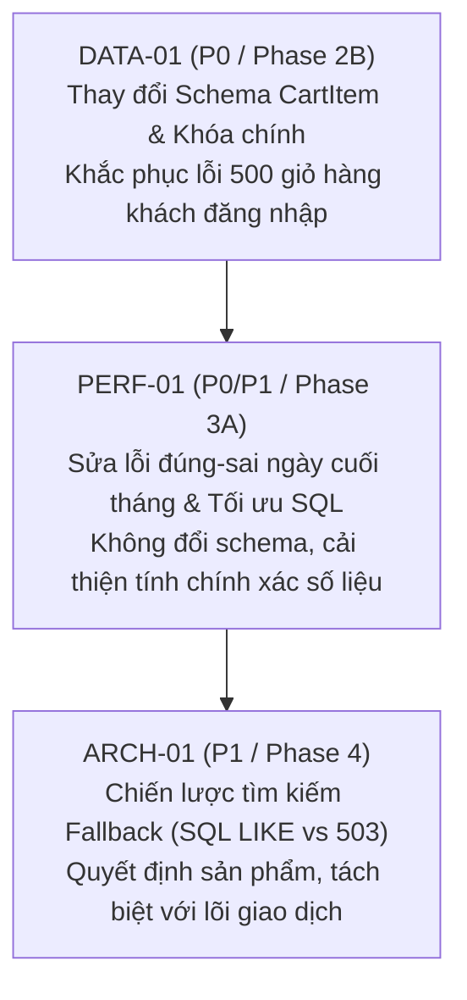
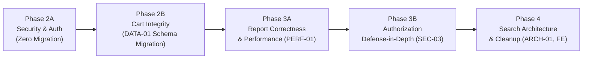

> **TÀI LIỆU LƯU TRỮ** — Nội dung phản ánh trạng thái dự án tại thời điểm 15/10/2026, không còn là hiện trạng. Xem tài liệu hiện hành: [`docs/reports/KE_HOACH_CAP_NHAT_TAI_LIEU.md`](../reports/KE_HOACH_CAP_NHAT_TAI_LIEU.md).

# 23. Kế Hoạch Remediation Giai Đoạn Tiếp Theo (Post-Phase-1 Remediation Plan)

**Ngày lập:** 2026-10-15  
**Tác giả:** Antigravity AI Pair Programmer  
**Mục tiêu:** Tổng hợp kết quả đánh giá độc lập Phase 1, xác định trạng thái thực tế của repository và các security findings, đồng thời thiết lập kế hoạch hành động chi tiết, phân rã theo các phase nhỏ có kiểm soát rủi ro cho giai đoạn tiếp theo.

---

## 1. Kết Quả Review Độc Lập Phase 1 & Trạng Thái Repository

### 1.1. Trạng Thái Repository Thực Tế
- **Nhánh hiện tại:** `main` (không phải `codex`).
- **Trạng thái working tree:** Clean (`git status --short` rỗng, không có thay đổi chưa commit).
- **Lịch sử commit:** Nhánh `codex` đã được merge vào `main` tại commit `9f0c820` ("Merge branch 'codex'"), trong đó commit `42a1055` ("fix(backend): remediate checkout transaction rollback, cancellation variant stock restoration, and RMA inventory completion (FLOW-01, FLOW-02, FLOW-03)") chứa toàn bộ code xử lý của Phase 1.
- **Worktree phụ:** Tồn tại 1 worktree tại `C:/Users/Admin/.codex/worktrees/0dfd/ecommerce` ở trạng thái detached HEAD sạch. Toàn bộ mã nguồn Phase 1 đã nằm an toàn trong lịch sử commit của `main`.

### 1.2. Đánh Giá Kỹ Thuật Chi Tiết 3 Luồng Phase 1

#### 1. FLOW-01: Checkout Transaction & Inventory Rollback
- **Transaction Boundary:** `TransactionBehavior<TRequest, TResponse>` đã được mở rộng để kiểm tra kiểu `IAppResult`. Trước đây, pipeline chỉ rollback khi gặp unhandled `Exception`, khiến các command handler trả về `Result<T>.Failure(...)` hoặc `Result<T>.BadRequest(...)` vẫn bị `CommitTransactionAsync`. Hiện tại, khi `response is IAppResult { IsSuccess: false }`, pipeline kích hoạt `await _unitOfWork.RollbackTransactionAsync(cancellationToken)` và ghi log warning có cấu trúc.
- **Rollback & Phục Hồi Tồn Kho:** Trong `CreateOrderCommandHandler`, cơ chế tracking `decrementedStockItems` và `redeemedPromoCode` đã được thiết lập. Trong các khối `catch (DbUpdateConcurrencyException)`, `catch (DbUpdateException)` và `catch (Exception)`, handler chủ động khôi phục số lượng kho đã trừ thông qua `RestoreDecrementedStockAsync` và hoàn lại lượt dùng mã giảm giá qua raw SQL `RevertPromoCodeRedemptionAsync`, đồng thời dọn sạch Change Tracker (`_unitOfWork.ClearTracking()`).
- **Outbox Consistency:** `ApplicationDbContext.SaveChangesAsync` đưa `OrderCreatedEvent` vào bảng `OutboxMessages` thông qua `OutboxMessageFactory.TryCreate`, bảo đảm sự kiện tạo đơn được cam kết nguyên tử (atomic) cùng với transaction của đơn hàng.

#### 2. FLOW-02: Hủy/Xóa Đơn Hàng, Hoàn Tồn Đúng SKU & Idempotency
- **Phân Định Đúng Entity:** Trong `OrderStatusChangedEventHandler.RestoreStockQuantities` và `DeleteOrderCommandHandler.Handle`, hệ thống đã phân biệt rõ `item.ProductVariantSkuId.HasValue`. Nếu là sản phẩm biến thể, hệ thống gọi `_unitOfWork.ProductVariantSkus.RestoreStockAsync(skuId, qty)`. Nếu là sản phẩm đơn, gọi `_unitOfWork.Products.RestoreStockAsync(productId, qty)`. Điều này chấm dứt tình trạng mất tồn SKU vĩnh viễn và làm phồng ảo `Product.StockQuantity`.
- **Eager Loading Khi Xóa:** `DeleteOrderCommandHandler` đã chuyển sang dùng `_unitOfWork.Orders.GetOrderWithItemsAndProductsAsync(request.Id)`, khắc phục triệt để lỗi cũ không eager load `OrderItems`.
- **Cơ Chế Idempotent Khi Hủy Đơn:** 
  - Lớp Domain: `Order.UpdateStatus` từ chối chuyển trạng thái trùng lặp `Cancelled -> Cancelled` (ném `InvalidStatusTransitionException`).
  - Lớp Event Handler: Kiểm tra `_unitOfWork.OrderHistories.GetQueryable().AnyAsync(h => h.OrderId == orderId && h.Notes == "StockRestored")`. Nếu đã hoàn tồn trước đó, handler ghi log và bỏ qua, ngăn chặn hoàn toàn nguy cơ cộng dồn tồn kho khi retry sự kiện.

#### 3. FLOW-03: Hoàn Kho RMA Sau QualityCheck
- **Đăng Ký & Lắng Nghe Event:** Đã bổ sung `ReturnRequestCompletedEventHandler` kế thừa `INotificationHandler<ReturnRequestCompletedEvent>`, được DI tự động nhận diện qua MediatR.
- **Ràng Buộc Nghiệp Vụ QualityCheck:** Handler xác minh chặt chẽ điều kiện `returnRequest.Status == EReturnStatus.Completed` VÀ `returnRequest.StatusHistory.Any(h => h.Status == EReturnStatus.QualityCheck)`. Hàng hoàn trả chưa qua kiểm định chất lượng sẽ không bị đưa nhầm về kho bán.
- **Idempotency & Phân Bổ Kho:** Handler kiểm tra `StatusHistory.Any(h => h.Note.Contains("StockRestored"))`, nạp `OrderItem` gốc từ đơn hàng để hoàn tồn đúng SKU/Product, sau đó gọi `returnRequest.MarkStockRestored()`.

### 1.3. Đánh Giá Assertion Thực Tế Của Test Suites
Các test mới trong `RemediationPhase1Tests.cs` (8 test) và `AuditVerificationTests.cs` không chỉ kiểm tra mã trạng thái trả về (status code) mà assert sâu vào trạng thái dữ liệu thực tế:
- `FLOW02_CancellingOrderTwice_DoesNotDoubleRestoreStock`: Assert SKU stock đạt đúng 5 sau lần hủy 1; assert lần hủy 2 trả về `IsSuccess == false`; assert re-dispatch event trực tiếp không làm biến động kho (vẫn là 5) và `Product.StockQuantity` vẫn là 0.
- `FLOW02_CancellingShippedOrder_IsRejectedAndDoesNotRestoreStock`: Assert đơn hàng đã Shipped không thể chuyển Cancelled và SKU stock giữ nguyên.
- `FLOW02_DeletingPendingOrderWithVariantSku_RestoresSkuStock`: Assert xóa đơn nạp đúng `OrderItems` và khôi phục SKU stock = 5, Product stock = 0.
- `FLOW03_RmaApproved_DoesNotRestoreStockEarly`: Assert trạng thái Approved không được hoàn kho trước hạn.
- `FLOW03_RmaCompleted_RestoresStockAndIsIdempotent`: Assert vòng đời hoàn chỉnh qua QualityCheck hoàn tồn SKU = 4, hoàn tất lần 2 bị từ chối, và publish lại event trực tiếp không gây cộng dồn.
- `FLOW03_RmaCompletedWithoutQualityCheck_DoesNotRestoreStock`: Assert RMA hoàn tất nhưng thiếu bước QualityCheck thì kho giữ nguyên = 3.

### 1.4. Đánh Giá 4 Test Localization Bị Lỗi Sẵn Có
Trong `Ecommerce.Application.Tests`, có 4 test bị fail:
1. `LoginUserCommandHandlerTests.Handle_UserNotFound_ReturnsBadRequest`
2. `LoginUserCommandHandlerTests.Handle_InvalidPasswordBelowLockThreshold_ReturnsRemainingAttempts`
3. `LoginUserCommandHandlerTests.Handle_InvalidPasswordAtLockThreshold_LocksUserAndReturnsBadRequest`
4. `LoginUserCommandHandlerTests.Handle_UserIsLocked_ReturnsBadRequestWithLockDetails`

**Nguyên nhân gốc:** `LoginUserCommandHandler` trả về chuỗi thông báo lỗi tiếng Việt ("Email hoặc mật khẩu không đúng.") trong khi các assertion cũ trong unit test so sánh tuyệt đối với chuỗi tiếng Anh ("Invalid email or password.").  
**Ảnh hưởng baseline:** 4 test này thuần túy là độ lệch chuỗi ngôn ngữ trong module Auth, hoàn toàn độc lập với module Orders/Inventory/RMA. Baseline logic nghiệp vụ của Phase 1 không bị ảnh hưởng.

### 1.5. Kết Luận Trạng Thái Phase 1
> **TRẠNG THÁI PHASE 1:** **`READY FOR REVIEW`**  
> Toàn bộ 3 mục tiêu cốt lõi FLOW-01, FLOW-02, FLOW-03 đã được xử lý triệt để, có transaction boundary an toàn, bảo đảm idempotency, có test assertion thực tế chặt chẽ, không gây breaking changes đến schema DB hay API contract.

---

## 2. Xác Minh Thực Tế Các Security Findings

Dựa trên việc đối chiếu trực tiếp mã nguồn hiện tại:

| Mã Finding | Tình Trạng Hiện Tại Trong Code | Đánh Giá Mức Độ | Ghi Chú Kỹ Thuật |
|---|---|---|---|
| **SEC-01** | **CONFIRMED (Trong Git History)** | **High** (Critical nếu repo từng công khai) | `appsettings*.json` đã được `.gitignore` và xóa khỏi HEAD từ commit `0b346f3`. Tuy nhiên, secrets (Supabase ServiceRoleKey, Jwt SecretKey, VNPay HashSecret) vẫn tồn tại ở các commit cũ (`695e86f`, `457b43b`, `9172248`, `59020af`) và các nhánh `backup/*`, `origin/v0/*`. File untracked cục bộ vẫn chứa cấu hình thật. |
| **SEC-03** | **CONFIRMED** | **Medium** (Rủi ro hồi quy cao khi sửa) | `AuthorizationBehavior.cs:25` vẫn chỉ đọc attribute từ `request.GetType().GetCustomAttributes<AuthorizeAttribute>()` thay vì từ Handler class. Đồng thời `[Authorize]` tại `ProductsController.cs:201` (`export-template`) và `UserActivitiesController.cs:12` vẫn đang bị comment out. |
| **SEC-04** | **CONFIRMED** | **High** (Chặn tính năng Refresh Token) | `AuthController.cs:149` gán `AccessToken = accessToken ?? ""`. `RefreshTokenCommandHandler.cs:31-39` yêu cầu access token hợp lệ (`ValidateToken` với `ClockSkew=0`, `ValidateLifetime=true`). Khi cookie 15 phút hết hạn, browser chỉ gửi `refresh_token`, khiến API trả về 422 hoặc BadRequest. Đồng thời liên đới **SEC-05** (CSRF bypass do `CsrfValidationMiddleware.cs:40` bỏ qua khi thiếu `access_token` cookie) và **SEC-12** (`TokenService.cs:54` dùng `DateTime.Now` thay vì `UtcNow`). |
| **SEC-07** | **CONFIRMED** | **High** (Lộ tài khoản quản trị trên môi trường thật) | `Program.cs:247` gọi cứng `await ApplicationDbContextSeed.SeedAsync(services, true);` (bỏ qua kiểm tra `app.Environment.IsDevelopment()`). Mọi môi trường (bao gồm Render/Production) đều tự động tạo tài khoản Admin, Manager, Staff với mật khẩu hardcoded trong mã nguồn và `MustChangePassword = false`. |
| **FE-03** | **CONFIRMED** | **Medium** (Lộ giao diện quản trị) | `apps/frontend/ecommerce-dashboard/middleware.ts:107` chỉ kiểm tra `isAuthenticated = Boolean(profile?.userId);` mà không kiểm tra mảng `profile.roles`. `(dashboard)/layout.tsx:14` chỉ kiểm tra sự tồn tại của cookie `access_token`. Người dùng role Customer có thể truy cập vỏ giao diện Dashboard (dù API backend chặn dữ liệu). |

---

## 3. Biện Luận Thứ Tự Hợp Lý Cho DATA-01, PERF-01 và ARCH-01

Ba finding này có bản chất kỹ thuật, phạm vi tác động và mức độ rủi ro hoàn toàn khác nhau:



### 3.1. DATA-01 (Ưu tiên cao nhất — Thực hiện tại Phase 2B)
- **Lý do kỹ thuật:** Bảng `CartItems` hiện có composite primary key `{ CartId, ProductId }`. Khi người dùng đã đăng nhập thêm 2 biến thể khác nhau của cùng 1 sản phẩm (ví dụ: Áo đỏ size M và Áo xanh size L), hệ thống sinh 2 bản ghi cùng PK và crash với mã lỗi **500 Internal Server Error**.
- **Tính cấp bách:** Trực tiếp phá vỡ phễu mua hàng (checkout funnel) - chức năng sống còn của trang e-commerce.
- **Rủi ro migration:** Cần đổi PK sang surrogate key `Id` (Guid) kèm unique index `(CartId, ProductId, Color, Size)` và sửa đổi hợp đồng API (`UpdateCartItem`/`RemoveCartItem` phải nhận `CartItemId` thay vì `ProductId`). Phải thực hiện sớm trước khi hệ thống có dữ liệu giỏ hàng thực tế của khách hàng trên database.

### 3.2. PERF-01 (Ưu tiên thứ hai — Thực hiện tại Phase 3A)
- **Lý do kỹ thuật:** Module báo cáo doanh thu (`GetRevenueByMonthQueryHandler`) có lỗi tính toán nghiêm trọng: `endDate = startDate.AddMonths(1).AddDays(-1)` kết hợp `OrderDate <= endDate` làm mất toàn bộ đơn hàng phát sinh sau 00:00 của ngày cuối cùng trong tháng. Về hiệu năng, handler đang chạy vòng lặp 12 truy vấn tuần tự rồi `GroupBy`/`Sum` trong bộ nhớ RAM của Web server.
- **Chiến lược tách pha:** 
  1. *Bước 1 (Tính chính xác):* Sửa điều kiện thời gian thành `OrderDate >= start && OrderDate < nextMonthStart` và chuẩn hóa UTC (không ảnh hưởng schema, không phá vỡ API).
  2. *Bước 2 (Hiệu năng):* Đẩy toàn bộ biểu thức tổng hợp `GroupBy` và `Sum` xuống một câu truy vấn SQL duy nhất.

### 3.3. ARCH-01 (Ưu tiên thứ ba — Thực hiện tại Phase 4)
- **Lý do kỹ thuật:** Khi tắt Elasticsearch (`UseElasticsearch=false`), `NoOpProductSearchService` chủ động ném `SearchServiceUnavailableException` (trả về 503), trái ngược với mô tả trong `AGENTS.md` ("falls back to SQL LIKE").
- **Bản chất vấn đề:** Đây là khoảng trống giữa tài liệu thiết kế và định hướng sản phẩm. Tính năng này không gây mất mát dữ liệu, không ảnh hưởng đến an toàn giao dịch thanh toán hay giỏ hàng. Cần sự thống nhất của Product Owner về việc: (a) viết thêm fallback truy vấn EF Core (`Contains`/`ILike`), hoặc (b) giữ nguyên kiến trúc phân tách và cập nhật tài liệu + xử lý thông báo graceful trên UI client.

---

## 4. Kế Hoạch Triển Khai Remediation Từng Phase Nhỏ (Scattered Scoped Phases)

Nhằm kiểm soát rủi ro hồi quy và bảo đảm tính tương thích, lộ trình được chia thành 5 phase nhỏ độc lập:



---

### GIAI ĐOẠN 2A: BẢO MẬT & XÁC THỰC CỐT LÕI (ZERO MIGRATION)
*Mục tiêu: Đóng các lỗ hổng xác thực nghiêm trọng mà không làm biến động schema database.*

#### 1. Các Finding Xử Lý
- **SEC-04 (+ SEC-05, SEC-12):** Khắc phục cơ chế Refresh Token khi cookie Access Token hết hạn, vá lỗ hổng bỏ qua CSRF, chuẩn hóa UTC.
- **SEC-07:** Kiểm soát seed tài khoản quản trị qua cờ cấu hình môi trường, loại bỏ seed mặc định trên Production.
- **FE-03:** Phân quyền vai trò trên Next.js Dashboard middleware và layout.

#### 2. Tệp Dự Kiến Thay Đổi
- `apps/backend/Ecommerce/Ecommerce.WebAPI/Controllers/AuthController.cs`
- `apps/backend/Ecommerce/Ecommerce.Application/Features/Auth/Commands/RefreshToken/RefreshTokenCommandHandler.cs`
- `apps/backend/Ecommerce/Ecommerce.Application/Features/Auth/Commands/RefreshToken/RefreshTokenCommandValidator.cs`
- `apps/backend/Ecommerce/Ecommerce.Infrastructure/Identity/TokenService.cs`
- `apps/backend/Ecommerce/Ecommerce.WebAPI/Middleware/CsrfValidationMiddleware.cs`
- `apps/backend/Ecommerce/Ecommerce.WebAPI/Program.cs`
- `apps/backend/Ecommerce/Ecommerce.Infrastructure/Persistence/Seed/ApplicationDbContextSeed.cs`
- `apps/frontend/ecommerce-dashboard/middleware.ts`
- `apps/frontend/ecommerce-dashboard/app/(dashboard)/layout.tsx`

#### 3. Test Bắt Buộc & Tiêu Chí Nghiệm Thu
- `AuditVerificationTests.SEC04_RefreshToken_WorksWhenOnlyRefreshCookieIsPresent`: Chuyển từ **FAIL** sang **PASS** (gửi refresh token cookie đơn lẻ trả về 200 và cấp cặp cookie mới).
- Test CSRF: Request gọi refresh token hoặc mutation API không có CSRF token header phải trả về 403 Forbidden dù có cookie `refresh_token`.
- Test Seeding: Khởi động ứng dụng với `Seed:Enabled=false` không được tạo bất kỳ user mặc định nào trong cơ sở dữ liệu.
- Dashboard Guard Test: Đăng nhập tài khoản role Customer và truy cập `/dashboard` -> bị redirect về `/unauthorized` hoặc `/login`. Đăng nhập tài khoản role Admin/Manager -> truy cập bình thường.

#### 4. Đánh Giá Tác Động Schema & API
- **Schema/Migration:** Không có migration (0 schema change).
- **API Compatibility:** Endpoint `/api/auth/refresh-token` chấp nhận body không chứa `accessToken` khi đã có cookie `refresh_token`. Backward-compatible với client cũ gửi body.

---

### GIAI ĐOẠN 2B: TOÀN VẸN DỮ LIỆU GIỎ HÀNG (DATA-01)
*Mục tiêu: Tái cấu trúc thực thể giỏ hàng, chuyển đổi Primary Key và hỗ trợ đa biến thể an toàn.*

#### 1. Các Finding Xử Lý
- **DATA-01:** Khắc phục lỗi đụng độ khóa chính `CartItem` khi thêm nhiều biến thể cùng sản phẩm.

#### 2. Tệp Dự Kiến Thay Đổi
- `apps/backend/Ecommerce/Ecommerce.Domain/Entities/CartItem.cs`
- `apps/backend/Ecommerce/Ecommerce.Domain/Entities/Cart.cs`
- `apps/backend/Ecommerce/Ecommerce.Infrastructure/Persistence/EntityConfigurations/CartItemConfiguration.cs`
- `apps/backend/Ecommerce/Ecommerce.Infrastructure/Persistence/ApplicationDbContext.cs`
- `apps/backend/Ecommerce/Ecommerce.Infrastructure/Persistence/Migrations/<Timestamp>_RefactorCartItemSurrogateKey.cs`
- `apps/backend/Ecommerce/Ecommerce.Application/Features/Carts/Commands/UpdateCartItem/UpdateCartItemCommandHandler.cs`
- `apps/backend/Ecommerce/Ecommerce.Application/Features/Carts/Commands/RemoveCartItem/RemoveCartItemCommandHandler.cs`
- `apps/backend/Ecommerce/Ecommerce.Application/Features/Carts/Dto/CartItemDto.cs`
- `apps/frontend/ecommerce-client/services/cart-service.ts`
- `apps/frontend/ecommerce-client/hooks/use-cart.ts`

#### 3. Test Bắt Buộc & Tiêu Chí Nghiệm Thu
- `AuditVerificationTests.DATA01_AddingTwoVariantsOfSameProduct_KeepsBothCartLines`: Chuyển từ **FAIL** sang **PASS** (thêm Red/M và Blue/L của cùng một ProductId đều trả về 2xx, DB lưu đúng 2 bản ghi riêng biệt).
- Test sửa số lượng / xóa dòng giỏ hàng: Cập nhật chính xác dựa trên `CartItemId`, không làm ảnh hưởng đến dòng khác cùng `ProductId`.
- Test gộp giỏ hàng khách (Guest Cart merge): Khi đăng nhập, giỏ hàng local gộp đúng các thuộc tính `(ProductId, Color, Size)`.

#### 4. Đánh Giá Tác Động Schema & API
- **Schema/Migration:** **CÓ MIGRATION**. Đổi PK từ composite `{CartId, ProductId}` thành surrogate key `Id` (Guid, PK) và tạo Unique Index trên `(CartId, ProductId, Color, Size)`.
  > [!IMPORTANT]
  > Trên PostgreSQL, các cột nullable trong unique index cần sử dụng mệnh đề `NULLS NOT DISTINCT` (hỗ trợ từ PG 15+) hoặc chuẩn hóa chuỗi rỗng `""` thay vì `NULL` trong Domain entity để bảo đảm tính duy nhất.
- **API Compatibility:** Dto `CartItemDto` trả về thêm trường `id` (CartItemId). Các lệnh `PUT /api/cart/items` và `DELETE /api/cart/items` chuyển đổi tham số định danh từ `productId` sang `itemId` (Guid của CartItem). Cần cập nhật đồng thời frontend client.

---

### GIAI ĐOẠN 3A: ĐỘ CHÍNH XÁC & HIỆU NĂNG BÁO CÁO (PERF-01)
*Mục tiêu: Đảm bảo số liệu tài chính doanh thu chuẩn xác và tối ưu tải database.*

#### 1. Các Finding Xử Lý
- **PERF-01 (Correctness):** Sửa lỗi loại bỏ đơn hàng ngày cuối tháng và chuẩn hóa UTC.
- **PERF-01 (Query Optimization):** Chuyển dịch xử lý tính toán tổng hợp từ RAM ứng dụng xuống SQL Server / PostgreSQL.

#### 2. Tệp Dự Kiến Thay Đổi
- `apps/backend/Ecommerce/Ecommerce.Application/Features/Reports/Queries/GetRevenueByMonth/GetRevenueByMonthQueryHandler.cs`
- `apps/backend/Ecommerce/Ecommerce.Application/Features/Reports/Queries/GetRevenueByCategory/GetRevenueByCategoryQueryHandler.cs`
- `apps/backend/Ecommerce/Ecommerce.Domain/Interfaces/IOrderRepository.cs`
- `apps/backend/Ecommerce/Ecommerce.Infrastructure/Persistence/Repositories/OrderRepository.cs`

#### 3. Test Bắt Buộc & Tiêu Chí Nghiệm Thu
- `AuditVerificationTests.REPORT_RevenueByMonth_IncludesOrdersPlacedOnLastDayOfMonth`: Chuyển từ **FAIL** sang **PASS** (đơn hàng tạo lúc 23:59 ngày 31 của tháng phải được tính đầy đủ vào doanh thu tháng đó).
- Benchmark Test: Giảm số lượng truy vấn SQL từ 12 queries tuần tự xuống đúng 1 query tổng hợp `GROUP BY` duy nhất.
- Số liệu doanh thu theo danh mục khớp 100% giữa truy vấn tổng hợp SQL và dữ liệu thực tế.

#### 4. Đánh Giá Tác Động Schema & API
- **Schema/Migration:** Không có migration (0 schema change).
- **API Compatibility:** Giữ nguyên 100% Response DTO của các API báo cáo doanh thu (`RevenueByMonthDto`, `RevenueByCategoryDto`).

---

### GIAI ĐOẠN 3B: BẢO VỆ PHÂN QUYỀN ĐA TẦNG (SEC-03 & SEC-02)
*Mục tiêu: Kích hoạt lớp bảo vệ phân quyền tầng ứng dụng (Defense-in-depth) và loại bỏ rủi ro bảo mật tiềm ẩn.*

#### 1. Các Finding Xử Lý
- **SEC-03:** Cải tiến `AuthorizationBehavior` quét cả Handler attributes và khôi phục các attribute `[Authorize]` trên Controller bị thiếu.
- **SEC-02:** Xóa bỏ hoặc chặn path traversal trong `FileStorageService.DeleteFileAsync` và vô hiệu hóa các controller test trong môi trường Release.

#### 2. Tệp Dự Kiến Thay Đổi
- `apps/backend/Ecommerce/Ecommerce.Application/Common/Behaviors/AuthorizationBehavior.cs`
- `apps/backend/Ecommerce/Ecommerce.WebAPI/Controllers/ProductsController.cs`
- `apps/backend/Ecommerce/Ecommerce.WebAPI/Controllers/UserActivitiesController.cs`
- `apps/backend/Ecommerce/Ecommerce.Infrastructure/Services/FileStorageService.cs`
- `apps/backend/Ecommerce/Ecommerce.WebAPI/Controllers/TestStorageController.cs`

#### 3. Test Bắt Buộc & Tiêu Chí Nghiệm Thu
- `AuditVerificationTests.SEC03_Anonymous_CannotDownloadProductImportTemplate`: Chuyển từ **FAIL** sang **PASS** (yêu cầu ẩn danh tải file mẫu bị chặn 401/403).
- Test quét toàn bộ Controller: Không còn bất kỳ endpoint nhạy cảm nào trả về 200 cho user ẩn danh nếu không có `[AllowAnonymous]`.
- Chạy toàn bộ integration test suite: Xác nhận không có event handler nội bộ hoặc background job nào bị chặn 401 khi gọi `_mediator.Send` không có `HttpContext`.
- `AuditVerificationTests.SEC02_LocalFileStorage_DeleteFileAsync_RejectsPathTraversal`: Chuyển từ **FAIL** sang **PASS**.

#### 4. Đánh Giá Tác Động Schema & API
- **Schema/Migration:** Không có migration (0 schema change).
- **API Compatibility:** Các endpoint trước đây bị hở truy cập ẩn danh nay yêu cầu token xác thực hợp lệ (đúng theo đặc tả bảo mật).

---

### GIAI ĐOẠN 4: KIẾN TRÚC TÌM KIẾM & HOÀN THIỆN HỆ THỐNG (ARCH-01, FE, OPS)
*Mục tiêu: Giải quyết tính nhất quán của dịch vụ tìm kiếm và đồng bộ hóa tài liệu toàn dự án.*

#### 1. Các Finding Xử Lý
- **ARCH-01:** Quyết định giải pháp Fallback cho tìm kiếm sản phẩm khi tắt Elasticsearch.
- **FE-01 / FE-02:** Đồng bộ Zod schema đăng ký với FluentValidation server-side (yêu cầu độ dài mật khẩu ≥12 ký tự) và hoàn thiện luồng redirect `from`.
- **OPS-01 & DOC:** Cập nhật `docker-compose/.env.example` và làm mới tài liệu kiến trúc `AGENTS.md`.

#### 2. Tệp Dự Kiến Thay Đổi
- `apps/backend/Ecommerce/Ecommerce.Infrastructure/Search/NoOpProductSearchService.cs` (hoặc cập nhật `SearchProductsQueryHandler.cs`)
- `apps/frontend/ecommerce-client/lib/validations/auth.ts`
- `apps/frontend/ecommerce-client/app/(auth)/login/page.tsx`
- `docker-compose/.env.example`
- `AGENTS.md`

#### 3. Test Bắt Buộc & Tiêu Chí Nghiệm Thu
- Khi cấu hình `UseElasticsearch=false`: Endpoint `/api/products/search` trả về kết quả truy vấn fallback SQL LIKE thành công (không còn ném 503).
- Client Validation Test: Đăng ký với mật khẩu dưới 12 ký tự bị chặn ngay tại client với thông báo rõ ràng khớp với backend.
- Docker Test: Chạy thử `docker compose up` với file cấu hình mẫu `.env.example` và kiểm tra proxy rewrite `/api/health` hoạt động ổn định.

---

## 5. Checklist Vận Hành Thủ Công Ngoài Code (Ops Checklist Cho SEC-01)

> [!WARNING]
> Tuyệt đối không tự động thay đổi secrets trong code hoặc tự ý đăng nhập các dịch vụ bên ngoài trong phiên làm việc của AI. Người quản trị hệ thống (User/DevOps) phải trực tiếp thực hiện các bước sau theo thứ tự an toàn:

### Bước 1: Thu hồi & Xoay vòng Thông tin Xác thực (Credential Rotation)
- [ ] **Supabase Storage & Database:**
  1. Truy cập Supabase Dashboard -> Project Settings -> Database. Đổi mật khẩu database.
  2. Truy cập API Settings -> Generate New `service_role` secret key.
  3. Cập nhật secret mới vào Render Secret Management và local `.env`.
- [ ] **JWT Signing Key & Token Hash Secret:**
  1. Tạo chuỗi bí mật ngẫu nhiên mới có entropy cao (tối thiểu 64 bytes) cho `Jwt:SecretKey` và `Auth:TokenHashSecret`.
  2. Cập nhật vào cấu hình môi trường Render / Production.
  3. *Lưu ý:* Thao tác này sẽ làm mất hiệu lực toàn bộ phiên đăng nhập và refresh token hiện có của người dùng, buộc đăng nhập lại.
- [ ] **VNPay Sandbox Merchant Secret:**
  1. Đăng nhập cổng VNPay Sandbox Merchant.
  2. Yêu cầu tạo mới `vnp_HashSecret`.
  3. Cập nhật vào biến môi trường hệ thống.

### Bước 2: Rà soát & Làm sạch Nhánh Git (Branch Auditing)
- [ ] Rà soát các nhánh remote cũ chứa commit lộ secrets:
  - `origin/v0/*`
  - `backup/pre-sanitize-2026-03-19`
- [ ] Xóa bỏ các nhánh backup không còn sử dụng trên GitHub remote:
  ```bash
  git push origin --delete backup/pre-sanitize-2026-03-19
  ```
- [ ] Đánh giá tính chất kho lưu trữ:
  - Nếu repository từng được đặt ở chế độ **Public**, coi như toàn bộ secrets cũ đã bị bên ngoài thu thập -> Bắt buộc xoay vòng toàn bộ key (Bước 1).
  - Tùy chọn làm sạch toàn bộ git history bằng công cụ `git-filter-repo` (cần phối hợp toàn đội ngũ trước khi force-push).

### Bước 3: Thiết lập Chốt Chặn Bảo Mật Tự Động (Prevention)
- [ ] Cài đặt công cụ `gitleaks` trên máy trạm dev.
- [ ] Thiết lập pre-commit hook chặn commit secrets:
  ```bash
  gitleaks protect --staged --verbose
  ```
- [ ] Thêm bước kiểm tra `gitleaks detect` vào GitHub Actions / CI pipeline.

---

## 6. Ma Trận Đánh Giá Tác Động Tổng Thể

| Phase | Phạm Vi Nghiệp Vụ | Migration DB | Breaking API Change | Rủi Ro Hồi Quy | Thời Gian Dự Kiến |
|---|---|---|---|---|---|
| **Phase 2A** | Auth, CSRF, Seeding, Dashboard Guard | Không | Không | Thấp - Trung bình | 1 - 1.5 ngày |
| **Phase 2B** | Cart, Multi-Variant Integrity | **Có (Đổi PK CartItem)** | Có (Params ItemId) | Trung bình - Cao | 1.5 - 2 ngày |
| **Phase 3A** | Báo cáo doanh thu & Hiệu năng SQL | Không | Không | Thấp | 1 ngày |
| **Phase 3B** | Authorization Pipeline & File Storage | Không | Không (Chỉ siết quyền) | Cao (Cần chạy full test) | 1.5 ngày |
| **Phase 4** | Search Fallback & Cleanup | Không | Không | Thấp | 1 ngày |

---

## 7. Tổng Kết & Khuyến Nghị

1. **Phase 1 đã hoàn tất vững chắc:** Mã nguồn Phase 1 trên nhánh `main` đạt chất lượng cao về tính toàn vẹn giao dịch và kho hàng, sẵn sàng để Review chính thức.
2. **Ưu tiên triển khai tiếp theo:** Khuyến nghị tiến hành ngay **Phase 2A** (Auth & Security Hardening) nhằm khóa các nguy cơ rò rỉ quyền quản trị và hoàn thiện luồng Refresh Token/CSRF mà không gặp rủi ro về database migration, đồng thời chuẩn bị kỹ lưỡng kịch bản migration cho **Phase 2B (DATA-01)**.
