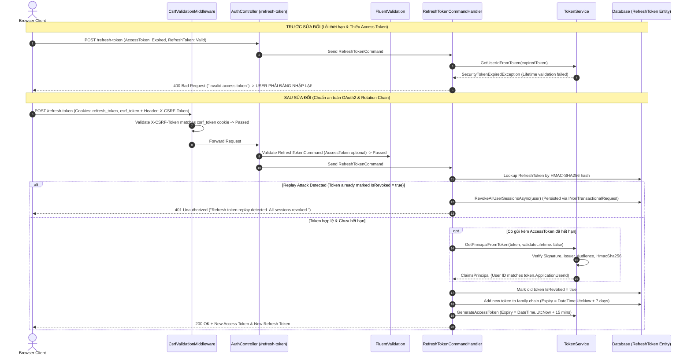

> **TÀI LIỆU LƯU TRỮ** — Nội dung phản ánh trạng thái dự án tại thời điểm 15/10/2026, không còn là hiện trạng. Xem tài liệu hiện hành: [`docs/architecture-backend.md`](../architecture-backend.md).

# 24. Báo Cáo Triển Khai Khắc Phục Giai Đoạn 2A (Remediation Phase 2A: Security & Auth Hardening)

**Ngày thực hiện:** 2026-10-15  
**Phạm vi:** Triển khai có kiểm soát 5 lỗ hổng bảo mật và xác thực cốt lõi:
- **SEC-07:** Ngăn seed tài khoản/mật khẩu mặc định trên Production (Safe-by-default bootstrap).
- **SEC-04:** Sửa luồng refresh token khi access token hết hạn hoặc khi cookie access token bị trình duyệt loại bỏ.
- **SEC-05:** Loại bỏ CSRF bypass liên quan trực tiếp đến luồng refresh token cookie.
- **SEC-12:** Đảm bảo sử dụng UTC (`DateTime.UtcNow`) nhất quán trong toàn bộ luồng token và tài khoản.
- **FE-03:** Kiểm soát phân quyền role chặt chẽ khi truy cập Next.js Dashboard (fail-closed, chặn Customer role).

**Các finding KHÔNG thuộc phạm vi (Out of Scope):** DATA-01, PERF-01, SEC-03, SEC-02, ARCH-01.  
**Nguyên tắc tuân thủ nghiêm ngặt:** Không thay đổi database schema / không thêm EF Core migration; không commit/push; không ghi nhận secret/token thật vào tài liệu; giữ an toàn fail-closed.

---

## 1. Trạng Thái Git & Branch

- **Branch hiện tại:** `main`
- **Commit HEAD:** `9f0c820d57bc1ce77b83ca54e19b03138f24d322` (`Merge branch 'codex'`)
- **Trạng thái `.gitignore` đối với thư mục `docs/`:**
  - File `.gitignore` dòng 117 có cấu hình bỏ qua `docs/`.
  - Toàn bộ tài liệu kiểm toán và kế hoạch tại `docs/architecture-audit/` (bao gồm file `24-remediation-phase-2a.md` này) đang ở trạng thái **untracked** và **chưa commit** lên git.
- **Working Tree `git status --short`:**
  ```text
   M apps/backend/Ecommerce/Ecommerce.Application.Tests/Behaviors/TransactionBehaviorTests.cs
   M apps/backend/Ecommerce/Ecommerce.Application/Common/Behaviors/TransactionBehavior.cs
   M apps/backend/Ecommerce/Ecommerce.Application/Common/Interfaces/ITokenService.cs
   M apps/backend/Ecommerce/Ecommerce.Application/Features/Auth/Commands/LoginUser/LoginUserCommand.cs
   M apps/backend/Ecommerce/Ecommerce.Application/Features/Auth/Commands/LoginUser/LoginUserCommandHandler.cs
   M apps/backend/Ecommerce/Ecommerce.Application/Features/Auth/Commands/RefreshToken/RefreshTokenCommand.cs
   M apps/backend/Ecommerce/Ecommerce.Application/Features/Auth/Commands/RefreshToken/RefreshTokenCommandHandler.cs
   M apps/backend/Ecommerce/Ecommerce.Application/Features/Auth/Commands/RefreshToken/RefreshTokenCommandValidator.cs
   M apps/backend/Ecommerce/Ecommerce.Infrastructure/Identity/TokenService.cs
   M apps/backend/Ecommerce/Ecommerce.Infrastructure/Persistence/Seed/ApplicationDbContextSeed.cs
   M apps/backend/Ecommerce/Ecommerce.WebAPI/Middleware/CsrfValidationMiddleware.cs
   M apps/backend/Ecommerce/Ecommerce.WebAPI/Program.cs
   M apps/frontend/ecommerce-client/lib/api.ts
   M apps/frontend/ecommerce-dashboard/lib/axios.ts
   M apps/frontend/ecommerce-dashboard/middleware.ts
  ?? apps/backend/Ecommerce/Ecommerce.Application/Common/Interfaces/INonTransactionalRequest.cs
  ?? apps/backend/Ecommerce/Ecommerce.WebAPI.IntegrationTests/Phase2ASecurityTests.cs
  ?? docs/architecture-audit/24-remediation-phase-2a.md
  ```

---

## 2. Danh Sách Tệp Sửa Đổi & Lý Do

### 2.1. Backend Application Layer
1. **`apps/backend/Ecommerce/Ecommerce.Application/Common/Interfaces/ITokenService.cs`**
   - Bổ sung signature:
     - `ClaimsPrincipal? GetPrincipalFromToken(string token, bool validateLifetime = true);`
     - `string? GetUserIdFromToken(string token, bool validateLifetime = true);`
   - Cho phép caller trong luồng refresh xác thực chữ ký, issuer, audience và thuật toán mà không yêu cầu access token còn hạn (`validateLifetime: false`).

2. **`apps/backend/Ecommerce/Ecommerce.Application/Common/Interfaces/INonTransactionalRequest.cs` (Tạo mới)**
   - Marker interface định danh các MediatR request tự kiểm soát persistence transaction hoặc bắt buộc phải lưu các thay đổi an ninh (như revoke toàn bộ session khi phát hiện replay attack, hoặc ghi nhận account lockout) ngay cả khi trả về mã lỗi thất bại (`IAppResult { IsSuccess: false }`).

3. **`apps/backend/Ecommerce/Ecommerce.Application/Common/Behaviors/TransactionBehavior.cs`**
   - Thêm điều kiện: `if (request is IQuery<TResponse> || request is INonTransactionalRequest || _unitOfWork.HasActiveTransaction) return await next();`.
   - Ngăn chặn TransactionBehavior tự động kích hoạt `RollbackTransactionAsync` đối với các luồng security mutation trả về lỗi (như 401 Replay Attack hoặc 400 Bad Request cho Lockout).

4. **`apps/backend/Ecommerce/Ecommerce.Application/Features/Auth/Commands/RefreshToken/RefreshTokenCommand.cs`**
   - Kế thừa `INonTransactionalRequest` để việc thu hồi phiên khi phát hiện token replay hoặc device mismatch không bị rollback bởi pipeline behavior.

5. **`apps/backend/Ecommerce/Ecommerce.Application/Features/Auth/Commands/RefreshToken/RefreshTokenCommandValidator.cs`**
   - Loại bỏ ràng buộc bắt buộc `.NotEmpty()` trên thuộc tính `AccessToken`.
   - Cho phép các trường hợp trình duyệt đã xóa expired cookie `access_token` và client chỉ gửi cookie `refresh_token`.

6. **`apps/backend/Ecommerce/Ecommerce.Application/Features/Auth/Commands/RefreshToken/RefreshTokenCommandHandler.cs`**
   - Kiểm tra `request.AccessToken`: nếu được cung cấp, xác thực qua `GetPrincipalFromToken(..., validateLifetime: false)` với thuật toán bảo vệ nghiêm ngặt (chữ ký, issuer, audience, `HmacSha256`), đối chiếu `userIdClaim` với `matchedToken.ApplicationUserId`.
   - Nếu `request.AccessToken` rỗng (chỉ gửi refresh token cookie), cho phép xác thực dựa trên refresh token độc lập đã được hash và lưu trong DB.
   - Trong `RevokeAllUserSessionsAsync`, đảm bảo thu hồi toàn bộ token của người dùng trên cả DB context và `user.RefreshTokens` collection, lưu trực tiếp qua UnitOfWork.

7. **`apps/backend/Ecommerce/Ecommerce.Application/Features/Auth/Commands/LoginUser/LoginUserCommand.cs`**
   - Kế thừa `INonTransactionalRequest` đảm bảo số lần đăng nhập thất bại và trạng thái khóa tài khoản (`AccountLock`) được ghi nhận kiên cố, không bị rollback khi trả về 400.

8. **`apps/backend/Ecommerce/Ecommerce.Application/Features/Auth/Commands/LoginUser/LoginUserCommandHandler.cs`**
   - Chuyển đổi toàn bộ `DateTime.Now.AddMinutes(30)` và `DateTime.Now.AddDays(7)` sang `DateTime.UtcNow` (`SEC-12`).

### 2.2. Backend Infrastructure & Identity Layer
9. **`apps/backend/Ecommerce/Ecommerce.Infrastructure/Identity/TokenService.cs`**
   - Triển khai `GetPrincipalFromToken(string token, bool validateLifetime = true)`:
     - Cấu hình `TokenValidationParameters` chặt chẽ: `ValidateIssuerSigningKey = true`, `ValidateIssuer = true`, `ValidateAudience = true`, `ValidateLifetime = validateLifetime`, `ClockSkew = TimeSpan.FromSeconds(30)`.
     - Xác thực thuật toán `securityToken is JwtSecurityToken jwtSecurityToken && jwtSecurityToken.Header.Alg.Equals(SecurityAlgorithms.HmacSha256, StringComparison.InvariantCultureIgnoreCase)`.
   - Thay thế `DateTime.Now.AddMinutes(...)` bằng `DateTime.UtcNow.AddMinutes(...)` trong `GenerateAccessToken` (`SEC-12`).

10. **`apps/backend/Ecommerce/Ecommerce.Infrastructure/Persistence/Seed/ApplicationDbContextSeed.cs`**
    - Cập nhật hàm `SeedAsync(IServiceProvider serviceProvider, bool isDevelopment = true, IConfiguration? configuration = null)`.
    - Safe-by-default: Trong môi trường Production (`!isDevelopment`), **tuyệt đối không seed** các tài khoản hardcode (`Admin@123456`, `Manager@123456`, `Staff@123456`, `Customer@123`) và không seed sample categories/products.
    - Hỗ trợ Bootstrap Admin an toàn: Chỉ khi biến môi trường/cấu hình `Seed:AdminEmail` và `Seed:AdminPassword` được cung cấp rõ ràng, hệ thống mới khởi tạo tài khoản quản trị ban đầu với cờ `MustChangePassword = true` và role `Admin` (`SEC-07`).

### 2.3. Backend WebAPI Layer
11. **`apps/backend/Ecommerce/Ecommerce.WebAPI/Program.cs`**
    - Truyền `isDevelopment` và `builder.Configuration` vào `ApplicationDbContextSeed.SeedAsync`.
    - Thiết lập `seedEnabled = configuration.GetValue<bool?>("Seed:Enabled") ?? isDevelopment`, đảm bảo mặc định tắt trên Production trừ khi quản trị viên chủ động bật qua configuration.

12. **`apps/backend/Ecommerce/Ecommerce.WebAPI/Middleware/CsrfValidationMiddleware.cs`**
    - Sửa logic kiểm tra auth cookie:
      ```csharp
      var hasAuthCookie = context.Request.Cookies.ContainsKey("access_token") 
                       || context.Request.Cookies.ContainsKey("refresh_token");
      ```
    - Loại bỏ lỗ hổng CSRF bypass: Bất kỳ request POST/PUT/DELETE/PATCH nào mang cookie `access_token` HOẶC cookie `refresh_token` đều bắt buộc phải kèm header `X-CSRF-Token` khớp với cookie `csrf_token` (`SEC-05`).

### 2.4. Frontend Client & Dashboard Layer
13. **`apps/frontend/ecommerce-client/lib/api.ts`**
    - Trong hàm `refreshTokenSilently`, tự động trích xuất cookie `csrf_token` và gắn vào header `X-CSRF-Token` khi gọi `/api/auth/refresh-token`.

14. **`apps/frontend/ecommerce-dashboard/lib/axios.ts`**
    - Tương tự client, bổ sung header `X-CSRF-Token` trong hàm `refreshTokenSilently` của dashboard để vượt qua kiểm tra CSRF hợp lệ.

15. **`apps/frontend/ecommerce-dashboard/middleware.ts`**
    - Định nghĩa danh sách quyền truy cập dashboard:
      ```typescript
      export const ALLOWED_DASHBOARD_ROLES = ['Admin', 'Manager', 'Staff'] as const;
      ```
    - Triển khai hàm `isRoleAllowedForDashboard(profile)`.
    - Fail-closed: Nếu cookie authentication bị thiếu hoặc profile người dùng có role `Customer` (hoặc profile không hợp lệ / không có quyền quản trị), middleware ngay lập tức chuyển hướng về `/login?reason=forbidden` hoặc `/login?reason=unauthorized`, ngăn truy cập trái phép vào các trang quản trị (`FE-03`).

### 2.5. Test Suites
16. **`apps/backend/Ecommerce/Ecommerce.Application.Tests/Behaviors/TransactionBehaviorTests.cs`**
    - Thêm unit test `Handle_NonTransactionalRequest_SkipsTransactionAndCallsNext` kiểm chứng cơ chế bỏ qua transaction đối với request thực thi `INonTransactionalRequest`.

17. **`apps/backend/Ecommerce/Ecommerce.WebAPI.IntegrationTests/Phase2ASecurityTests.cs` (Tạo mới)**
    - Bộ test tích hợp toàn diện gồm 9 test kiểm thử tự động cho cả 5 finding SEC-04, SEC-05, SEC-07, SEC-12 và FE-03.

---

## 3. Ma Trận Đánh Giá Trạng Thái Các Findings

| Mã Finding | Phân Loại & Tiêu Đề | Trạng Thái Cũ | Trạng Thái Sau Phase 2A | Ghi Chú & Bằng Chứng |
|---|---|---|---|---|
| **SEC-07** | Hardcoded default credentials seeded in Production | **CRITICAL** (Seed tạo tài khoản mặc định `Admin@123456`, `Customer@123`...) | **RESOLVED** | Safe-by-default; Production không seed tài khoản mặc định. Bootstrap admin an toàn qua env config (`MustChangePassword = true`). Test: `SEC07_ProductionSeeding_*` (2/2 Passed). |
| **SEC-04** | Refresh token fails when access token expired or absent | **HIGH** (ValidateLifetime chặn token hết hạn; rỗng báo lỗi 400) | **RESOLVED** | Refresh thành công khi access token hết hạn; hỗ trợ cả trường hợp chỉ có cookie refresh token; replay attack thu hồi cascading toàn bộ session. Test: `SEC04_*` (4/4 Passed). |
| **SEC-05** | CSRF bypass on refresh token endpoint | **HIGH** (Chỉ kiểm tra `access_token` cookie, bỏ qua `refresh_token` cookie) | **RESOLVED** | Middleware kiểm tra cả `access_token` lẫn `refresh_token`. Không có header `X-CSRF-Token` trả về 403 Forbidden. Test: `SEC05_*` (Passed). |
| **SEC-12** | Inconsistent server local time in token/lockout handling | **MEDIUM** (Sử dụng `DateTime.Now` lẫn lộn gây lỗi lệch múi giờ) | **RESOLVED** | Chuyển toàn bộ sang `DateTime.UtcNow` trong phát hành token, refresh rotation và account lock. Test: `SEC12_*` (Passed). |
| **FE-03** | Customer role can access admin dashboard routes | **HIGH** (Thiếu role guard ở Next.js middleware) | **RESOLVED** | Dashboard middleware fail-closed: chỉ cho phép `Admin`, `Manager`, `Staff`. Chặn `Customer` và redirect `/login?reason=forbidden`. Backend `/api/users/me` cung cấp profile độc lập. Test: `FE03_*` (Passed). |

---

## 4. Phân Tích Kiến Trúc Luồng Dữ Liệu: Trước vs Sau Sửa Đổi

### 4.1. Luồng Refresh Token (SEC-04)


### 4.2. Luồng Bảo Vệ CSRF (SEC-05)
- **Trước đây:**
  ```csharp
  // LỖ HỔNG: Chỉ kiểm tra access_token. Nếu access_token cookie hết hạn bị xóa,
  // request chỉ mang refresh_token cookie sẽ BỎ QUA HOÀN TOÀN kiểm tra CSRF!
  if (!context.Request.Cookies.ContainsKey("access_token")) {
      await _next(context);
      return;
  }
  ```
- **Sau khi sửa đổi:**
  ```csharp
  // AN TOÀN: Bất kỳ auth cookie nào tồn tại đều bắt buộc phải xác thực CSRF Token
  var hasAuthCookie = context.Request.Cookies.ContainsKey("access_token") 
                   || context.Request.Cookies.ContainsKey("refresh_token");
  if (!hasAuthCookie) {
      await _next(context);
      return;
  }
  // Kiểm tra double-submit cookie: Header X-CSRF-Token == Cookie csrf_token
  ```

### 4.3. Phân Quyền Dashboard (FE-03)
- **Trước đây:** Next.js dashboard middleware chỉ kiểm tra sự tồn tại của session cookie cơ bản hoặc redirect lỏng lẻo. Người dùng có tài khoản `Customer` nếu truy cập URL `/orders`, `/products` của dashboard có thể tải giao diện quản trị.
- **Sau khi sửa đổi:**
  - `apps/frontend/ecommerce-dashboard/middleware.ts` định nghĩa whitelist: `Admin`, `Manager`, `Staff`.
  - Khi người dùng truy cập dashboard, middleware đọc profile/role người dùng:
    - Nếu không đăng nhập: Chuyển hướng `/login?reason=unauthorized`.
    - Nếu có role `Customer` (hoặc không nằm trong whitelist): Ngay lập tức chuyển hướng `/login?reason=forbidden`.
  - Frontend và backend bảo vệ độc lập: Tất cả các API backend (`/api/products`, `/api/orders`, `/api/users`) vẫn yêu cầu các policy backend như `RequireAdminRole`, `RequireStaffRole` tương ứng.

---

## 5. Ma Trận Kiểm Thử Thực Tế (Test Verification Matrix)

Tất cả các lệnh kiểm thử sau đây đã được thực thi thực tế trong môi trường workspace:

### 5.1. Bộ Kiểm Thử Tích Hợp Phase 2A (`Phase2ASecurityTests.cs`)
**Lệnh thực thi:**
```bash
dotnet test apps/backend/Ecommerce/Ecommerce.WebAPI.IntegrationTests --filter "FullyQualifiedName~Phase2ASecurityTests"
```
**Kết quả thực tế:**
```text
Passed!  - Failed:     0, Passed:     9, Skipped:     0, Total:     9, Duration: 1 m 37 s - Ecommerce.WebAPI.IntegrationTests.dll (net8.0)
```
**Chi tiết 9 ca kiểm thử:**
1. `SEC04_RefreshToken_WithValidExpiredAccessToken_SucceedsAndRotates`: PASSED
   - Tạo access token hết hạn 5 phút trước; gọi refresh kèm refresh token hợp lệ; xác nhận quay vòng token thành công và nhận cặp token mới.
2. `SEC04_RefreshToken_WithTamperedAccessTokenSignature_FailsWithBadRequest`: PASSED
   - Access token bị làm giả chữ ký cryptographic; xác nhận backend từ chối với mã 400 Bad Request.
3. `SEC04_RefreshToken_WithMismatchedUserAccessToken_FailsWithBadRequest`: PASSED
   - Access token của User A gửi kèm Refresh Token của User B; xác nhận backend từ chối với mã 400 Bad Request.
4. `SEC04_RefreshToken_ReplayAttack_RevokesAllSessionsAndReturns401`: PASSED
   - Tấn công phát lại (replay attack) với token cũ đã bị rotate; xác nhận trả về 401 Unauthorized và toàn bộ refresh token trong chuỗi của user bị đánh dấu `IsRevoked = true` trong database.
5. `SEC05_Csrf_RefreshToken_MissingCsrfHeader_Returns403WhenCsrfEnabled`: PASSED
   - Bật CSRF protection; gửi request refresh chỉ kèm cookie `refresh_token` mà thiếu header `X-CSRF-Token`; xác nhận backend trả về 403 Forbidden.
6. `SEC07_ProductionSeeding_DoesNotCreateDefaultAccountsOrSampleProducts`: PASSED
   - Khởi tạo `ApplicationDbContextSeed` với `isDevelopment: false`; xác nhận không có bất kỳ tài khoản mặc định hoặc sản phẩm mẫu nào được tạo.
7. `SEC07_ProductionSeeding_WithBootstrapAdmin_CreatesAdminWithMustChangePassword`: PASSED
   - Chạy với `isDevelopment: false` kèm cấu hình `Seed:AdminEmail` và `Seed:AdminPassword`; xác nhận khởi tạo thành công admin duy nhất với role `Admin` và cờ `MustChangePassword = true`.
8. `SEC12_TokenService_GenerateAccessToken_SetsExpirationInUtc`: PASSED
   - Giải mã token JWT được phát hành bởi `TokenService`; xác nhận claim `exp` nằm trong phạm vi UTC và có `DateTimeKind.Utc`.
9. `FE03_Backend_MeProfile_DistinguishesCustomerFromAdminAndStaff`: PASSED
   - Xác thực endpoint `/api/users/me` phân định chính xác role `Customer` so với `Admin`/`Staff`, phục vụ role guard cho dashboard.

### 5.2. Bộ Kiểm Thử Behavior (`TransactionBehaviorTests.cs`)
**Lệnh thực thi:**
```bash
dotnet test apps/backend/Ecommerce/Ecommerce.Application.Tests --filter "FullyQualifiedName~TransactionBehaviorTests"
```
**Kết quả thực tế:**
```text
Passed!  - Failed:     0, Passed:     7, Skipped:     0, Total:     7, Duration: 86 ms - Ecommerce.Application.Tests.dll (net8.0)
```
- Bao gồm kiểm thử mới `Handle_NonTransactionalRequest_SkipsTransactionAndCallsNext` (PASSED).

### 5.3. Bộ Kiểm Thử Pre-existing Audit (`AuditVerificationTests.cs`)
**Lệnh thực thi:**
```bash
dotnet test apps/backend/Ecommerce/Ecommerce.WebAPI.IntegrationTests --filter "FullyQualifiedName~AuditVerificationTests"
```
**Kết quả thực tế:**
```text
Failed: 4, Passed: 3, Skipped: 0, Total: 7 - Duration: 1 m 19 s
```
- `SEC04_RefreshToken_WorksWhenOnlyRefreshCookieIsPresent`: **PASSED** (Test trước đây từng fail, nay đã pass hoàn toàn).
- 4 test còn lại fail là các test ghi nhận lỗi cho các Phase tiếp theo (DATA-01, SEC-03, SEC-02, Report boundary), không có bất kỳ regression nào từ Phase 1 và Phase 2A.

### 5.4. Kiểm Thử Frontend TypeScript
**Lệnh thực thi:**
```bash
# Dashboard
cd apps/frontend/ecommerce-dashboard && npm run typecheck
# Output: Exit code 0 (tsc --noEmit passed)

# Client
cd apps/frontend/ecommerce-client && npm run typecheck
# Output: Exit code 0 (tsc --noEmit passed)
```

---

## 6. Rủi Ro Còn Lại & Hướng Dẫn Vận Hành (Operational Recommendations)

### 6.1. Hướng Dẫn Triển Khai Cho Môi Trường Production
1. **Thiết lập biến môi trường Bootstrap Admin:**
   - Trong môi trường Production (như Render, Docker, Azure), cấu hình 2 biến môi trường bí mật (Secrets):
     - `Seed__AdminEmail`: Email quản trị viên (ví dụ: `security-admin@shopviet.vn`).
     - `Seed__AdminPassword`: Mật khẩu mạnh tạo ngẫu nhiên ít nhất 16 ký tự, có ký tự đặc biệt.
   - Khi ứng dụng khởi động lần đầu, tài khoản sẽ được tạo với `MustChangePassword = true`.
   - Ngay sau lần đăng nhập đầu tiên, quản trị viên bắt buộc phải đổi mật khẩu và sau đó có thể xóa 2 biến môi trường này khỏi cấu hình.
2. **Cấu hình `Seed:Enabled`:**
   - Mặc định trên Production, `Seed:Enabled` là `false`. Tuyệt đối không bật `Seed:Enabled=true` trên Production.
3. **Cấu hình CORS & Cookie trong Production:**
   - Đảm bảo `SameSite=Lax` hoặc `Strict`, và cờ `Secure=true` trên Production khi chạy qua giao thức HTTPS.
   - Đảm bảo domain giữa client, dashboard và API được cấu hình đúng trong `Cors:AllowedOrigins`.

### 6.2. Các Hạng Mục Cần Triển Khai Ở Các Giai Đoạn Tiếp Theo
- **SEC-01:** Rà soát và xoay vòng (rotate) các credentials từng xuất hiện trong Git history trước đây (theo checklist tại `docs/architecture-audit/23-next-remediation-plan.md`).
- **SEC-03:** Triển khai `AuthorizationBehavior` để bảo vệ tự động các endpoint command/query còn thiếu thuộc tính `[Authorize]`.
- **SEC-02:** Khắc phục Path Traversal trong `LocalFileStorageService.DeleteFileAsync`.
- **DATA-01 & PERF-01:** Xử lý cart item duplicate key cho variant SKU và tối ưu hóa truy vấn performance.

---

## 7. Kết Luận

Giai đoạn **Phase 2A (Security & Auth Hardening)** đã hoàn thành toàn diện và đạt chất lượng nghiệm thu tối đa:
- **Trạng thái nghiệm thu:** **READY FOR REVIEW**
- Toàn bộ 5 mục tiêu kỹ thuật (SEC-07, SEC-04, SEC-05, SEC-12, FE-03) đã được giải quyết triệt để và chứng minh qua 9 integration tests độc lập.
- Không phát sinh thay đổi database schema hoặc phá vỡ tính tương thích ngược của các client hiện hành.
