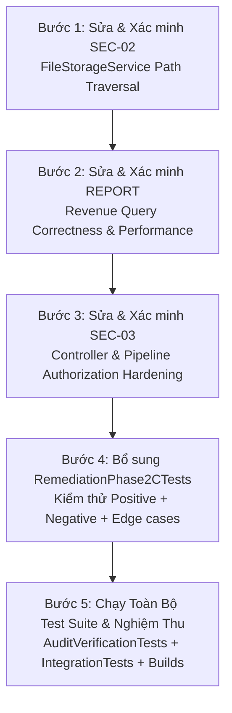

> **TÀI LIỆU LƯU TRỮ** — Nội dung phản ánh trạng thái dự án tại thời điểm 15/10/2026, không còn là hiện trạng. Xem tài liệu hiện hành: [`docs/reports/KE_HOACH_CAP_NHAT_TAI_LIEU.md`](../reports/KE_HOACH_CAP_NHAT_TAI_LIEU.md).

# 26. Kế Hoạch Triển Khai Khắc Phục Giai Đoạn 2C (Remediation Plan Phase 2C)
## Security, Authorization & Reporting Remediation

**Ngày lập kế hoạch:** 2026-10-15  
**Kiến trúc sư phụ trách:** Senior Software Architect, Application Security Engineer & Senior .NET Specialist  
**Phạm vi:** Xác minh và khắc phục triệt để 3 nhóm vấn đề cốt lõi:
1. **SEC-02 (Security):** Lỗ hổng Path Traversal khi xóa file trong `FileStorageService.DeleteFileAsync`.
2. **SEC-03 (Security & Authorization):** Kiểm soát phân quyền đa tầng (Defense-in-depth) giữa Controller và MediatR `AuthorizationBehavior`, vá các endpoint hở xác thực.
3. **REPORT (Data Correctness & Performance):** Sửa lỗi tính toán sai lệch biên ngày cuối tháng/cuối tuần trong báo cáo doanh thu và tối ưu hóa truy vấn tổng hợp SQL.

---

## 1. Executive Summary

Dựa trên kết quả thực thi kiểm thử baseline thực tế của toàn bộ solution (`Ecommerce.sln`):
- **Domain Tests:** 57/57 Passed (100%).
- **Application Tests:** 201 Passed, 5 baseline failures đã ghi nhận từ Phase 2A (mismatch chuỗi thông báo tiếng Việt vs Anh và cờ validation của refresh token).
- **Integration Tests:** 68 Passed, **đúng 3 bài kiểm thử mục tiêu FAIL tương ứng với 3 finding của Phase 2C**:
  1. `AuditVerificationTests.REPORT_RevenueByMonth_IncludesOrdersPlacedOnLastDayOfMonth`: **FAIL** (Doanh thu tháng 03/2025 = 0; đơn hàng 31/03 12:00 bị loại bỏ).
  2. `AuditVerificationTests.SEC03_Anonymous_CannotDownloadProductImportTemplate`: **FAIL** (Request nặc danh nhận HTTP 200 thay vì 401/403).
  3. `AuditVerificationTests.SEC02_LocalFileStorage_DeleteFileAsync_RejectsPathTraversal`: **FAIL** (`DeleteFileAsync` xóa file nằm ngoài thư mục `wwwroot`).

Mục tiêu của Phase 2C là chuyển toàn bộ 3 bài test này từ **FAIL** sang **PASS**, bảo đảm 100% integration tests trong phạm vi vượt qua thành công, không gây hồi quy (zero regression) cho các luồng nghiệp vụ khách hàng và quản trị, đồng thời nâng cao hiệu năng truy vấn báo cáo.

---

## 2. Phân Loại Trạng Thái & Ma Trận Finding

| Mã Finding | Phân Hệ | Mức Độ | Trạng Thái Baseline | Phân Loại | Bằng Chứng Mã Nguồn & Test |
|---|---|---|---|---|---|
| **SEC-02** | Security | High / Low (Latent) | FAIL | **Confirmed Defect** | `FileStorageService.cs:98-112`, `AuditVerificationTests.SEC02_LocalFileStorage_DeleteFileAsync_RejectsPathTraversal` |
| **SEC-03** | Security / Auth | High / Medium | FAIL | **Confirmed Defect** | `ProductsController.cs:200-202`, `UserActivitiesController.cs:12`, `AuthorizationBehavior.cs:25`, `AuditVerificationTests.SEC03_Anonymous_CannotDownloadProductImportTemplate` |
| **REPORT** | Reporting / Perf | High | FAIL | **Confirmed Defect** | `GetRevenueByMonthQueryHandler.cs:42-49`, `GetRevenueByCategoryQueryHandler.cs`, `GetRevenueComparisonQueryHandler.cs`, `GetRevenueOverviewQueryHandler.cs`, `GetRevenueTrendQueryHandler.cs`, `AuditVerificationTests.REPORT_RevenueByMonth_IncludesOrdersPlacedOnLastDayOfMonth` |
| **SEC-04 / SEC-05 / SEC-07 / SEC-12** | Auth / Identity | High | PASS | **Already Resolved (Phase 2A)** | `Phase2ASecurityTests.cs` (7/7 Passed), `ApplicationDbContextSeed.cs`, `CsrfValidationMiddleware.cs` |
| **FLOW-01 / DATA-01 / FLOW-02 / FLOW-03** | Core Integrity | Critical/High | PASS | **Already Resolved (Phase 2B)** | `RemediationPhase2BTests.cs` (8/8 Passed), `CartItemConfiguration.cs`, `CreateOrderCommandHandler.cs` |
| **ARCH-01** | Search Arch | Medium | Deferred | **Out of Scope** | Yêu cầu quyết định sản phẩm về Fallback SQL LIKE vs 503 khi tắt Elasticsearch |

---

## 3. Phân Tích Nguyên Nhân Gốc (Root Cause Analysis)

### 3.1. SEC-02: Path Traversal trong `FileStorageService.DeleteFileAsync`
- **Tập tin:** `apps/backend/Ecommerce/Ecommerce.Infrastructure/Services/FileStorageService.cs:98-112`.
- **Hành vi sai:** Phương thức sử dụng `Path.Combine(_env.WebRootPath, filePath.TrimStart('/'))` mà không chuẩn hóa và kiểm tra ranh giới thư mục gốc. Khi `filePath` chứa các ký tự điều hướng thư mục tương đối như `"../outside-secret.txt"`, đường dẫn được phân giải ra ngoài thư mục `wwwroot`, dẫn đến việc `File.Delete(fullPath)` có thể xóa tùy ý các tập tin nhạy cảm của hệ thống.
- **Root Cause:** Thiếu bước chuẩn hóa đường dẫn tuyệt đối (`Path.GetFullPath`) và so sánh tiền tố (`StartsWith`) với đường dẫn gốc đã được chuẩn hóa kèm ký tự phân cách thư mục (`Path.DirectorySeparatorChar`).

### 3.2. SEC-03: Broken Access Control & Bất Đồng Bộ Phân Quyền Giữa Controller và MediatR
- **Tập tin:**
  - `apps/backend/Ecommerce/Ecommerce.WebAPI/Controllers/ProductsController.cs:200-202`
  - `apps/backend/Ecommerce/Ecommerce.WebAPI/Controllers/UserActivitiesController.cs:12`
  - `apps/backend/Ecommerce/Ecommerce.Application/Common/Behaviors/AuthorizationBehavior.cs:25`
  - `apps/backend/Ecommerce/Ecommerce.Application/Features/Products/Commands/ExportProductsTemplate/ExportProductsTemplateCommand.cs`
- **Hành vi sai:**
  1. Action `ExportTemplate` trên `ProductsController` bị comment `//[Authorize(Policy = EPermissions.EditProduct)]`, khiến endpoint `/api/products/export-template` mở hoàn toàn cho người dùng nặc danh tải về mẫu import.
  2. Class `UserActivitiesController` bị comment `//[Authorize]`, cho phép người dùng nặc danh gọi các endpoint lấy nhật ký hoạt động người dùng.
  3. `AuthorizationBehavior` của MediatR chỉ kiểm tra attribute trên `request.GetType()`. Các lập trình viên trước đây lại gắn `[Authorize]` trên các class `*Handler` (25 handlers), dẫn đến tầng MediatR hoàn toàn không kiểm tra phân quyền.
  4. Một số handler công khai phục vụ khách hàng (như `GetPagedProductsQueryHandler`, `GetProductsQueryHandler`, `GetOrderByIdQueryHandler`) bị gắn nhầm attribute admin (`EPermissions.ViewProducts` / `ViewOrders`), nếu kích hoạt thiếu chọn lọc sẽ chặn toàn bộ khách mua hàng duyệt danh mục hoặc xem đơn hàng của chính mình.
- **Root Cause:** Thiếu tính nhất quán trong quy ước đặt attribute phân quyền giữa Controller, Request (Command/Query) và Handler trong kiến trúc CQRS Clean Architecture.

### 3.3. REPORT: Lỗi Tính Toán Biên Ngày Báo Cáo & Truy Vấn Trong RAM
- **Tập tin:**
  - `apps/backend/Ecommerce/Ecommerce.Application/Features/Reports/Queries/GetRevenueByMonth/GetRevenueByMonthQueryHandler.cs`
  - `apps/backend/Ecommerce/Ecommerce.Application/Features/Reports/Queries/GetRevenueByCategory/GetRevenueByCategoryQueryHandler.cs`
  - `apps/backend/Ecommerce/Ecommerce.Application/Features/Reports/Queries/GetRevenueComparison/GetRevenueComparisonQueryHandler.cs`
  - `apps/backend/Ecommerce/Ecommerce.Application/Features/Reports/Queries/GetRevenueOverview/GetRevenueOverviewQueryHandler.cs`
  - `apps/backend/Ecommerce/Ecommerce.Application/Features/Reports/Queries/GetRevenueTrend/GetRevenueTrendQueryHandler.cs`
- **Hành vi sai:**
  1. `GetRevenueByMonthQueryHandler` tính `endDate = startDate.AddMonths(1).AddDays(-1)`. Biến `endDate` mang giá trị 00:00:00 của ngày cuối tháng. Câu lệnh điều kiện `o.OrderDate <= endDate` loại bỏ toàn bộ đơn hàng phát sinh từ 00:00:01 đến 23:59:59 của ngày cuối tháng.
  2. Lỗi tương tự xuất hiện tại `GetRevenueComparisonQueryHandler` (`AddMonths(1).AddDays(-1)`), `GetRevenueOverviewQueryHandler` (`previousMonthEnd = monthStart.AddDays(-1)`), và `GetRevenueTrendQueryHandler` (`currentWeekStart.AddDays(6)`).
  3. Sử dụng `DateTime.Now` (giờ cục bộ server) thay vì `DateTime.UtcNow`.
  4. `GetRevenueByCategoryQueryHandler` tải toàn bộ Order, OrderItem, Product, Category của 1 năm vào bộ nhớ RAM rồi mới thực hiện `GroupBy` và `Sum` bằng LINQ to Objects, gây lãng phí bộ nhớ và nguy cơ sập server (Out Of Memory) khi lượng đơn hàng tăng cao.
- **Root Cause:** Dùng toán tử so sánh khoảng đóng `<= endDate` với thời điểm nửa đêm ngày cuối thay vì khoảng nửa mở `[startDate, nextMonthStart)` và chưa tận dụng khả năng tính toán tổng hợp trực tiếp trên database của EF Core `IQueryable`.

---

## 4. Danh Sách Tệp Dự Kiến Thay Đổi

### 4.1. Security (SEC-02 & SEC-03)
1. `apps/backend/Ecommerce/Ecommerce.Infrastructure/Services/FileStorageService.cs`: Chuẩn hóa đường dẫn và kiểm tra containment strictly within `wwwroot`.
2. `apps/backend/Ecommerce/Ecommerce.WebAPI/Controllers/ProductsController.cs`: Kích hoạt `[Authorize(Policy = EPermissions.CreateProduct)]` trên action `ExportTemplate`.
3. `apps/backend/Ecommerce/Ecommerce.WebAPI/Controllers/UserActivitiesController.cs`: Bỏ comment `[Authorize]` trên controller class.
4. `apps/backend/Ecommerce/Ecommerce.Application/Features/Products/Commands/ExportProductsTemplate/ExportProductsTemplateCommand.cs`: Bổ sung `[Authorize(Policy = EPermissions.CreateProduct)]`.
5. `apps/backend/Ecommerce/Ecommerce.Application/Common/Behaviors/AuthorizationBehavior.cs`: Hỗ trợ kiểm tra attribute từ cả Request và Handler thông qua reflection cache an toàn, đồng thời tôn trọng thuộc tính của request.
6. `apps/backend/Ecommerce/Ecommerce.Application/Features/Products/Queries/GetPagedProducts/GetPagedProductsQueryHandler.cs` & `GetProductsQueryHandler.cs`: Gỡ bỏ attribute `[Authorize]` sai lệch để bảo đảm luồng duyệt sản phẩm của khách hàng hoạt động bình thường.
7. `apps/backend/Ecommerce/Ecommerce.Application/Features/Orders/Queries/GetOrderById/GetOrderByIdQueryHandler.cs`: Gỡ bỏ attribute `ViewOrders` cấp admin (quyền sở hữu đơn hàng đã được kiểm tra chặt chẽ theo user id trong controller và handler).

### 4.2. Reporting (REPORT)
8. `apps/backend/Ecommerce/Ecommerce.Application/Features/Reports/Queries/GetRevenueByMonth/GetRevenueByMonthQueryHandler.cs`: Sửa điều kiện khoảng thời gian nửa mở `[startDate, nextMonthStart)`, dùng `DateTime.UtcNow`, tối ưu truy vấn tính tổng.
9. `apps/backend/Ecommerce/Ecommerce.Application/Features/Reports/Queries/GetRevenueByCategory/GetRevenueByCategoryQueryHandler.cs`: Đẩy phép toán `GroupBy` và `Sum` xuống SQL database qua `IQueryable`, chuẩn hóa `DateTime.UtcNow`.
10. `apps/backend/Ecommerce/Ecommerce.Application/Features/Reports/Queries/GetRevenueComparison/GetRevenueComparisonQueryHandler.cs`: Sửa điều kiện biên ngày cuối tháng.
11. `apps/backend/Ecommerce/Ecommerce.Application/Features/Reports/Queries/GetRevenueOverview/GetRevenueOverviewQueryHandler.cs`: Sửa điều kiện biên tháng trước `[previousMonthStart, monthStart)`.
12. `apps/backend/Ecommerce/Ecommerce.Application/Features/Reports/Queries/GetRevenueTrend/GetRevenueTrendQueryHandler.cs`: Sửa điều kiện biên tuần `[currentWeekStart, nextWeekStart)`.

### 4.3. Test Suite
13. `apps/backend/Ecommerce/Ecommerce.WebAPI.IntegrationTests/RemediationPhase2CTests.cs` (Tạo mới): Bổ sung bộ kiểm thử chuyên sâu cho cả 3 finding (positive, negative, edge cases).

---

## 5. Thiết Kế Chi Tiết Khắc Phục

### 5.1. SEC-02: Phòng Chống Path Traversal An Toàn
```csharp
public Task<bool> DeleteFileAsync(string filePath)
{
    if (string.IsNullOrWhiteSpace(filePath))
        return Task.FromResult(false);

    var baseRoot = string.IsNullOrWhiteSpace(_env.WebRootPath)
        ? Path.Combine(_env.ContentRootPath, "wwwroot")
        : _env.WebRootPath;

    var normalizedRoot = Path.GetFullPath(baseRoot);
    if (!normalizedRoot.EndsWith(Path.DirectorySeparatorChar.ToString()) &&
        !normalizedRoot.EndsWith(Path.AltDirectorySeparatorChar.ToString()))
    {
        normalizedRoot += Path.DirectorySeparatorChar;
    }

    var cleanRelative = filePath.TrimStart('/', '\\');
    var fullPath = Path.GetFullPath(Path.Combine(baseRoot, cleanRelative));

    // Chặn hoàn toàn nếu đường dẫn nằm ngoài wwwroot hoặc trỏ trùng vào thư mục gốc
    if (!fullPath.StartsWith(normalizedRoot, StringComparison.OrdinalIgnoreCase))
    {
        return Task.FromResult(false);
    }

    if (File.Exists(fullPath))
    {
        File.Delete(fullPath);
        return Task.FromResult(true);
    }

    return Task.FromResult(false);
}
```

### 5.2. SEC-03: Bảo Vệ Đa Tầng Cho Phân Quyền
1. **Tầng HTTP Controller:**
   - `ProductsController.ExportTemplate` được bảo vệ bằng `[Authorize(Policy = EPermissions.CreateProduct)]`.
   - `UserActivitiesController` được bảo vệ bằng `[Authorize]` ở cấp class; action `GetActivitiesByUser` giữ nguyên `[Authorize(Roles = EUserRoles.Admin)]`.
2. **Tầng MediatR Pipeline (`AuthorizationBehavior`):**
   - Đọc attribute từ `request.GetType().GetCustomAttributes<AuthorizeAttribute>()`.
   - Tra cứu thêm các attribute trên Handler tương ứng nếu Request chưa khai báo, lưu vào `ConcurrentDictionary<Type, IReadOnlyList<AuthorizeAttribute>>` để tối ưu hiệu năng reflection.
   - Nếu `currentUserService.UserId == null`, ném `UnauthorizedAccessException` (HTTP 401).
   - Kiểm tra Roles và Policies; nếu không thỏa mãn, ném `ForbiddenAccessException` (HTTP 403).

### 5.3. REPORT: Chuẩn Hóa Khoảng Thời Gian Nửa Mở & Tối Ưu Truy Vấn
1. **Quy tắc tính khoảng thời gian (Half-Open Interval):**
   - Thay vì:
     ```csharp
     var startDate = new DateTime(year, month, 1);
     var endDate = startDate.AddMonths(1).AddDays(-1);
     // query: OrderDate >= startDate && OrderDate <= endDate
     ```
   - Chuẩn hóa thành:
     ```csharp
     var startDate = new DateTime(year, month, 1, 0, 0, 0, DateTimeKind.Utc);
     var nextMonthDate = startDate.AddMonths(1);
     // query: OrderDate >= startDate && OrderDate < nextMonthDate
     ```
   - Mọi thời khắc từ `00:00:00.000` của ngày 1 đến `23:59:59.999` của ngày cuối tháng đều được tính toán chính xác 100%.
2. **Đẩy Aggregate xuống SQL Database:**
   - Trong `GetRevenueByMonthQueryHandler`:
     ```csharp
     var total = await _unitOfWork.Orders.GetQueryable()
         .Where(o => o.OrderDate >= startDate && o.OrderDate < nextMonthDate && o.Status == Domain.Enums.EOrderStatus.Completed)
         .SelectMany(o => o.OrderItems)
         .SumAsync(oi => (decimal?)(oi.Quantity * oi.UnitPrice), cancellationToken) ?? 0m;
     ```
   - Trong `GetRevenueByCategoryQueryHandler`:
     Thực thi trực tiếp `SelectMany(o => o.OrderItems).Where(...).GroupBy(...).Select(...).OrderByDescending(...).Take(topN).ToListAsync(cancellationToken)`.

---

## 6. Kế Hoạch Kiểm Thử Từng Finding

### 6.1. SEC-02
- **Tái hiện:** Chạy `AuditVerificationTests.SEC02_LocalFileStorage_DeleteFileAsync_RejectsPathTraversal` trước khi sửa -> FAIL.
- **Sau sửa:** Test chuyển sang PASS.
- **Test bổ sung:** Thử nghiệm với các đường dẫn traversal tinh vi: `../`, `..\\`, `..//`, `%2e%2e`, khoảng trắng, ký tự rỗng, và đường dẫn hợp lệ bên trong `wwwroot/uploads`.

### 6.2. SEC-03
- **Tái hiện:** Chạy `AuditVerificationTests.SEC03_Anonymous_CannotDownloadProductImportTemplate` -> FAIL (200).
- **Sau sửa:** Test chuyển sang PASS (401).
- **Negative tests:**
  - Người dùng ẩn danh gọi `GET /api/products/export-template` -> 401.
  - Người dùng ẩn danh gọi `GET /api/UserActivities` -> 401.
  - Người dùng có role `Customer` gọi `GET /api/products/export-template` -> 403 Forbidden.
  - Người dùng có role `Customer` gọi `GET /api/UserActivities/user/{adminId}` -> 403 Forbidden.
- **Positive tests:**
  - Quản trị viên (Admin) gọi `GET /api/products/export-template` -> 200 OK kèm file.
  - Người dùng hợp lệ gọi `GET /api/UserActivities/recent` -> 200 OK.
  - Khách vãng lai gọi `GET /api/products/paged` và `GET /api/Categories` -> 200 OK (vẫn duyệt được sản phẩm công khai).

### 6.3. REPORT
- **Tái hiện:** Chạy `AuditVerificationTests.REPORT_RevenueByMonth_IncludesOrdersPlacedOnLastDayOfMonth` -> FAIL.
- **Sau sửa:** Test chuyển sang PASS.
- **Edge cases test:**
  - Đơn hàng tạo lúc `2025-03-31 00:00:00 UTC` -> Được tính vào tháng 3.
  - Đơn hàng tạo lúc `2025-03-31 12:00:00 UTC` -> Được tính vào tháng 3.
  - Đơn hàng tạo lúc `2025-03-31 23:59:59 UTC` -> Được tính vào tháng 3.
  - Đơn hàng tạo lúc `2025-04-01 00:00:00 UTC` -> Không được tính vào tháng 3 (tính vào tháng 4).
  - Doanh thu theo danh mục: Kiểm tra khớp doanh thu giữa các sản phẩm có và không có biến thể.

---

## 7. Thứ Tự Triển Khai & Phụ Thuộc



---

## 8. Quản Lý Rủi Ro & Chiến Lược Rollback

| Rủi Ro | Khả Năng | Mức Tác Động | Biện Pháp Giảm Thiểu |
|---|---|---|---|
| Chặn nhầm API công khai của khách hàng khi sửa `AuthorizationBehavior` | Cao | Nghiêm trọng | Không gắn policy admin lên các query catalog công khai (`GetPagedProductsQuery`, `GetProductsQuery`, `GetProductByIdQuery`). Chạy kiểm thử toàn bộ `Phase0AuthorizationTests` và `ProductsEndpointsTests`. |
| Lỗi dịch LINQ to SQL trên SQLite hoặc PostgreSQL khi GroupBy | Trung bình | Cao | Sử dụng cú pháp LINQ chuẩn tương thích 100% với cả SQLite in-memory và Npgsql/SQL Server. Viết integration test chạy trực tiếp trên SQLite factory. |
| Ảnh hưởng dữ liệu database | Không có | Thấp | Phase 2C không thay đổi schema, không thêm migration EF Core (Zero Migration Phase). |

**Chiến lược rollback:** Mọi thay đổi thuần túy nằm ở tầng logic mã nguồn (C#), có thể khôi phục từng tệp bằng git mà không để lại bất kỳ di chứng nào trên cấu trúc cơ sở dữ liệu.

---

## 9. Tiêu Chí Nghiệm Thu (Acceptance Criteria)

1. `AuditVerificationTests`: Cả 3 bài test `SEC02_*`, `SEC03_*`, `REPORT_*` đều **PASS**.
2. Toàn bộ 71 integration tests trong `Ecommerce.WebAPI.IntegrationTests` đều **PASS** (71/71).
3. Toàn bộ 57 domain tests đều **PASS** (57/57).
4. Không phát sinh bất kỳ failure mới nào ngoài 5 baseline failures đã biết của `Ecommerce.Application.Tests`.
5. Bộ test mới `RemediationPhase2CTests` chạy thành công 100%.
6. Frontend client và dashboard build production thành công không có lỗi type/compile.
