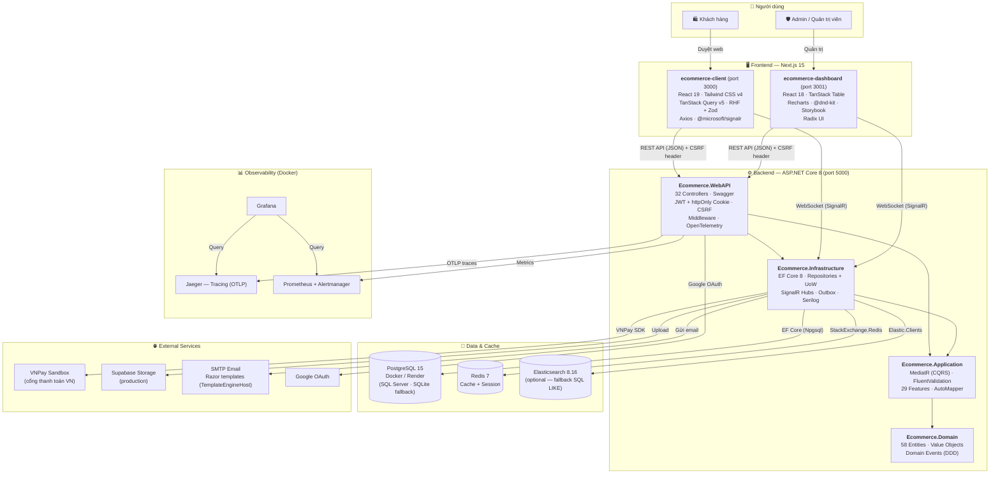

> **TÀI LIỆU LƯU TRỮ** — Nội dung phản ánh trạng thái dự án tại thời điểm Tháng 05/2026, không còn là hiện trạng. Xem tài liệu hiện hành: [`docs/architecture-backend.md`](architecture-backend.md) và [`README.md`](../README.md).

# ShopViet — Kiến trúc tổng quan (Architecture Overview)

> Tài liệu này được tạo tự động từ phân tích cấu trúc dự án thực tế (tháng 5/2026).

## 1. Biểu đồ kiến trúc tổng quan



## 2. Tóm tắt công nghệ

| Thành phần | Công nghệ chính | Cổng |
|---|---|---|
| **Backend** | .NET 8, ASP.NET Core Web API, Clean Architecture + DDD + CQRS (MediatR), EF Core 8, FluentValidation, AutoMapper, Serilog | 5000 |
| **Frontend Client** | Next.js 15 (App Router), React 19, Tailwind v4, TanStack Query v5, React Hook Form + Zod, Axios, SignalR | 3000 |
| **Frontend Dashboard** | Next.js 15, React 18, TanStack Table, Recharts, @dnd-kit, Storybook, Radix UI | 3001 |
| **Database** | PostgreSQL 15 (Docker/Render); SQL Server (local dev); SQLite (fallback) | 5432 |
| **Cache / Session** | Redis 7 (optional, fallback: memory cache) | 6379 |
| **Search** | Elasticsearch 8.16 (optional, fallback: `NoOpProductSearchService` → SQL LIKE) | 9200 |
| **Realtime** | SignalR — `NotificationHub`, `ReviewHub` | — |
| **Payment** | VNPay (sandbox) | — |
| **Storage** | Local `uploads/` (dev) / Supabase (production) | — |
| **Observability** | OpenTelemetry → Jaeger, Prometheus, Alertmanager, Grafana | 16686/9090/9093/3002 |
| **Deployment** | Docker Compose (full stack), Render (`render.yaml`), GitHub Actions (`frontend-quality.yml`) | — |

## 3. Luồng dữ liệu chính

1. **Khách hàng** duyệt web trên `ecommerce-client` → gọi REST API trên `Ecommerce.WebAPI` (JWT dạng httpOnly cookie + CSRF header cho POST/PUT/DELETE).
2. **Admin** thao tác trên `ecommerce-dashboard` → cùng REST API, phân quyền theo Role/Permission.
3. **WebAPI** → **Application** (CQRS: Command/Query qua MediatR, validate bằng FluentValidation) → **Domain** (entities, domain events).
4. **Infrastructure** thực thi: EF Core ghi **PostgreSQL** (có outbox pattern cho background jobs), cache **Redis**, index sản phẩm lên **Elasticsearch**, thanh toán qua **VNPay**, upload lên **Supabase**, gửi email qua **SMTP** (template Razor).
5. **Realtime**: cả 2 frontend kết nối SignalR WebSocket tới `NotificationHub` (thông báo) và `ReviewHub` (đánh giá).
6. **Observability**: backend export traces (OTLP) sang Jaeger và metrics sang Prometheus; Grafana trực quan hóa cả hai.

## 4. Kiến trúc backend theo lớp (Clean Architecture)

```
Ecommerce.WebAPI          → Controllers (32), Middleware, Program.cs, Swagger
      │ references
Ecommerce.Application     → Features/<Domain>/ (Commands + Queries), DTOs, Interfaces, Behaviors
      │ references
Ecommerce.Domain          → Entities (58), Enums, Events, Value Objects — không phụ thuộc gì
Ecommerce.Infrastructure  → Persistence (EF Core + Migrations), Repositories, Cache, Elasticsearch,
                            SignalR, Payments (VNPay), Outbox, EmailTemplates, Supabase
      └── chỉ phụ thuộc Domain + Application (dependency inversion qua interfaces)
```

## 5. Ghi chú / Gotchas

- **Auth**: Access token 15 phút + refresh token 7 ngày — đều là httpOnly cookie (không localStorage). CSRF token bắt buộc trong header.
- **Database không đồng nhất**: local dev dùng SQL Server, Docker/Render dùng PostgreSQL — connection string khác nhau giữa `appsettings.json` và `docker-compose/.env`.
- **Redis & Elasticsearch là optional**: tắt Redis → memory cache; tắt ES → tìm kiếm bằng SQL LIKE. Dev không cần chạy cả stack.
- **Migrations**: 3 migration (`InitialCreate`, `AddReviewProductUserUniqueIndex`, `AddOutboxMessages`) — thêm entity mới phải chạy `dotnet ef migrations add`.
- **Seeding**: tự động seed (admin, roles, sample products) khi `ASPNETCORE_ENVIRONMENT=Development`.
- **Tests**: 3 dự án test đã có trong `apps/backend/Ecommerce/tests/` (Domain.Tests, Application.Tests, WebAPI.IntegrationTests).
- **Dashboard khác client**: dashboard dùng React 18 (client dùng React 19) và có Storybook; cả hai dùng chung backend API.
