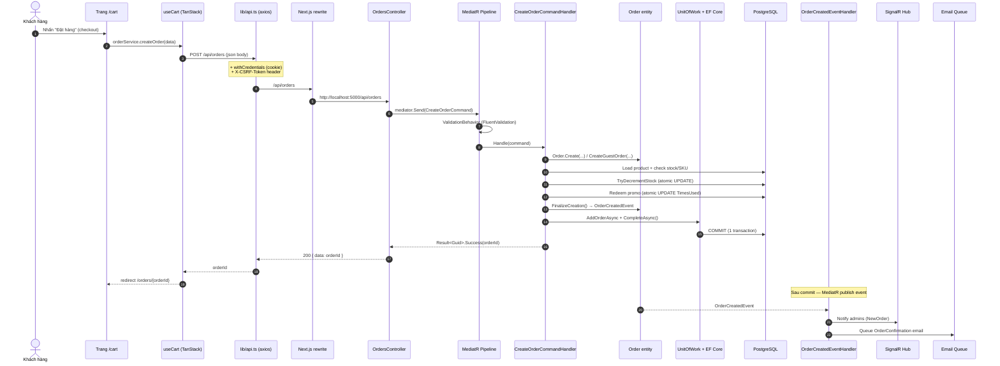

> **TÀI LIỆU LƯU TRỮ** — Nội dung phản ánh trạng thái dự án tại thời điểm 15/08/2026, không còn là hiện trạng. Xem tài liệu hiện hành: [`docs/architecture-backend.md`](architecture-backend.md) và [`apps/frontend/ecommerce-client/README.md`](../apps/frontend/ecommerce-client/README.md).

# ShopViet — Deep Dive: Backend .NET 8 & Frontend Client

> Phân tích chi tiết các Controller/Service chính, luồng xử lý đặt hàng, và cách Frontend Client tương tác với API.

---

## Phần 1: Backend .NET 8

### 1.1 Kiến trúc xử lý request (Pipeline chuẩn)

Mọi request đi qua cùng một pipeline, đảm bảo tính nhất quán:

```
HTTP Request
   │
   ▼
┌────────────────────────────────────────────────────────────┐
│ Middleware (WebAPI): RequestLogging → CsrfValidation       │
│   → AccountLock → GlobalExceptionHandling → ForwardedHeaders│
└────────────────────────────────────────────────────────────┘
   │
   ▼
Controller (thin) — chỉ trích claims + gọi IMediator.Send()
   │
   ▼
┌─ MediatR Pipeline (Application) ──────────────────────────┐
│ 1. AuthorizationBehavior   (kiểm tra policy/permission)  │
│ 2. ValidationBehavior      (FluentValidation validator)  │
│ 3. TransactionBehavior     (mở transaction EF Core)      │
│ 4. LoggingBehavior         (log request/response)        │
│ 5. PerformanceTracking     (đo thời gian xử lý)          │
│ 6. CachingBehavior         (query có [Cacheable])        │
│    └── Handler (Command/Query)                           │
└──────────────────────────────────────────────────────────┘
   │
   ▼
Domain (entities + factory methods + domain events)
   │
   ▼
Infrastructure (UnitOfWork → Repositories → EF Core → PostgreSQL)
   │
   ▼
Domain events → MediatR Publisher → EventHandlers
   (SignalR, email, outbox, cache invalidation…)
```

### 1.2 Controllers chính (32 controllers)

| Controller | Route | Vai trò chính | Auth |
|---|---|---|---|
| **AuthController** | `/api/auth` | Login/register/refresh-token/logout, Google OAuth | Public + JWT |
| **ProductsController** | `/api/products` | CRUD, paged, slug, similar, reviews, import/export, bestselling, featured | Public GET, permission CRUD |
| **CartController** | `/api/cart` | GET cart, add/update/remove item, clear, promo code | JWT hoặc Guest-ID |
| **OrdersController** | `/api/orders` | Create, paged, my-orders, history, status, analytics | JWT + permission |
| **PaymentsController** | `/api/payments` | Tạo payment, callback VNPay (IPN), kiểm tra trạng thái | JWT |
| **CategoriesController** | `/api/categories` | Tree, options, products-by-category | Public |
| **BrandsController** | `/api/brands` | CRUD + options | Public GET |
| **ReviewsController** | `/api/reviews` | CRUD review, reply, like | JWT |
| **WishlistController** | `/api/wishlist` | CRUD wishlist items | JWT/Guest |
| **SearchController** | `/api/search` | Tìm kiếm sản phẩm (Elasticsearch hoặc LIKE) | Public |
| **NotificationsController** | `/api/notifications` | Danh sách thông báo, đánh dấu đã đọc | JWT |
| **Users/Roles/Permissions** | `/api/users`… | Quản trị user, role, permission | Policy-based |
| **Reports/Dashboard** | `/api/reports`, `/api/dashboard` | Thống kê doanh thu, đơn hàng | Admin |
| **ReturnsController** | `/api/returns` | Yêu cầu trả hàng/hoàn tiền (RMA) | JWT |
| **PromoCodesController** | `/api/promocodes` | CRUD mã giảm giá | Admin |
| **InventoryController** | `/api/inventory` | Quản lý tồn kho | Admin |
| **AccountLocks/Logs/UserActivities/AuditLogs** | — | Bảo mật & giám sát | Admin |

**Mẫu controller điển hình (OrdersController.Create):**
```csharp
[HttpPost]
public async Task<IActionResult> Create(CreateOrderCommand command)
{
    if (User.Identity?.IsAuthenticated == true)
        command.ApplicationUserId = command.ApplicationUserId ?? User.GetUserId();
    var result = await _mediator.Send(command);
    return result.ToActionResult();
}
```
→ Controller không chứa business logic; chỉ gắn identity và ủy quyền cho MediatR.

### 1.3 Services chính (Infrastructure)

| Service | Interface | Triển khai | Mục đích |
|---|---|---|---|
| **UnitOfWork** | `IUnitOfWork` | `UnitOfWork.cs` | Điều phối toàn bộ repository, `CompleteAsync()` commit 1 transaction |
| **Repository** | `IProductRepository`… | `BaseRepository<T>` + 22 repository con | Truy cập dữ liệu qua EF Core (query + raw SQL cho concurrency) |
| **Cache** | `ICacheService` | `RedisCacheService` / `MemoryCacheService` | Cache query sản phẩm/category/brand theo TTL từng loại |
| **Search** | `IProductSearchService` | `ElasticsearchProductSearchService` / `NoOpProductSearchService` | Index + tìm kiếm sản phẩm (fallback SQL LIKE) |
| **Payment** | `IPaymentGateway` | `VnPayPaymentGateway` | Tạo URL thanh toán VNPay, xử lý IPN callback |
| **Notification** | `INotificationService` | `NotificationService` + SignalR | Thông báo realtime tới nhóm admin/người dùng |
| **Email** | `IEmailService` + `IEmailQueue` | SMTP + background queue | Gửi email (template Razor từ TemplateEngineHost) |
| **Storage** | `IFileStorageService` | Local `uploads/` / Supabase | Lưu ảnh sản phẩm, bằng chứng trả hàng |
| **Token** | `ITokenService` | `TokenService` | Tạo/xác thực JWT access + refresh token |
| **Outbox** | — | `OutboxBackgroundService` | Xử lý background jobs (email, đồng bộ ES) bền vững |
| **GuestCart/MergeCart** | `IGuestCartService`, `IMergeCartService` | — | Giỏ hàng khách vãng lai + merge khi đăng nhập |
| **Activity/Audit** | `IUserActivityService` | — | Ghi log hành vi người dùng, audit log |

### 1.4 Luồng xử lý chức năng cốt lõi: **Đặt hàng (CreateOrder)**

**Bước 1 — Controller nhận request**
`POST /api/orders` với body `CreateOrderCommand` (shippingAddress, phone, email, orderItems[], discountCode…). Nếu user đã đăng nhập, controller gán `ApplicationUserId` từ JWT claims.

**Bước 2 — MediatR pipeline validation**
`CreateOrderCommandValidator` (FluentValidation) kiểm tra: address/phone/email bắt buộc, phone theo regex `^\+?[0-9]{8,15}$`, ít nhất 1 order item, quantity > 0, guest phải có GuestName.

**Bước 3 — Handler `CreateOrderCommandHandler`** (điểm quan trọng nhất)

```
Handle(request)
 ├─ for attempt = 1..3  (retry tối đa 3 lần)
 │  ├─ BuildOrderContextAsync()
 │  │    ├─ user:  Order.Create(...)        → factory, sinh mã ORD-...
 │  │    └─ guest: Order.CreateGuestOrder() → gắn GuestId
 │  ├─ với từng OrderItem:
 │  │    ├─ quantity > 0
 │  │    ├─ Product tồn tại?
 │  │    ├─ ResolveOrderStockItemAsync()
 │  │    │    ├─ product có variant → kiểm tra SKU hợp lệ + stock SKU
 │  │    │    └─ product thường    → kiểm tra stock, giá = SalePrice ?? Price
 │  │    └─ order.AddOrderItem(...) → tính lại TotalAmount
 │  ├─ nếu có DiscountCode → ValidatePromoCodeForOrderAsync
 │  │    (kiểm tra code tồn tại, active, trong hạn, chưa hết UsageLimit)
 │  ├─ với từng item: TryDecrementStockAsync()  ← trừ stock atomic
 │  │    └─ thất bại → RestoreDecrementedStockAsync() + trả lỗi (rollback thủ công)
 │  ├─ RedeemPromoCodeAsync() → raw UPDATE PromoCodes SET TimesUsed+1
 │  │    WHERE Code=… AND UsageLimit chưa đạt (atomic, chống race condition)
 │  ├─ order.FinalizeCreation() → AddDomainEvent(OrderCreatedEvent)
 │  ├─ _unitOfWork.Orders.AddAsync(order)
 │  └─ _unitOfWork.CompleteAsync() → COMMIT transaction
 │
 ├─ catch DbUpdateConcurrencyException → reload entities + retry (xử lý hết hàng đồng thời)
 ├─ catch DbUpdateException (IX_Orders_Code) → restore stock + retry với mã mới
 └─ catch DomainException/Exception → log lỗi + trả BadRequest
```

**Điểm nổi bật của handler:**
- **Tối ưu concurrency**: dùng `TryDecrementStockAsync` (SQL `UPDATE … WHERE Stock >= qty`) thay vì đọc rồi ghi — chống bán quá số lượng khi 2 user đặt cùng lúc.
- **Rollback thủ công có kiểm soát**: nếu item thứ 3 hết hàng, khôi phục lại stock đã trừ của item 1, 2.
- **Retry 3 lần** cho concurrency exception và trùng mã đơn hàng.

**Bước 4 — Domain events (sau commit)**
`OrderCreatedEvent` được MediatR publish → **`OrderCreatedEventHandler`**:
1. `SendNotificationToGroupAsync("Administrators", "NewOrder", …)` → **SignalR** đẩy realtime cho admin.
2. `SendAdminNotificationAsync(...)` → lưu thông báo DB.
3. Render email **OrderConfirmation** bằng Razor template → `IEmailQueue.QueueEmailAsync` gửi cho khách.

**Bước 5 — Trả response**
`Result<Guid>.Success(order.Id)` → 200/201 với order ID. Client dùng ID này để điều hướng tới trang theo dõi đơn hàng / thanh toán VNPay.

**Entity `Order` là rich domain model**: private setters, factory methods (`Create`, `CreateGuestOrder`), state machine `IsValidStatusTransition` (Pending → Processing → Shipped → Delivered → Completed, có nhánh Cancel/Return), `ApplyDiscount`, `RecalculateTotal`, `Snapshot()`.

---

## Phần 2: Frontend Client (ecommerce-client)

### 2.1 Kiến trúc kết nối API

```
Trang (app/...)                 ── client component
   │  dùng hooks (TanStack Query)
   ▼
hooks/use-*.ts                  ── queryKey + queryFn + optimistic update
   │
   ▼
services/*-service.ts           ── BaseService (get/post/put/delete wrapper)
   │
   ▼
lib/api.ts                      ── axios instance
   │   baseURL: "/api" (relative → same-origin)
   │   withCredentials: true    ← gửi httpOnly cookie
   │   request interceptor:     ← thêm X-CSRF-Token (POST/PUT/DELETE)
   │                              thêm X-Guest-ID (giỏ hàng guest)
   │   response interceptor:    ← 401 → refresh-token queue (tối đa 3 lần/phút)
   │                              → retry request gốc
   ▼
next.config.ts rewrites         ── /api/:path* → NEXT_PUBLIC_API_URL (:5000/api)
   ▼
Backend WebAPI
```

**Điểm then chốt**: axios dùng **relative path `/api`** (không gọi thẳng localhost:5000) để cookie được set trên cùng domain frontend, và mọi request đi qua rewrite proxy của Next.js. CSRF + Guest-ID được chèn tự động ở request interceptor.

### 2.2 Trang chi tiết sản phẩm `/product/[slug]`

**Dữ liệu load** (`page.tsx`):

| Hook | API endpoint | Mục đích |
|---|---|---|
| `useProductBySlug(slug)` | `GET /api/products/slug/{slug}` | Thông tin sản phẩm + variants + stock |
| `useSimilarProducts(product.id)` | `GET /api/products/{id}/similar` | Sản phẩm tương tự (load sau khi có product) |
| `useCart().addToCart` | `POST /api/cart/items` | Thêm vào giỏ hàng |

**Tương tác chính:**
- `staleTime: 60s`, `gcTime: 5p` → giảm request lặp lại (TanStack Query cache).
- Chọn màu/size → cập nhật state local → `addToCart({ productId, quantity, options: { color } })`.
- `Add to cart` đồng thời gọi `analytics.trackAddToCart(...)`.
- SEO: inject JSON-LD schema sản phẩm, lazy-load tab đánh giá bằng `next/dynamic`.
- Trang nằm trong route group `(routes)` — layout dùng chung header/footer.

### 2.3 Trang giỏ hàng `/cart`

**Dữ liệu load** (`page.tsx` + `components/cart/CartContent.tsx`):

| Hook | API endpoint | Mục đích |
|---|---|---|
| `useCart().cart` | `GET /api/cart` | Toàn bộ giỏ hàng (items, totals, discount) |
| `updateCartItem({itemId, quantity})` | `PUT /api/cart/items` | Đổi số lượng |
| `removeCartItem(itemId)` | `DELETE /api/cart/items/{id}` | Xóa 1 item |
| `clearCart()` | `DELETE /api/cart` | Xóa toàn bộ |
| `applyPromoCode(code)` | `POST /api/cart/promo` | Áp mã giảm giá |

**Điểm nổi bật (`use-cart.ts`):**
- **Optimistic updates**: `onMutate` → `cancelQueries` + snapshot `previousCart` → cập nhật UI ngay; `onError` → rollback về snapshot; `onSettled` → `invalidateQueries` đồng bộ server. Được note rõ: trước đây dùng invalidate sau success gây race condition khi click nhiều lần.
- `applyPromoCode` **không** optimistic (cần server tính discount).
- Khi `isAuthenticated` thay đổi → invalidate giỏ hàng (merge cart sau login).
- Guest cart: `X-Guest-ID` header từ `localStorage.getItem("guest_id")`, cookie httpOnly cho user đã đăng nhập.

### 2.4 Các trang khác (tóm tắt)

| Trang | Hook chính | Endpoints |
|---|---|---|
| `/products` + `/products/[categorySlug]` | `useProducts`, `useSearchProducts` | `GET /api/products/paged`, `GET /api/search/products` |
| `/checkout` | `useCart` + `orderService` | `POST /api/orders` → `GET /api/payments/create` (VNPay) |
| `/account` (orders) | `useOrders` | `GET /api/orders/my-orders`, `GET /api/orders/{id}` |
| `/wishlist` | `useWishlist` | `GET/POST/DELETE /api/wishlist` |
| `/login`, `/register` | `useAuth` | `POST /api/auth/login`, `/register`, `/refresh-token` |
| `/` (home) | `useBanners`, `useCategories`, `useProducts` | `GET /api/banner`, `/api/categories`, `/api/products/featured`, `/bestselling` |

**Route protection**: `middleware.ts` chặn `/account`, `/orders`, `/checkout` — gọi `GET /api/auth/me/profile` (kèm cookie) để kiểm tra đăng nhập, chưa đăng nhập thì redirect `/login?from=…`.

### 2.5 Ánh xạ endpoint Client ↔ Backend (khớp thực tế)

| Client call | Backend route | Handler |
|---|---|---|
| `GET /api/cart` | `CartController [HttpGet]` | `GetCartQuery` |
| `POST /api/cart/items` | `[HttpPost("items")]` | `AddToCartCommand` |
| `PUT /api/cart/items` | `[HttpPut("items")]` | `UpdateCartItemCommand` |
| `DELETE /api/cart/items/{id}` | `[HttpDelete("items/{id}")]` | `RemoveCartItemCommand` |
| `POST /api/cart/promo` | `[HttpPost("promo")]` | `ApplyPromoCodeCommand` |
| `GET /api/products/paged` | `ProductsController [HttpGet("paged")]` | `GetPagedProductsQuery` |
| `GET /api/products/slug/{slug}` | `[HttpGet("slug/{slug}")]` | `GetProductBySlugQuery` |
| `GET /api/products/{id}/similar` | `[HttpGet("{id}/similar")]` | `GetSimilarProductsQuery` |
| `POST /api/orders` | `OrdersController [HttpPost]` | `CreateOrderCommand` |
| `GET /api/orders/my-orders` | `[HttpGet("my-orders")]` | `GetOrdersByUserQuery` |

---

## Phần 3: Sơ đồ sequence — Luồng đặt hàng hoàn chỉnh



---

## Kết luận

- **Backend** nhất quán 100% theo Clean Architecture: controller rỗng → MediatR pipeline → rich domain → repository/UoW. Luồng đặt hàng là ví dụ điển hình về xử lý concurrency (atomic stock decrement + retry + rollback thủ công) và side-effects qua domain events (SignalR + email).
- **Frontend Client** tách lớp rõ ràng (page → hooks → services → axios) với đầy đủ xử lý auth (refresh token queue, CSRF, guest id) và UX tối ưu (optimistic updates, caching TanStack Query). Mọi endpoint client gọi đều khớp 1-1 với controller backend qua proxy Next.js.
