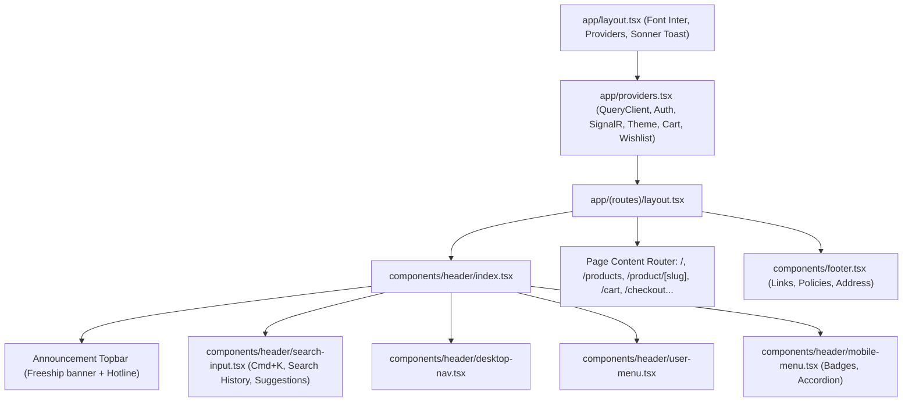

# BÁO CÁO KHẢO SÁT TOÀN DIỆN CODEBASE & KIỂM KÊ GIAO DIỆN (BƯỚC 2A)
**Dự án:** ShopViet E-Commerce Platform (`apps/frontend/ecommerce-client`)  
**Tác giả:** Principal Frontend Architect & Senior E-commerce UI/UX Auditor  
**Thời gian lập:** 19/10/2026  
**Mục tiêu:** Kiểm kê 100% hiện trạng giao diện, thành phần động, luồng dữ liệu, lỗi hiển thị bề nổi và các ràng buộc kiến trúc bất khả xâm phạm trước khi bước sang giai đoạn thiết kế lại (Step 2B).

---

## 1. TỔNG QUAN KIẾN TRÚC & QUY ƯỚC CÔNG NGHỆ HIỆN TẠI

### 1.1 Tech Stack & Thư viện Cốt lõi
*Dẫn chứng:* `apps/frontend/ecommerce-client/package.json`

| Thư viện / Công nghệ | Phiên bản | Vai trò & Đặc điểm kỹ thuật |
|---|---|---|
| **Next.js** | `^15.5.14` | App Router, Server & Client Components, Standalone build output (`next.config.ts:72`), Image Optimization |
| **React** | `^19.0.0` | React 19 Canary/Stable, Server Actions & Modern Hook Primitives |
| **Tailwind CSS** | `^4.0.0` (`@tailwindcss/postcss: ^4`) | Tailwind v4 dùng cú pháp `@theme`, CSS Variables HSL & Hex tokens, `@utility container-app` (`globals.css:274-282`) |
| **TanStack Query** | `^5.69.0` (`@tanstack/react-query`) | Quản lý server state, caching 1 phút (`staleTime: 60s`), garbage collection 5 phút (`gcTime: 300s`) |
| **TanStack Virtual** | `^3.13.23` (`@tanstack/react-virtual`) | Ảo hóa danh sách sản phẩm dài (`VirtualProductList` trong `product-listing.tsx:27-66`) |
| **SignalR Client** | `^8.0.7` (`@microsoft/signalr`) | WebSocket 2 chiều cho realtime Reviews (`/api/reviewHub`) và Notifications (`/api/notification-hub`) |
| **Form & Schema** | `react-hook-form: ^7.54.2` + `zod: ^3.24.2` + `@hookform/resolvers: ^4.1.3` | Validation kép client-side Zod Schema kết hợp API Backend FluentValidation |
| **Theme Management** | `next-themes: ^0.4.6` | Hỗ trợ Dual-theme (`light` & `dark`), inline script FOUC-prevention trong `<head>` (`app/layout.tsx:68-72`) |
| **UI Primitives** | Radix UI (`accordion`, `alert-dialog`, `avatar`, `checkbox`, `dialog`, `dropdown-menu`, `popover`, `radio-group`, `select`, `slider`, `tabs`) | Headless Accessible UI Components |
| **Notification Toast** | `sonner: ^2.0.1` | Rich Toast notification manager (`components/toast/toast-provider.tsx`) |
| **Icons & Animation** | `lucide-react: ^0.483.0`, `framer-motion: ^12.23.12`, `tailwindcss-animate: ^1.0.7` | Bộ icon SVG đồng nhất và micro-interactions |

---

### 1.2 Hệ thống Design Tokens & Màu sắc (CSS Variables)
*Dẫn chứng:* `apps/frontend/ecommerce-client/app/globals.css` (Dòng 8–267)

Hệ thống token hiện tại kết hợp giữa chuẩn Shadcn UI HSL và các token Stitch/Obsidian Atelier:
- **Brand Identity Accent:** Đỏ Ruby / Crimson (`--brand: 347 77% 50%`, `--brand-hover: 350 77% 46%`, Hex container `#e11d48`).
- **Light Mode (`:root`):**
  - `--background`: `0 0% 98%` (Xám trắng dịu mắt)
  - `--foreground`: `240 4% 11%` (Đen mực)
  - `--card`: `0 0% 100%` (Trắng tinh khiết)
  - `--surface`: `0 0% 98%` | `--surface-2`: `0 0% 95%`
  - `--ink`: `240 4% 11%` | `--ink-soft`: `240 4% 38%` | `--ink-faint`: `240 4% 60%`
  - `--line`: `0 0% 89%`
- **Dark Mode (`.dark`):**
  - `--background`: `222 36% 5%` (Deep Obsidian Black)
  - `--foreground`: `210 40% 98%` (Bạc sáng)
  - `--card`: `221 34% 11%` (Dark Navy Blue)
  - `--surface`: `222 36% 5%` | `--surface-2`: `221 34% 11%`
  - `--surface-container-low`: `#131926` | `--surface-container`: `#181c24`
  - `--ink`: `210 40% 98%` | `--ink-soft`: `215 20% 65%` | `--ink-faint`: `215 16% 47%`
  - `--line`: `220 20% 14%`
- **Typography Scale:**
  - Font chữ: `Inter` hỗ trợ subset `latin`, `vietnamese` (`app/layout.tsx:13-17`).
  - Kích thước: Display (`3.5rem`), H1 (`2.5rem`), H2 (`1.875rem`), H3 (`1.25rem`), Body (`1rem`), Small (`0.875rem`), Tiny (`0.75rem`), Label Sm (`0.6875rem`).
- **Breakpoints chuẩn:**
  - `sm: 640px`, `md: 768px`, `lg: 1024px`, `xl: 1280px`. Container tối đa: `max-width: 80rem` (1280px) qua `@utility container-app`.
  - Hai viewport audit chính: Desktop **1440px** và Mobile **390px** (iPhone 14/15/16).

---

## 2. BẢNG DANH MỤC 100% MÀN HÌNH ĐỘC LẬP & BIẾN THỂ TRANG (PAGE INVENTORY)

| STT | Tên màn hình / Chức năng | Route Path trong App Router | Loại trang & Quyền truy cập | Biến thể hiển thị (Variants) | Trạng thái tương tác & Dữ liệu (States) | File nguồn thực tế |
|---|---|---|---|---|---|---|
| **01** | **Trang chủ (Home Page)** | `/` | Public (SSR + Hydration) | Desktop (1440px), Mobile (390px) | - Loading: Skeleton banners & grids<br>- Data: Carousel, Bento grid, Bestseller carousel<br>- Empty: N/A<br>- Error: ErrorBoundary catch | `app/page.tsx` |
| **02** | **Danh mục / Tất cả sản phẩm (Product Catalog)** | `/products` | Public (Client + Query Params) | Grid 3-col / List-view; Desktop Sidebar vs Mobile Drawer | - Loading: `ProductCardSkeleton` x9, `ProductListItemSkeleton` x8<br>- Empty: `PackageOpen` icon + Nút xóa bộ lọc<br>- Error: Box cảnh báo màu destructive + Nút "Thử lại"<br>- Virtualized: Active khi view=list và items > 20 | `app/(routes)/products/page.tsx`<br>`components/product-listing.tsx` |
| **03** | **Lọc sản phẩm theo Danh mục** | `/products/[category]` | Public (Dynamic Slug) | Kế thừa Catalog; breadcrumbs danh mục động | - Loading / Empty / Error như catalog<br>- Invalid Category: Hiển thị box "Danh mục không tồn tại" | `app/(routes)/products/[category]/page.tsx` |
| **04** | **Lọc sản phẩm theo Thương hiệu** | `/products/[category]/[brand]` | Public (Nested Dynamic Slugs) | Kế thừa Catalog; tiêu đề & breadcrumbs hiển thị kết hợp Category + Brand | - Loading / Empty / Error như catalog<br>- Invalid Brand: Hiển thị box "Thương hiệu không tồn tại" | `app/(routes)/products/[category]/[brand]/page.tsx` |
| **05** | **Bắt đầu từ Category Slug (Catch-all)** | `/[categorySlug]` | Public (Dynamic Top Slug) | Chuyển hướng hoặc render Catalog trực tiếp theo category | - Validation slug khớp danh mục | `app/(routes)/[categorySlug]/page.tsx` |
| **06** | **Chi tiết sản phẩm chính (Product Detail - Canonical)** | `/product/[slug]` | Public (Dynamic Slug) | Desktop (Gallery 2 cột bên trái + Info cố định bên phải); Mobile (Gallery trượt ảnh trên + CTA Bottom Sheet) | - Loading: Skeleton Gallery + Info<br>- Variant Picker: Color pills, Size pills<br>- Quantity: Min 1, Max stockQuantity<br>- Tabs: Specs table, Prose description, Real-time Reviews<br>- Out of Stock: Badge "Hết hàng" + Grayscale CTA | `app/(routes)/product/[slug]/page.tsx` |
| **07** | **Chi tiết sản phẩm phụ (Legacy/Nested URL)** | `/products/[category]/[brand]/[slug]` | Public (Deep Nested Slug) | Biến thể đường dẫn SEO sâu (Thiếu schema SEO & dynamic tab so với canonical `/product/[slug]`) | - Tương tự như trên nhưng ít options hơn | `app/(routes)/products/[category]/[brand]/[slug]/page.tsx` |
| **08** | **Giỏ hàng (Shopping Cart)** | `/cart` | Public / Guest / Member | Trạng thái có hàng vs Trạng thái giỏ rỗng | - Loading: `LoadingSkeleton` bảng hàng<br>- Empty: `EmptyCart` với 3 USP card và CTA mua sắm<br>- Active: Danh sách CartItem, cập nhật số lượng, xóa item, mã giảm giá PromoCode, OrderSummary cố định | `app/(routes)/cart/page.tsx`<br>`components/cart/CartContent.tsx` |
| **09** | **Thanh toán (Checkout)** | `/checkout` | Hybrid (Guest & Authenticated Member) | Chuyển đổi RadioGroup: "Khách vãng lai" vs "Đăng nhập thành viên" | - Validation: Zod schema error labels đỏ dưới từng field<br>- Payment Method: COD (Thanh toán khi nhận) vs VNPay Gateway Sandbox<br>- Shipping bar: Progress đạt mốc freeship | `app/(routes)/checkout/page.tsx` |
| **10** | **Kết quả thanh toán VNPay** | `/payment/vnpay-return` | Public (Query Params callback) | Giao dịch thành công (`vnp_ResponseCode=00`) vs Thất bại/Hủy | - Success: Mã đơn hàng, biên lai thanh toán, nút xem đơn<br>- Failed: Mã lỗi, lý do từ chối, nút thanh toán lại | `app/(routes)/payment/vnpay-return/page.tsx` |
| **11** | **So sánh sản phẩm (Product Compare)** | `/compare` | Public (Local State `comparedProducts`) | Bảng ma trận đối chiếu 2 đến 4 thiết bị theo từng thông số | - Loading: Skeleton table<br>- Empty (< 2 items): Card cảnh báo "Chưa đủ sản phẩm" + CTA về trang sản phẩm<br>- Matrix: So sánh Giá, Đánh giá, và 100% specs động | `app/(routes)/compare/page.tsx` |
| **12** | **Danh sách yêu thích (Wishlist)** | `/wishlist` | Public / Guest / Member | Lưới sản phẩm yêu thích (Card dạng Editorial Minimal) | - Loading: `WishlistLoading`<br>- Empty: `EmptyWishlist`<br>- Active: WishlistItem với nút xóa AlertDialog xác nhận và nút Add to Cart | `app/(routes)/wishlist/page.tsx`<br>`components/wishlist/wishlist-client.tsx` |
| **13** | **Tài khoản cá nhân - Hồ sơ** | `/account` | Protected (Yêu cầu đăng nhập - `AuthGuard`) | Tab Hồ sơ: Form thông tin cá nhân + Đổi mật khẩu | - Form update profile (Tên, SĐT, Email)<br>- Form đổi mật khẩu với Zod validation | `app/(routes)/account/page.tsx`<br>`components/account/profile-tab.tsx` |
| **14** | **Sổ địa chỉ giao hàng** | `/account/addresses` & `/new` | Protected (`AuthGuard`) | Danh sách địa chỉ đã lưu + Form tạo/sửa địa chỉ mới | - Default address badge<br>- Cascading select Tỉnh/Thành, Quận/Huyện, Phường/Xã | `app/(routes)/account/addresses/page.tsx`<br>`components/account/address-form.tsx` |
| **15** | **Lịch sử đơn hàng** | `/account/orders` | Protected (`AuthGuard`) | Danh sách đơn hàng theo trạng thái (Pending, Processing, Completed, Cancelled) | - Filter tabs theo status badge<br>- OrderItem card tóm tắt giá trị và ngày đặt | `app/(routes)/account/orders/page.tsx`<br>`components/account/orders-tab.tsx` |
| **16** | **Chi tiết đơn hàng** | `/account/orders/[orderId]` | Protected (`AuthGuard`) | Chi tiết tiến trình đơn hàng (Timeline tracking + danh sách hàng) | - Loading: `OrderDetailsSkeleton`<br>- Nút Hủy đơn (nếu Pending), Yêu cầu trả hàng (nếu Completed) | `app/(routes)/account/orders/[orderId]/page.tsx` |
| **17** | **Quản lý đổi trả hàng** | `/account/returns` & `[returnId]` | Protected (`AuthGuard`) | Danh sách và tiến trình xét duyệt khiếu nại trả hàng | - Status timeline đổi trả, hình ảnh chứng minh | `app/(routes)/account/returns/page.tsx` |
| **18** | **Giới thiệu (About Us)** | `/about` | Public | Thông tin công ty, giá trị cốt lõi, đội ngũ | - Static editorial layout + dynamic about stats | `app/(routes)/about/page.tsx` |
| **19** | **Liên hệ & Hỗ trợ (Contact)** | `/contact` | Public | Bản đồ, thông tin hotline, Form gửi tin nhắn hỗ trợ | - Form validate Zod, gửi tin qua `contactService` | `app/(routes)/contact/page.tsx` |
| **20** | **Đăng nhập (Login)** | `/login` (thuộc group `(auth)`) | Public / Guest (Redirect nếu đã auth) | Form nhập Email/Mật khẩu + Đăng nhập Google 1-Click | - Validation errors<br>- Rate limit lockout handling<br>- Tham số `returnUrl` giữ ngữ cảnh trước khi vào auth | `app/(auth)/login/page.tsx` |
| **21** | **Đăng ký tài khoản (Register)** | `/register` (thuộc group `(auth)`) | Public / Guest | Form họ tên, email, mật khẩu, xác nhận điều khoản | - Zod password complexity rules | `app/(auth)/register/page.tsx` |
| **22** | **Quên mật khẩu** | `/forgot-password` | Public | Form gửi email lấy lại mật khẩu | - Feedback "Kiểm tra hòm thư của bạn" | `app/(auth)/forgot-password/page.tsx` |
| **23** | **Đặt lại mật khẩu** | `/reset-password` & `[token]` | Public (Token required) | Form tạo mật khẩu mới với xác thực token | - Token validation failure alert | `app/(auth)/reset-password/page.tsx` |
| **24** | **Google OAuth Callback** | `/auth/google-callback` | Public (OAuth redirect target) | Màn hình trung gian tiếp nhận Cookie & đồng bộ Tab | - Spinner chuyển hướng về trang trước đó | `app/auth/google-callback/page.tsx` |

---

## 3. CÂY PHÂN CẤP COMPONENT & LUỒNG DỮ LIỆU SẢN PHẨM (COMPONENT HIERARCHY & DTO AUDIT)

### 3.1 Cây phân cấp Component cốt lõi (Layout Shell)



---

### 3.2 Khảo sát DTO Sản phẩm Backend vs Client (Dữ liệu tiềm năng cho Product Card)
*Dẫn chứng:*  
- Frontend Type: `apps/frontend/ecommerce-client/types/product.ts:1-23`
- Backend DTO: `apps/backend/Ecommerce/Ecommerce.Application/Features/Products/Dto/ProductDto.cs:7-38`
- Backend Spec DTO: `apps/backend/Ecommerce/Ecommerce.Application/Features/Products/Dto/ProductSpecificationDto.cs:7-16`

| Trường dữ liệu trong Backend DTO (`ProductDto`) | Kiểu dữ liệu | Đã có trong Frontend Type `Product`? | Đang hiển thị trên Product Card? | Tiềm năng đưa vào Redesign Product Card (Step 2B) |
|---|---|:---:|:---:|---|
| `Id`, `Slug` | `Guid` / `string` | Có | Có | Định danh và link điều hướng chuẩn `/product/[slug]` |
| `Name` | `string` | Có | Có | Tên sản phẩm (line-clamp-2) |
| `Price` | `decimal` | Có | Có | Giá niêm yết gốc |
| `SalePrice` | `decimal?` | Có | Có | Giá khuyến mãi + Tính toán badge `-%` giảm giá |
| `MainImage` | `string` | Có | Có | Ảnh chính chuẩn 1:1 / 3:4 với `formatImageUrl()` |
| `AdditionalImages` | `List<string>` | Có | Không | Có thể làm tính năng hover đổi ảnh thứ 2 (Secondary image peek) |
| `Rating` | `double` | Có | Có | Điểm đánh giá thực tế (sao vàng + số) |
| `ReviewCount` | `int` | Có | Có | Số lượng bài đánh giá |
| `CategoryName`, `CategorySlug`| `string` | Có | Có | Nhãn danh mục (Micro-label 11px uppercase) |
| `BrandName`, `BrandSlug` | `string` | Có | Không | **Nên hiển thị logo/tên thương hiệu** (Apple, Sony, Samsung...) |
| **`SoldQuantity`** | **`int`** | **Chưa có trong `Product` TS interface** | **KHÔNG** | **RẤT QUAN TRỌNG:** Social Proof đặc trưng thị trường VN ("Đã bán 1.2k") |
| **`StockQuantity`** | **`int`** | **Có (`stockQuantity?: number`)** | **Chỉ dùng check `isSoldOut`** | **Nên hiển thị:** Cảnh báo tồn kho ("Chỉ còn 3 sản phẩm", "Hết hàng") |
| **`Specifications`** | **`List<SpecificationDto>`** | **Có (`{ name, value }[]`)** | **KHÔNG** | **RẤT QUAN TRỌNG:** Hiển thị 2-3 chip thông số "Hero Spec" (VD: `M3 Max · 36GB · 1TB`, `Snapdragon 8 Gen 3`, `OLED 120Hz`) |
| **`Colors`** | **`List<string>`** | **Có trong `variants.colors`** | **KHÔNG** | Hiển thị bảng chấm màu sắc tùy chọn (Color swatches) |

---

## 4. BẰNG CHỨNG KIỂM TRA THỰC TẾ & CÁC LỖI GIAO DIỆN BỀ NỔI (LIVE INSPECTION AUDIT)

Qua kiểm tra trực tiếp mã nguồn, đối chiếu dev server `http://localhost:3000` trên cả **Desktop (1440px)** và **Mobile (390px)** ở 2 chế độ **Light Mode** & **Dark Mode**, đã phát hiện chính xác các lỗi nghiêm trọng sau:

### 4.1 Lỗi Nền tối Chữ tối ở Bảng Giỏ Hàng khi bật Light Mode
- **Vị trí file & dòng code:**
  - `apps/frontend/ecommerce-client/components/cart/CartContent.tsx:44`:
    ```tsx
    <div className="bg-[#131926] rounded-2xl border border-white/8 overflow-hidden shadow-md">
    ```
  - `apps/frontend/ecommerce-client/components/cart/OrderSummary.tsx:52`:
    ```tsx
    <aside className="bg-[#131926] rounded-3xl border border-white/8 overflow-hidden sticky top-28 shadow-lg">
    ```
- **Nguyên nhân cốt lõi:**
  Class `bg-[#131926]` được hardcode màu xanh đen Obsidian trực tiếp trên container của bảng giỏ hàng và thanh tóm tắt đơn hàng. Trong khi đó, các phần tử chữ bên trong lại sử dụng class semantic token `text-ink` (`globals.css:161`). Khi ở **Light Mode**, `--ink: 240 4% 11%` biến chữ thành **màu đen**, dẫn đến tình trạng chữ đen hiển thị trên nền xanh đen đậm `#131926`, người dùng hoàn toàn không đọc được giỏ hàng.
- **Hệ quả UX:** Tỷ lệ bỏ giỏ hàng (Cart Abandonment) cực kỳ cao do không đọc được giá và tên sản phẩm trong Light Mode.

---

### 4.2 Lỗi Nút "Thêm vào giỏ" Trắng trên Nền trắng ở Trang `/wishlist` khi bật Dark Mode
- **Vị trí file & dòng code:**
  - `apps/frontend/ecommerce-client/components/wishlist/wishlist-item.tsx:122`:
    ```tsx
    <AddToCartButton
        productId={product.productId}
        productName={product.productName}
        price={product.price}
        className="w-full mt-2 h-11 rounded-full bg-ink text-background hover:bg-brand dark:text-foreground dark:hover:text-white hover:text-white border-0 transition-colors"
    />
    ```
- **Nguyên nhân cốt lõi:**
  Trong `globals.css:231`, ở Dark Mode token `--ink` là `210 40% 98%` (màu trắng sáng). Nút này lại khai báo `bg-ink` (nền nút = màu trắng) kèm theo `dark:text-foreground` (`globals.css:190`, `--foreground: 210 40% 98%` = màu chữ cũng là trắng sáng!).
- **Hệ quả UX:** Ở chế độ Dark Mode, toàn bộ các nút "Thêm vào giỏ" trên trang Wishlist trở thành một khối chữ nhật trắng trơn không nhìn thấy chữ, chỉ khi di chuột vào đổi màu mới nhận biết được.

---

### 4.3 Lỗi Mất ảnh & Thiếu Fallback hợp lệ ở Hàng loạt Thẻ sản phẩm
- **Vị trí file & dòng code:**
  - `components/product-card.tsx:99`: `onError={() => setImgSrc("/placeholder.svg")}`
  - `components/product-list-item.tsx:71`: `onError={() => setImgSrc("/placeholder.svg")}`
  - `components/wishlist/wishlist-item.tsx:95`: `onError={() => setImgSrc("/placeholder.svg")}`
  - `app/(routes)/compare/page.tsx:173`: Link trực tiếp `formatImageUrl(product.mainImage)`
  - `lib/image.ts:8`: `return "/placeholder.svg"`
- **Nguyên nhân cốt lõi:**
  Kiểm tra thư mục `apps/frontend/ecommerce-client/public/` bằng lệnh `Test-Path "apps/frontend/ecommerce-client/public/placeholder.svg"` trả về **`False`** (File `placeholder.svg` **hoàn toàn không tồn tại** trong mã nguồn). Khi ảnh sản phẩm bị lỗi URL hoặc backend chưa kịp sync ảnh, hàm `onError` chuyển sang tải `/placeholder.svg`, Next.js trả về HTTP **404 Not Found**, dẫn đến trình duyệt hiện icon vỡ ảnh và layout nhảy loạn xạ.

---

### 4.4 Mâu thuẫn Thông báo Chính sách Miễn phí Vận chuyển (Freeship Policy)
- **Vị trí đối chiếu mã nguồn:**
  1. `components/header/index.tsx:107`:  
     `"Miễn phí vận chuyển toàn quốc cho đơn từ 2.000.000₫"`
  2. `components/features-section.tsx:9`:  
     `"Giao Siêu Tốc 2H - Miễn phí đơn từ 2.000.000₫"`
  3. `components/cart/CartHeader.tsx:44`:  
     `"Miễn phí vận chuyển cho đơn hàng từ 500.000₫"`
  4. `components/cart/OrderSummary.tsx:49`:  
     `const isFreeShipping = shippingCost === 0 || subtotal >= 500000`
  5. `components/checkout/order-totals.tsx:18`:  
     `const FREE_SHIPPING_THRESHOLD = 500000 // ₫500,000 for free shipping`
- **Thực trạng UX:**
  Khách hàng nhìn thấy trên Topbar và Trang chủ cam kết đơn từ **2.000.000₫** mới được freeship, nhưng khi vào Giỏ hàng và Thanh toán thì thanh tiến độ lại áp dụng mốc **500.000₫**. Sự không nhất quán này gây hiểu lầm và giảm độ tin cậy của thương hiệu. Cần được thống nhất một mốc chuẩn duy nhất cấu hình qua hằng số dùng chung.

---

### 4.5 Dư thừa & Xung đột Tuyến đường Chi tiết Sản phẩm
- **Vị trí file:**
  - Route A: `app/(routes)/product/[slug]/page.tsx` (Canonical Route)
  - Route B: `app/(routes)/products/[category]/[brand]/[slug]/page.tsx` (Legacy/Nested Route)
- **Thực trạng:**
  Toàn bộ các thẻ sản phẩm trong hệ thống (`ProductCard`, `ProductListItem`, `CartItem`, `WishlistItem`, `SearchInput`) đều đang điều hướng cứng về `/product/${slug}`. Tuyến đường Route B thiếu cơ chế SEO JSON-LD (`generateProductSchema`), thiếu dynamic import `ProductTabs`, và thiếu tracking analytics. Cần thống nhất hoặc chuẩn hóa canonical redirect về Route A.

---

## 5. DANH MỤC CÁC RÀNG BUỘC KIẾN TRÚC BẤT KHẢ XÂM PHẠM (MUST-PRESERVE)

Khi tái cấu trúc giao diện ở các bước tiếp theo, **BẮT BUỘC PHẢI BẢO TOÀN 100% CÁC LOGIC VÀ TÍCH HỢP SAU**:

1. **Cơ chế Xác thực Dual-Token & Interceptor:**
   - Bảo toàn logic trong `lib/api.ts`: Gửi request thông qua Next.js rewrite proxy (`baseURL: '/api'`), bật `withCredentials: true`.
   - Token refresh queue chống race conditions (`refreshTokenSilently()`), rate-limit tối đa 3 lần/phút (`canAttemptRefresh()`).
   - Tự động gắn header `X-CSRF-Token` từ cookie `csrf_token` cho mọi request `POST`, `PUT`, `DELETE`, `PATCH`.
   - Danh sách "Soft Endpoints" (`["wishlist", "me/profile", "products", "cart", "categories", "banner"]`) không bao giờ tự động chuyển hướng khách vãng lai (Guest) sang `/login` khi nhận mã 401.
   - Đồng bộ trạng thái đa tab thông qua `sessionSync.broadcast('SESSION_REFRESH')` và `LOGOUT` (`lib/session-sync.ts`).

2. **Định danh Khách vãng lai (Guest ID):**
   - Giữ nguyên `lib/guest-id.ts` (`getOrCreateGuestId()`, UUID v4 lưu `localStorage.getItem("guest_id")`) và hook `hooks/use-guest-id.ts`.
   - Interceptor trong `lib/api.ts:125-129` luôn tự động đính kèm `X-Guest-ID` vào request header phục vụ giỏ hàng khách vãng lai và gộp giỏ hàng khi đăng nhập.

3. **Hạ tầng Real-time SignalR Hubs:**
   - Giữ nguyên `hubs/signalr-context.tsx`:
     - Kết nối `/api/reviewHub`: `joinProductGroup`, `leaveProductGroup`, `sendTypingIndicator`, `onNewReview`, `offNewReview`, `onRatingUpdated`, `offRatingUpdated`, `onReviewLikeUpdated`, `offReviewLikeUpdated`, `onUserTyping`, `offUserTyping`.
     - Kết nối `/api/notification-hub`: `onReceiveNotification`.

4. **Ảo hóa & Động cơ Tìm kiếm Kép:**
   - Bảo tồn thư viện `@tanstack/react-virtual` trong `components/product-listing.tsx` cho chế độ danh sách lớn.
   - Bảo tồn cơ chế routing tìm kiếm thông minh: Khi có `trimmedSearchTerm.length > 0` tự động kích hoạt `useSearchProducts` (Elasticsearch Full-text Search), ngược lại dùng `useProducts` (EF Core SQL Catalog).

5. **Động cơ So sánh Thiết bị (Comparison Engine):**
   - Bảo tồn event toàn cục `window.dispatchEvent(new CustomEvent("comparisonUpdated"))`.
   - Lưu trữ danh sách qua `localStorage.getItem("comparedProducts")`, duy trì giới hạn tối đa 4 sản phẩm và tối thiểu 2 sản phẩm để kích hoạt ma trận đối chiếu.

6. **Form Validation & Thanh toán:**
   - Bảo tồn `react-hook-form` tích hợp `zodResolver` trên các form Checkout, Auth, Profile, Address.
   - Giữ nguyên luồng tạo URL thanh toán VNPay Sandbox (`paymentService.createVnPayUrl`) và trang xử lý kết quả `payment/vnpay-return`.
   - Bảo toàn luồng chuyển đổi **Đặt hàng nhanh (Khách vãng lai)** vs **Đăng nhập thành viên** tại `CheckoutPage`.

7. **Chuẩn hóa SEO & Analytics:**
   - Bảo tồn bộ công cụ `lib/seo-utils.ts`: `generateProductSchema`, `generateBreadcrumbSchema`, `generateOrganizationSchema`.
   - Bảo tồn hệ thống tracking sự kiện `lib/analytics.ts` (`trackPageView`, `trackProductView`, `trackAddToCart`, `trackBeginCheckout`, `trackPurchase`, `trackWishlistAdd`...).

---

## 6. DANH SÁCH & THAM SỐ CÔNG CỤ GOOGLE STITCH MCP ĐÃ XÁC MINH

Đã kiểm tra trực tiếp 15 file schema JSON tại `C:\Users\Admin\.gemini\antigravity\mcp\StitchMCP\`. Dưới đây là danh sách tên hàm và tham số đầu vào chính xác để chuẩn bị cho Bước 2B (Planning & Screen Generation):

| STT | Tên Tool Stitch MCP | Mô tả chức năng | Danh sách Tham số đầu vào & Trạng thái Bắt buộc |
|:---:|---|---|---|
| **1** | `create_project` | Tạo một Stitch Project mới làm container chứa UI designs | - `title` *(string, Optional)*: Tên dự án |
| **2** | `get_project` | Lấy chi tiết thông tin và các screen instances của dự án | - `name` *(string, **Required**)*: Định dạng `projects/{projectId}` |
| **3** | `list_projects` | Liệt kê các dự án Stitch người dùng có quyền truy cập | - `filter` *(string, Optional)*: Bộ lọc theo AIP-160 (VD: `view=owned`, `view=shared`) |
| **4** | `delete_project` | Xóa một Stitch Project theo tên tài nguyên | - `name` *(string, **Required**)*: Định dạng `projects/{projectId}` |
| **5** | `generate_screen_from_text` | Sinh màn hình UI mới từ mô tả văn bản (Prompt) | - `projectId` *(string, **Required**)*: Project ID (bỏ tiền tố `projects/`)<br>- `prompt` *(string, **Required**)*: Mô tả chi tiết giao diện cần sinh<br>- `deviceType` *(string, Optional)*: `mobile` hoặc `desktop`<br>- `designSystem` *(string, Optional)*: ID Design System tái sử dụng (VD: `assets/159...`)<br>- `modelId` *(string, Optional)*: Model ID chỉ định |
| **6** | `get_screen` | Lấy chi tiết của một màn hình đã sinh | - `name` *(string, **Required**)*: Định dạng `projects/{project}/screens/{screen}` |
| **7** | `list_screens` | Liệt kê tất cả các màn hình trong một dự án | - `projectId` *(string, **Required**)*: Project ID |
| **8** | `edit_screens` | Chỉnh sửa các màn hình hiện có bằng prompt bổ sung | - `projectId` *(string, **Required**)*: Project ID<br>- `selectedScreenIds` *(array of string, **Required**)*: Danh sách Screen IDs cần sửa<br>- `prompt` *(string, **Required**)*: Yêu cầu chỉnh sửa UI<br>- `deviceType` *(string, Optional)*<br>- `modelId` *(string, Optional)* |
| **9** | `generate_variants` | Sinh các biến thể UI khác nhau từ màn hình đã có | - `projectId` *(string, **Required**)*<br>- `selectedScreenIds` *(array of string, **Required**)*<br>- `prompt` *(string, **Required**)*<br>- `variantOptions` *(object, **Required**)*: Số lượng biến thể, phạm vi sáng tạo<br>- `deviceType` *(string, Optional)*<br>- `modelId` *(string, Optional)* |
| **10** | `upload_design_md` | Tải file `DESIGN.md` dạng Base64 lên Stitch Project | - `projectId` *(string, **Required**)*: Project ID<br>- `designMdBase64` *(string, **Required**)*: Nội dung `DESIGN.md` mã hóa Base64 UTF-8 |
| **11** | `create_design_system_from_design_md` | Tạo Design System trong UI từ file DESIGN.md vừa upload | - `projectId` *(string, **Required**)*: Project ID<br>- `selectedScreenInstance` *(object, **Required**)*: Instance tạo từ upload<br>- `deviceType` *(string, Optional)* |
| **12** | `create_design_system` | Khởi tạo Design System mới cho dự án | - `designSystem` *(object, **Required**)*: Cấu trúc token design system<br>- `projectId` *(string, Optional)*: Project ID liên kết |
| **13** | `update_design_system` | Cập nhật bộ Design System của dự án | - `name` *(string, **Required**)*: Định dạng `assets/{asset_id}`<br>- `projectId` *(string, **Required**)*: Project ID<br>- `designSystem` *(object, **Required**)*: Dữ liệu tokens mới |
| **14** | `list_design_systems` | Liệt kê các Design Systems của một dự án | - `projectId` *(string, Optional)*: Project ID |
| **15** | `apply_design_system` | Áp dụng Design System đã chọn lên danh sách màn hình | - `projectId` *(string, **Required**)*: Project ID<br>- `assetId` *(string, **Required**)*: ID tài nguyên Design System<br>- `selectedScreenInstances` *(array, **Required**)*: Danh sách instance cần đổi theme |

---

## 7. KẾT LUẬN & ĐỀ XUẤT CHO BƯỚC 2B (TRANSITION TO STEP 2B)
1. Toàn bộ mã nguồn `apps/` đã được bảo toàn tuyệt đối, không có bất kỳ file code nào bị chỉnh sửa hay thay đổi cấu trúc trong bước này.
2. Bản kiểm kê đã làm rõ toàn bộ danh mục 24 màn hình/biến thể, phân tích chi tiết dữ liệu DTO backend để đưa Hero Specs & Sold Quantity lên Product Card mới.
3. 5 vấn đề cốt lõi bề nổi (Lỗi nền giỏ hàng Light Mode, Nút Wishlist Dark Mode, Thiếu placeholder ảnh, Mâu thuẫn chính sách Freeship, Tuyến đường lặp) đã được định vị chính xác vị trí file và dòng code.
4. Hệ thống 15 tools Stitch MCP đã sẵn sàng kết nối và thực thi tạo Design System và Screens ở các bước kế tiếp.
